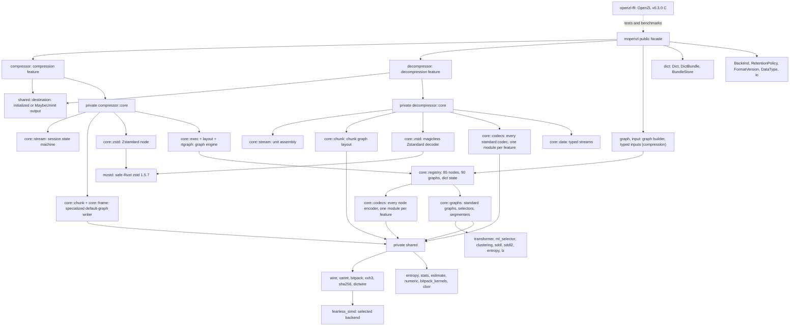

# Architecture

Specifications describe current ownership, APIs, data flow, state transitions,
SIMD dispatch, errors and known gaps. Start with the [user guide](../docs/README.md)
for usage or [development](../docs/development.md) for checks and repository layout.

## Module map

Public modules own ergonomic configuration and high-level errors. Private `core`
modules own algorithms and state machines; implementation errors, SIMD types and
`mzstd` types do not appear in public signatures. Each codec compiles
independently.

## Specifications

| Specification | Scope |
| --- | --- |
| [Frame format](frame-format.md) | Magic, frame header (bundle ID, typed and multiple inputs, comment), chunk header lanes including the dictionary lane, stream numbering, stored streams, checksums and limits as both codecs read and write them. |
| [Compressor](compressor.md) | Public API, the specialized default-graph path (store / Zstandard / store-on-expansion), chunking, sinks, the session state machine, graph selection, I/O and errors. |
| [Compression graphs](compressor-graphs.md) | The graph engine: typed streams, runtime graph, node and graph contexts, successor order, stores, conversions, permissive and trial compression, the registry tables, the session plan and how a new codec or graph plugs in. |
| [Encoder codecs](encoder-codecs.md) | Every node encoder: node ID to codec ID, feature, ports, wire summaries, deviations and gaps. |
| [Standard graphs](standard-graphs.md) | The decision logic of every standard graph: routing, stores, segmenters, partition_bitpack, compress_small_lengths, structure graphs. |
| [Transformer](transformer.md) | The numeric selector: features, generated scorers, guards, depth limits, static fallbacks, float determinism and the no_std caveat. |
| [ML selector and clustering](ml-and-clustering.md) | Gradient-boosted-tree selection and tag-based clustering with their CBOR configurations. |
| [SDDL and SDDL2](sddl.md) | The description interpreter, the bytecode VM, chunking and replay. |
| [Entropy coders](entropy.md) | OpenZL's FSE/Huffman fork, PivCo-Huffman, the five entropy nodes and the entropy graph's plan. |
| [LZ codecs and graphs](lz.md) | lz4 (fast, HC, optimal), lz, field_lz, mux_lengths, quantize, the shared lz_common infrastructure and the LZ graphs. |
| [Dictionaries](dictionaries.md) | Dict, DictBundle and BundleStore, wire formats, the encoder and decoder flows. |
| [Decompressor](decompressor.md) | Frame and unit parsing, chunk graph layout, the typed node executor and stream budget, typed multi-output decoding, dictionaries, the session's unit assembly with bounded peeking, limits, I/O and errors. |
| [Decoder codecs](decoder-codecs.md) | Every standard codec decoder: signatures, wire formats, invariants and deviations from the reference on malformed data. |
| [Uninitialized output](uninit-output.md) | `compress_to_uninit`, `decompress_to_uninit` and `process_uninit`: `BorrowedBuf` sinks, zero-free Vec decoding, the generic session `Destination` and their Miri/ASan coverage. |
| [Shared primitives](shared-primitives.md) | Varints, bit packing, wire constants, XXH3 with its SIMD accumulator, and the encoder-side shared modules (stats, entropy, estimate, numeric, bitpack kernels, CBOR, SHA-256, dictionary wire formats). |
| [Codec features](codec-features.md) | Direction and per-codec feature gates (`all-codecs` and one feature per codec), `std`/`no_std` and libm, what each build exposes and how disabled codecs behave. |
| [Compatibility](compatibility.md) | The C oracle and its shims per family, byte-identity and decode differential tests, and what each test file covers. |
| [Implementation comparison](benchmark-comparison.md) | Benchmark methodology and recorded results against the C library. |
| [Continuous integration](ci.md) | Workflows, Miri and AddressSanitizer coverage of the SIMD kernel, coverage gate and releases. |
| [Fuzzing](fuzzing.md) | AFL targets, oracles, regression replay and the libFuzzer adapters. |

## Known gaps (whole crate)

- Scope: every non-legacy OpenZL v0.3.0 node, graph, selector and segmenter is
  ported, on both sides. Deprecated nodes 76 to 85 and format versions below 21
  are not supported; custom codecs decode as `Unsupported`.
- Dictionaries: only Zstandard dictionaries materialize; no training
  ([dictionaries](dictionaries.md)).
- Performance: all codec kernels except XXH3 are scalar ports; SIMD variants of
  the reference (SSE/AVX2/BMI2/NEON/SVE2) and the partition+bitpack decoder
  fusion are not ported.
- `no_std` builds use the `libm` crate for floating point; the Transformer and
  estimator decisions are byte-identical with the reference only with `std`
  ([transformer](transformer.md)).
- No C ABI crate; no parallel compression.
- Verification gaps: no AFL targets for the graph engine, SDDL or CBOR
  configurations; Miri/ASan lists cover only the existing uninit and XXH3
  modules ([fuzzing](fuzzing.md), [CI](ci.md)).
