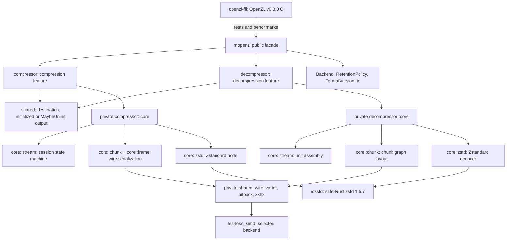

# Architecture

Specifications describe current ownership, APIs, data flow, state transitions,
SIMD dispatch, errors and known gaps. Start with the [user guide](../docs/README.md)
for usage or [development](../docs/development.md) for checks and repository layout.

## Module map

Public modules own ergonomic configuration and high-level errors. Private `core`
modules own algorithms and state machines; implementation errors, SIMD types and
`mzstd` types do not appear in public signatures. Each codec compiles
independently.

## Specifications

| Specification | Scope |
| --- | --- |
| [Frame format](frame-format.md) | Magic, frame header, chunk header lanes, stream numbering, stored streams, checksums and limits as both codecs read and write them. |
| [Compressor](compressor.md) | Public API, the default graph (store / Zstandard / store-on-expansion), chunking, sinks, the session state machine, I/O and errors. |
| [Decompressor](decompressor.md) | Frame and unit parsing, chunk graph layout and execution, the session's unit assembly with bounded peeking, limits, I/O and errors. |
| [Uninitialized output](uninit-output.md) | `compress_to_uninit`, `decompress_to_uninit` and `process_uninit`: `BorrowedBuf` sinks, zero-free Vec decoding, the generic session `Destination` and their Miri/ASan coverage. |
| [Shared primitives](shared-primitives.md) | Varints, bit packing, wire constants and the XXH3 checksum with its SIMD accumulator and dispatch. |
| [Codec features](codec-features.md) | Direction and per-codec feature gates (`zstd`), `std`/`no_std`, what each build exposes and how disabled codecs behave. |
| [Compatibility](compatibility.md) | The C oracle, byte-identity and decode differential tests, and what they cover. |
| [Implementation comparison](benchmark-comparison.md) | Benchmark methodology and recorded results against the C library. |
| [Continuous integration](ci.md) | Workflows, Miri and AddressSanitizer coverage of the SIMD kernel, coverage gate and releases. |
| [Fuzzing](fuzzing.md) | AFL targets, oracles, regression replay and the libFuzzer adapters. |

## Known gaps (whole crate)

- Codecs: only the default graph's codecs (store and Zstandard, ID 22) are
  ported. Every other standard codec (FSE, Huffman, field LZ, transpose,
  tokenize, ...) and custom codecs decode as `DecodeError::Unsupported`.
- Typed inputs (struct, numeric, string), multiple inputs, header comments on
  the encoder side, dictionary bundles and format versions below 21 are not
  supported.
- No compressor graphs, selectors or segmenters beyond the serial segmenter;
  no training; no C ABI crate; no parallel compression.
