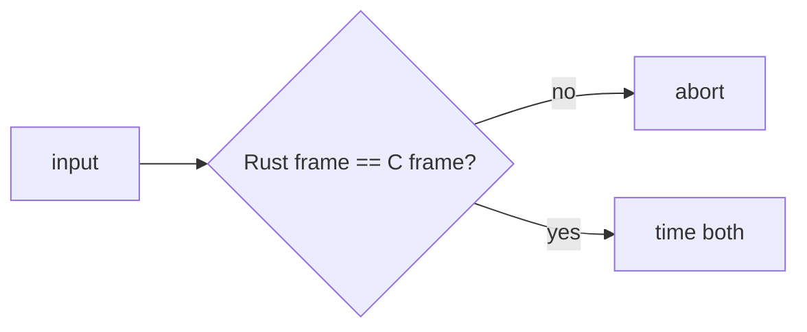
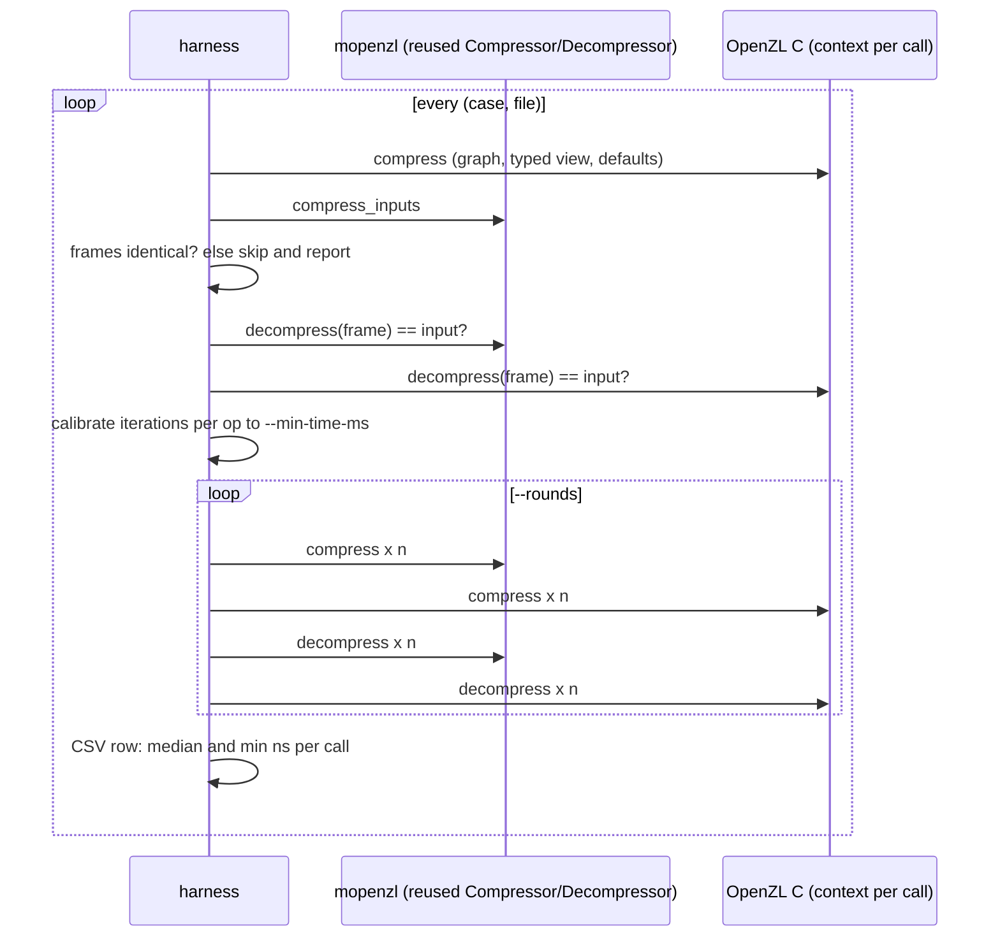

# Implementation comparison

`benches/compress.rs` and `benches/decompress.rs` (Criterion) time mopenzl
against OpenZL v0.3.0 through `openzl-ffi` on the corpora of
`benches/support`: a 64-byte prefix (per-call cost), 1 MiB of the vendored
OpenZL C sources (text), 1 MiB of structured 16-byte records and 256 KiB of
random bytes.

Every compression case asserts byte-identical frames before timing, so ratios
are equal by construction; decompression cases assert both decoders regenerate
the input. The C compression side creates its context per call (as
`ZL_compress`-style callers do) while the Rust side reuses its compressor, so
the 64-byte case mostly measures context setup.

## Recorded results

Initial port (the graph engine and node packages came after), recorded
2026-11-09 on an Apple M5 Pro, rustc 1.99.1, release profile, Criterion with 1 s
warm-up and 2 s measurement (`cargo bench --bench compress` / `decompress`
with those flags), throughput of input bytes:

| Case | Rust compress | C compress | Rust decompress | C decompress |
| --- | --- | --- | --- | --- |
| tiny-64B L1 | 44.6 MiB/s | 9.9 MiB/s | 1.01 GiB/s | 136 MiB/s |
| c-source-1MiB L1 | 788 MiB/s | 814 MiB/s | 2.27 GiB/s | 2.26 GiB/s |
| c-source-1MiB L6 | 192 MiB/s | 203 MiB/s | 2.45 GiB/s | 2.48 GiB/s |
| records-1MiB L1 | 717 MiB/s | 711 MiB/s | 1.38 GiB/s | 1.64 GiB/s |
| records-1MiB L6 | 279 MiB/s | 283 MiB/s | 2.11 GiB/s | 2.36 GiB/s |
| random-256KiB L1 | 8.19 GiB/s | 4.63 GiB/s | 15.8 GiB/s | 9.93 GiB/s |
| random-256KiB L6 | 5.49 GiB/s | 3.13 GiB/s | 15.7 GiB/s | 9.93 GiB/s |

Zstandard dominates compressible inputs, so those rows mirror `mzstd` against
zstd. Incompressible inputs are stored, and there the SIMD XXH3 checksum and
the absence of per-call setup decide.

The "Rust decompress" column decodes into a reused slice. A second run of the
same harness with the uninit and Vec cases:

| Case | slice | uninit | Vec (`decompress`) | C |
| --- | --- | --- | --- | --- |
| c-source-1MiB L1 | 2.10 GiB/s | 2.05 GiB/s | 2.09 GiB/s | 2.13 GiB/s |
| c-source-1MiB L6 | 2.39 GiB/s | 2.29 GiB/s | 2.29 GiB/s | 2.40 GiB/s |
| records-1MiB L1 | 1.39 GiB/s | 1.37 GiB/s | 1.76 GiB/s | 1.62 GiB/s |
| records-1MiB L6 | 2.16 GiB/s | 2.16 GiB/s | 2.48 GiB/s | 2.34 GiB/s |

The Vec path appends through `mzstd::decompress_into` and beats C on records,
so the slice/uninit gap lies in `mzstd::decompress_to_slice` on this data, not
in the OpenZL layer.

## Zstandard node package: before and after

Recorded 2026-11-09 on the same Apple M5 Pro with the same harness
(`cargo bench --bench compress` / `decompress`, Criterion, 1 s warm-up, 2 s
measurement, throughput of input bytes), before and after the Zstandard node
moved to native magicless frames: the encoder no longer writes a magic and
overwrites it, and the decoder no longer stages `magic + frame` into a buffer
before decoding (it reads the content size with `FrameHeaderInfo::parse` and
decodes in place). Frames are byte-identical before and after, so compressed
sizes did not move.

| Case | Before | After | C (after) |
| --- | --- | --- | --- |
| decompress c-source-1MiB L1, slice | 1.995 GiB/s | 2.269 GiB/s | 2.312 GiB/s |
| decompress c-source-1MiB L1, uninit | 2.171 GiB/s | 2.270 GiB/s | |
| decompress c-source-1MiB L6, slice | 2.413 GiB/s | 2.517 GiB/s | 2.561 GiB/s |
| decompress records-1MiB L1, slice | 1.416 GiB/s | 1.462 GiB/s | 1.681 GiB/s |
| decompress records-1MiB L1, Vec | 1.854 GiB/s | 1.850 GiB/s | 1.681 GiB/s |
| decompress tiny-64B L1, slice | 613 MiB/s | 664 MiB/s | 136 MiB/s |
| compress c-source-1MiB L6 | 175.6 MiB/s | 197.2 MiB/s | 208.3 MiB/s |
| compress records-1MiB L6 | 264.5 MiB/s | 278.9 MiB/s | 284.6 MiB/s |
| compress tiny-64B L1 | 42.4 MiB/s | 43.6 MiB/s | 10.1 MiB/s |

The slice and uninit decode paths of the compressible text corpus gained up to
about 9 to 14 percent (run to run noise on this machine is roughly 5 percent: the
untouched C rows moved by up to 15 percent between the two runs). Compression is
within that noise, because the removed work was a one-byte overwrite. The
records corpus through the slice destination remains about 15 percent behind C
(`mzstd::decompress_to_slice`), while the `Vec` destination is ahead of it.

No benchmarks of the other node encoders, the graphs or the selectors have been
recorded yet; their correctness is established by byte identity (see
[compatibility](compatibility.md)), their speed is unmeasured.

## Silesia harness: every codec family

`benchmarks/comparison` (its own workspace) runs one standard graph per case
over whole Silesia files, Rust and C in one process, with `openzl-ffi`'s C
built at `-O3` (`OPENZL_FFI_OPT_LEVEL=3`). The harness `run` loop is:

Cases: `zstd`, `lz4`, `lz`, `huffman`, `fse`, `entropy`, `huffman_pivco`,
`flatpack` and `generic` over every file; `field_lz_struct4`,
`numeric32` and `generic_num32` over sao/osdb/nci as 4-byte records or numbers;
`bitpack_num16`, `numeric16` and `generic_num16` over mr/x-ray as 16-bit
numbers. `profile` runs one side and operation untimed for callgrind, perf or
the `hotpath` features. `report.py` renders `docs/benchmarks/`.

Recorded 2026-11-10 on an AMD Ryzen 9 7950X (KVM guest, 2 vCPUs), rustc
1.99.1, `--min-time-ms 300 --rounds 5`. "Before" is commit 0839dd3 (v0.2.0),
measured with the same harness on the same host the same day. Every one of the
123 pairs was byte-identical on both revisions. Medians of per-file C time / Rust time:

| Graph | Compress | Decompress | Before: compress | Before: decompress |
| --- | --- | --- | --- | --- |
| zstd | 0.989× | 0.957× | 0.951× | 0.963× |
| lz4 | 0.954× | 0.918× | 0.784× | 0.305× |
| lz | 0.834× | 1.465× | 0.489× | 0.436× |
| huffman | 0.936× | 0.782× | 0.397× | 0.197× |
| fse | 0.955× | 0.881× | 0.437× | 0.294× |
| entropy | 0.896× | 0.774× | 0.401× | 0.198× |
| huffman_pivco | 1.053× | 1.026× | 0.092× | 0.051× |
| flatpack | 1.472× | 1.490× | 0.734× | 1.432× |
| generic | 0.976× | 0.960× | 0.972× | 0.947× |
| field_lz_struct4 | 0.827× | 0.763× | 0.598× | 0.323× |
| bitpack_num16 | 1.774× | 2.248× | 0.078× | 0.683× |
| numeric16 | 0.943× | 0.798× | 0.483× | 0.269× |
| numeric32 | 0.827× | 0.706× | 0.557× | 0.368× |
| generic_num16 | 0.878× | 0.826× | 0.508× | 0.282× |
| generic_num32 | 0.844× | 0.710× | 0.615× | 0.334× |

Per-file tables and charts: [docs/benchmarks](../docs/benchmarks/README.md).
Where the time went before and what changed is in each codec's specification
([entropy](entropy.md), [LZ](lz.md), [shared primitives](shared-primitives.md),
[decompressor](decompressor.md), [compressor](compressor.md)). Remaining gaps,
measured with callgrind and `perf stat`:

- Huffman decode now executes fewer instructions than C's
  `HUF_decompress4X2` (23.4M against 24.6M on 3 MB of dickens) but at IPC
  about 3.2 against 5: the dependent lookup chain, the refills and the
  two-phase cell store/reload. It also pays the output zero-fill and an extra
  output copy that C does not.
- FSE is within 2 to 8% of C's instructions and cycles; two-state decode is
  bound by the format's dependent state chain.
- LZ4 decode matches C's instructions and branch misses; about 10% more cycles
  remain at the match-source loads and stores (likely store forwarding).
  The HC chain walk runs 8 to 16% over C's instructions.
- The field_lz decoder runs at C's instruction count (about 47 per token);
  the field_lz graphs' remaining decode gap is mostly the Huffman/FSE stages
  and the zero-fill. The field_lz parse runs 1.3 to 1.5× C's instructions
  (finder state spilled around the two inlined searches).
- Decoders zero-fill their output `Vec` before writing it (about 3 to 10% of
  a stage): skipping that needs `set_len`, which the crate forbids.
- `shared::stats::histogram::count8` is about a fifth of Huffman compression.
- Cells move by up to ±8% between runs of unchanged code on this shared host
  (for example LZ4 compression and `lz` decoding between the round-3 and
  round-4 recordings).

## Known gaps

- The Criterion benchmarks cover only the default graph; the Silesia harness
  covers the standard graphs on serial, struct and numeric views, but not the
  Transformer at levels 7 and above, dictionaries, SDDL or string inputs.
- Both harnesses run on one shared x86-64 host per recording; no ARM64 or
  non-AVX-512 recording exists, so the 128-bit fallback paths of the SIMD
  kernels are tested but not benchmarked.
- The C compression side creates a context per call; see the methodology note.

## Custom codec callback benchmark

`cargo bench --bench custom_codec --locked -- --sample-size 10
--measurement-time 0.1 --warm-up-time 0.1` measures the custom serial XOR codec
against its C implementation (`openzl-ffi/shim/custom_codec.c`). Both sides
include fresh context creation and output allocation, use format 27, minimum
stream size 1, both checksums, and disable store-on-expansion. Rust graph and decoder registration are prepared outside timing; the C helper
registers its transform inside the timed call. Both paths construct their
per-operation contexts. Frames are checked for byte identity and decoded by both
implementations before timing. This is a new API, so no before-change timing
exists. These short smoke measurements are not a performance regression baseline.

Measured on `aarch64-apple-darwin`, Rust 1.99.1 release, vendored C at its build
script default `-O2`, with other validation jobs running; medians in microseconds:

| Corpus | Input bytes | Frame bytes | Rust encode | C encode | Rust decode | C decode |
| --- | ---: | ---: | ---: | ---: | ---: | ---: |
| tiny text | 64 | 93 | 1.11 | 5.14 | 0.61 | 0.73 |
| vendored C source | 571256 | 571289 | 45.46 | 68.34 | 44.64 | 54.55 |
| structured records | 1048576 | 1048609 | 82.94 | 129.64 | 87.88 | 103.90 |
| random bytes | 262144 | 262177 | 26.14 | 38.97 | 20.78 | 26.87 |
| zero bytes | 1048576 | 1048609 | 86.52 | 122.67 | 89.30 | 103.39 |

XOR preserves payload length; the frame overhead is 29 bytes for the tiny case
and 33 for these larger cases. The benchmark's corpus labels call the source
case `c-source-1MiB`, but this checkout supplies only 571256 bytes; the table
records the actual size. The C timed encoder constructs and registers its
compressor graph while Rust clones a prebuilt graph, so these numbers describe
end-to-end API cost rather than an isolated transform kernel.
