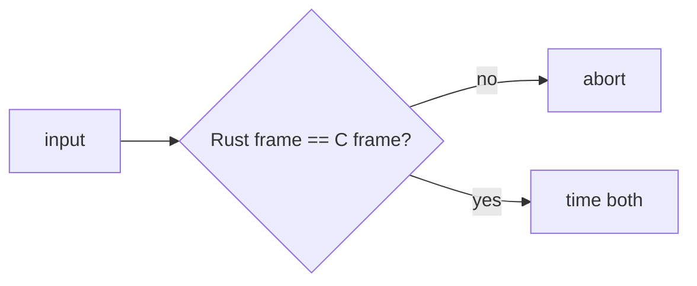

# Implementation comparison

`benches/compress.rs` and `benches/decompress.rs` (Criterion) time mopenzl
against OpenZL v0.3.0 through `openzl-ffi` on the corpora of
`benches/support`: a 64-byte prefix (per-call cost), 1 MiB of the vendored
OpenZL C sources (text), 1 MiB of structured 16-byte records and 256 KiB of
random bytes.

Every compression case asserts byte-identical frames before timing, so ratios
are equal by construction; decompression cases assert both decoders regenerate
the input. The C compression side creates its context per call (as
`ZL_compress`-style callers do) while the Rust side reuses its compressor, so
the 64-byte case mostly measures context setup.

## Recorded results

Initial port (the graph engine and node packages came after), recorded
2026-11-09 on an Apple M5 Pro, rustc 1.99.1, release profile, Criterion with 1 s
warm-up and 2 s measurement (`cargo bench --bench compress` / `decompress`
with those flags), throughput of input bytes:

| Case | Rust compress | C compress | Rust decompress | C decompress |
| --- | --- | --- | --- | --- |
| tiny-64B L1 | 44.6 MiB/s | 9.9 MiB/s | 1.01 GiB/s | 136 MiB/s |
| c-source-1MiB L1 | 788 MiB/s | 814 MiB/s | 2.27 GiB/s | 2.26 GiB/s |
| c-source-1MiB L6 | 192 MiB/s | 203 MiB/s | 2.45 GiB/s | 2.48 GiB/s |
| records-1MiB L1 | 717 MiB/s | 711 MiB/s | 1.38 GiB/s | 1.64 GiB/s |
| records-1MiB L6 | 279 MiB/s | 283 MiB/s | 2.11 GiB/s | 2.36 GiB/s |
| random-256KiB L1 | 8.19 GiB/s | 4.63 GiB/s | 15.8 GiB/s | 9.93 GiB/s |
| random-256KiB L6 | 5.49 GiB/s | 3.13 GiB/s | 15.7 GiB/s | 9.93 GiB/s |

Zstandard dominates compressible inputs, so those rows mirror `mzstd` against
zstd. Incompressible inputs are stored, and there the SIMD XXH3 checksum and
the absence of per-call setup decide.

The "Rust decompress" column decodes into a reused slice. A second run of the
same harness with the uninit and Vec cases:

| Case | slice | uninit | Vec (`decompress`) | C |
| --- | --- | --- | --- | --- |
| c-source-1MiB L1 | 2.10 GiB/s | 2.05 GiB/s | 2.09 GiB/s | 2.13 GiB/s |
| c-source-1MiB L6 | 2.39 GiB/s | 2.29 GiB/s | 2.29 GiB/s | 2.40 GiB/s |
| records-1MiB L1 | 1.39 GiB/s | 1.37 GiB/s | 1.76 GiB/s | 1.62 GiB/s |
| records-1MiB L6 | 2.16 GiB/s | 2.16 GiB/s | 2.48 GiB/s | 2.34 GiB/s |

The Vec path appends through `mzstd::decompress_into` and beats C on records,
so the slice/uninit gap lies in `mzstd::decompress_to_slice` on this data, not
in the OpenZL layer.

## Zstandard node package: before and after

Recorded 2026-11-09 on the same Apple M5 Pro with the same harness
(`cargo bench --bench compress` / `decompress`, Criterion, 1 s warm-up, 2 s
measurement, throughput of input bytes), before and after the Zstandard node
moved to native magicless frames: the encoder no longer writes a magic and
overwrites it, and the decoder no longer stages `magic + frame` into a buffer
before decoding (it reads the content size with `FrameHeaderInfo::parse` and
decodes in place). Frames are byte-identical before and after, so compressed
sizes did not move.

| Case | Before | After | C (after) |
| --- | --- | --- | --- |
| decompress c-source-1MiB L1, slice | 1.995 GiB/s | 2.269 GiB/s | 2.312 GiB/s |
| decompress c-source-1MiB L1, uninit | 2.171 GiB/s | 2.270 GiB/s | |
| decompress c-source-1MiB L6, slice | 2.413 GiB/s | 2.517 GiB/s | 2.561 GiB/s |
| decompress records-1MiB L1, slice | 1.416 GiB/s | 1.462 GiB/s | 1.681 GiB/s |
| decompress records-1MiB L1, Vec | 1.854 GiB/s | 1.850 GiB/s | 1.681 GiB/s |
| decompress tiny-64B L1, slice | 613 MiB/s | 664 MiB/s | 136 MiB/s |
| compress c-source-1MiB L6 | 175.6 MiB/s | 197.2 MiB/s | 208.3 MiB/s |
| compress records-1MiB L6 | 264.5 MiB/s | 278.9 MiB/s | 284.6 MiB/s |
| compress tiny-64B L1 | 42.4 MiB/s | 43.6 MiB/s | 10.1 MiB/s |

The slice and uninit decode paths of the compressible text corpus gained up to
about 9 to 14 percent (run to run noise on this machine is roughly 5 percent: the
untouched C rows moved by up to 15 percent between the two runs). Compression is
within that noise, because the removed work was a one-byte overwrite. The
records corpus through the slice destination remains about 15 percent behind C
(`mzstd::decompress_to_slice`), while the `Vec` destination is ahead of it.

No benchmarks of the other node encoders, the graphs or the selectors have been
recorded yet; their correctness is established by byte identity (see
[compatibility](compatibility.md)), their speed is unmeasured.

## Known gaps

- Only the default graph is benchmarked; no Criterion benchmark exists for
  structured inputs, the Transformer, the entropy or LZ graphs, dictionaries
  or SDDL.
- The C compression side creates a context per call; see the methodology note.
