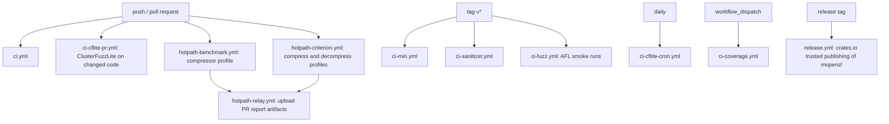
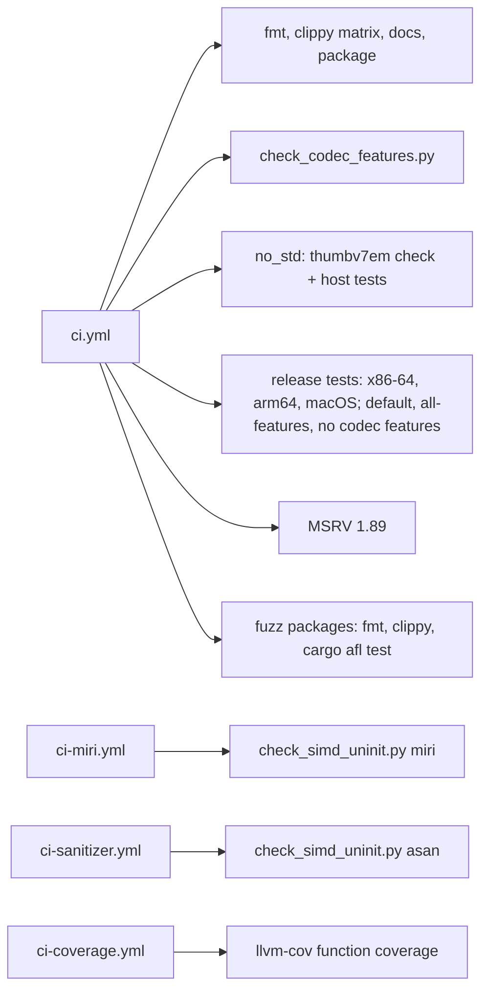
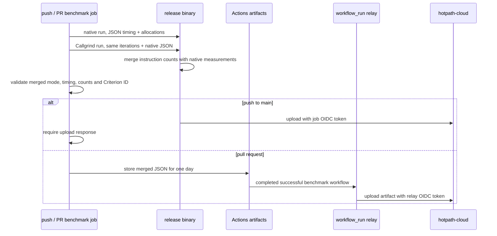

# Continuous integration

Code-running workflows check out with `submodules: true` (non-recursive:
OpenZL, zstd and lz4 for `openzl-ffi`). They use read-only repository
permissions; the hotpath push jobs additionally request an OIDC token for
uploads. The hotpath relay only handles report artifacts and checks out no
code.

`ci.yml`: formatting; clippy with `--all-features`, default features, the
hotpath features and a feature matrix including builds without codec
features; documentation builds with `-D warnings` per feature set; `cargo
package`; `scripts/check_codec_features.py`; a `thumbv7em-none-eabi` no_std
check; release-mode tests on Linux x86-64, Linux arm64 and macOS with default
features, `--all-features` (alloc-only) and without codec features; MSRV
1.89; formatting, clippy and `cargo afl test` of the fuzz packages.

`ci-miri.yml` and `ci-sanitizer.yml` run `scripts/check_simd_uninit.py`: the
XXH3 kernel, the uninitialized-output modules and the `simd_backends` and
`uninit` tests, under Miri (x86-64 with `-Ctarget-cpu=x86-64-v3`, arm64 at its
Neon baseline; tests that call the C library are skipped or filtered to
`rust_only_*`) and AddressSanitizer. `ci-sanitizer.yml` also runs every unit
and integration test under AddressSanitizer and LeakSanitizer on x86-64.
`openzl-ffi` exports `__asan_default_options` with
`allocator_may_return_null=1`: the C decoder reserves whatever size a damaged
frame declares, and must see a null allocation (and report an error) as it
does with plain `malloc` instead of ASan aborting the test. `ASAN_OPTIONS`
overrides it. `ci-coverage.yml` runs `cargo llvm-cov` and gates function
coverage.

## Coverage of the encoder and graph code

The integration tests that compare against the C library (`tests/encode_*.rs`,
`standard_graphs.rs`, `graph_engine.rs`, `codecs_*.rs`; see
[compatibility](compatibility.md)) run in the release-mode test jobs on Linux
x86-64, Linux arm64 and macOS, with default features, `--all-features` and
without codec features, so the byte-identity of every node and graph is checked
on both architectures. `tests/docs_examples.rs` runs every example of
`README.md` and `docs/*.md`; it is generated by `scripts/gen_docs_examples.py`
and its `docs_examples_are_current` test fails when the markdown and the file
disagree. `scripts/check_codec_features.py` runs once on Ubuntu and derives the
codec list from the `all-codecs` feature.

## Hotpath reports

`hotpath-benchmark.yml` and `hotpath-criterion.yml` run on pushes to `main`
and pull requests, matching the setup in the sibling mbrotli repository.
Both pin Ubuntu 26.04, Rust 1.99.1 and Valgrind 3.26.0 and build with
`hotpath-alloc,hotpath-callgrind,hotpath-cloud` in release mode with the
lockfile. Runtime SIMD detection still chooses the backend on the runner;
none of these jobs changes dispatch or codec output.

The standalone `examples/profile_compressor.rs` validates a round trip and
then performs ten reusable-output compressions at each of levels 1, 3, 6 and
12 over a fixed repeated text. Its entry point owns the hotpath guard and
tracking allocator. Its unit test runs the same workload without profiling.

The Criterion jobs use `hotpath::criterion` in the existing `compress` and
`decompress` benches. The adapter delegates to ordinary Criterion unless
`HOTPATH_CRITERION_ITERATIONS` is set. CI selects exactly one benchmark per
process: `compress/rust/c-source-1MiB/L6` (20 iterations) or
`decompress/rust/c-source-1MiB/L6` (100 iterations). Existing Rust/C frame
and round-trip validation still runs outside the measured closures. The
adapter starts its guard around the selected closure, excluding corpus
loading, validation and unrelated cases from its report.

Push jobs use `HOTPATH_UPLOAD=fail-on-error` and fail on upload errors.
Pull request jobs have no OIDC permission and only publish report artifacts.
`hotpath-relay.yml` handles successful PR runs using the pinned
`hotpath-rs/hotpath-relay` v1.0.0 action, with `actions: read`,
`pull-requests: read` and `id-token: write`. It never executes PR code.
Workflow names, Criterion series, artifact names and report filenames must
stay in sync with the relay; concurrency cancels an older relay for the same
repository, branch and series. The repository must be connected to
hotpath-cloud for authenticated uploads to succeed.

## Known gaps

- The Miri and AddressSanitizer lists cover the XXH3 kernel, the uninitialized
  output modules and the `simd_backends`/`uninit` tests only. The encoder codecs,
  graphs and shared algorithms are safe scalar code and are not on the lists;
  if a SIMD kernel or a `MaybeUninit` path is added to them, they must be added
  to `scripts/check_simd_uninit.py`.
- No CI step reruns `scripts/gen_transformer_scorers.py` and diffs its output, so
  a drift between the vendored scorers and the generated Rust is not detected.
- The clippy and docs matrices toggle `zstd` and "no codecs" only, not every
  codec feature subset; the `features` job probes the public API of each.
- Hotpath CI profiles the default graph only; the full Silesia comparison
  remains a manual run ([comparison](benchmark-comparison.md)).
