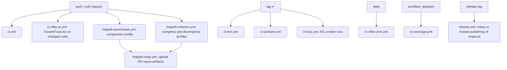
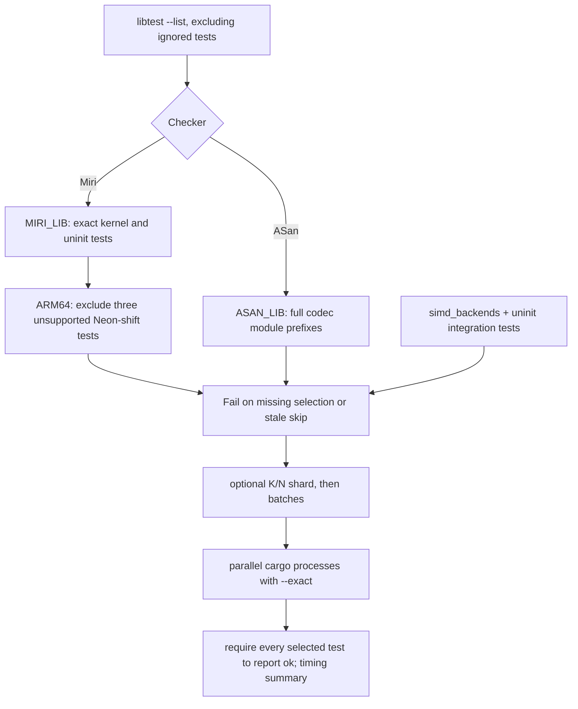
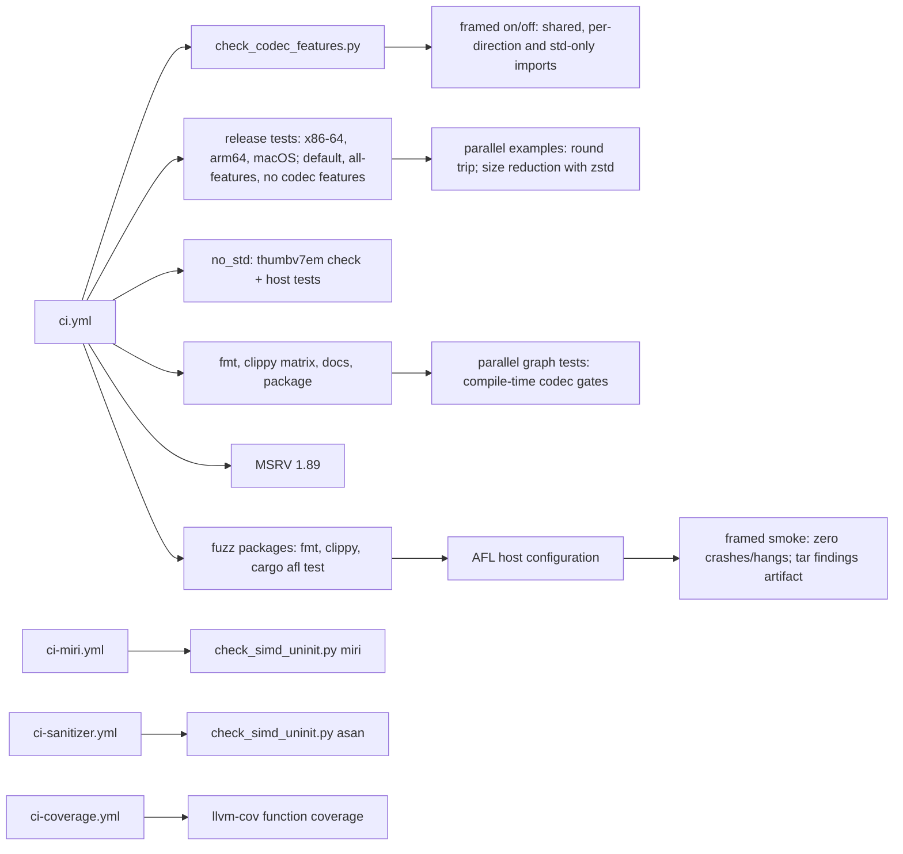
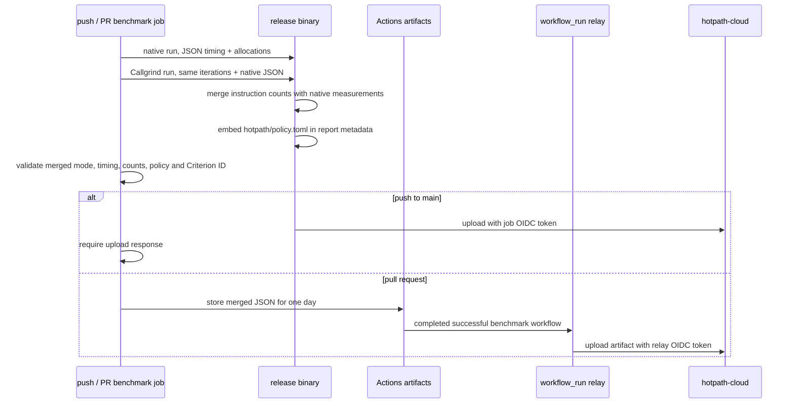

# Continuous integration

The opt-in `framed` API is included in std Clippy, release tests, docs and
the coverage run. Direction-only std and no_std framed combinations are in
the feature matrix; all-features also exercises the alloc-only container.
Framed AFL/libFuzzer bodies and regression replay run through the excluded
fuzz packages, whose root dependency enables `framed` explicitly.
The Linux fuzz job also runs each framed AFL target for 15 seconds with a
secondary worker, preserves artifacts and rejects saved crashes or hangs.

Code-running workflows check out with `submodules: true` (non-recursive:
OpenZL, zstd and lz4 for `openzl-ffi`). They use read-only repository
permissions; the hotpath push jobs additionally request an OIDC token for
uploads. The hotpath relay only handles report artifacts and checks out no
code.

`ci.yml`: formatting; clippy with `--all-features`, default features, the
hotpath features and a feature matrix including builds without codec
features; documentation builds with `-D warnings` per feature set; `cargo
package`; `scripts/check_codec_features.py`; a `thumbv7em-none-eabi` no_std
check; release-mode tests on Linux x86-64, Linux arm64 and macOS with default
features, `--all-features` (alloc-only) and without codec features; MSRV
1.89; formatting, clippy and `cargo afl test` of the fuzz packages.
Parallel streaming doc tests validate decoded bytes when decompression is
enabled and assert size reduction only with `zstd`; codec-free builds store
chunks. The parallel standard-graph integration test selects codec graphs
with compile-time feature gates, retaining the Store graph in every build.

`ci-miri.yml` and `ci-sanitizer.yml` run `scripts/check_simd_uninit.py`: the
SIMD kernels, uninitialized destinations and the `simd_backends` and
`uninit` tests, under Miri (x86-64 with `-Ctarget-cpu=x86-64-v3`, arm64 at its
Neon baseline; tests that call the C library are skipped or filtered to
`rust_only_*`) and AddressSanitizer. `ci-sanitizer.yml` also runs every unit
and integration test under AddressSanitizer and LeakSanitizer on x86-64.
`openzl-ffi` exports `__asan_default_options` with
`allocator_may_return_null=1`: the C decoder reserves whatever size a damaged
frame declares, and must see a null allocation (and report an error) as it
does with plain `malloc` instead of ASan aborting the test. `ASAN_OPTIONS`
overrides it. `ci-coverage.yml` runs `cargo llvm-cov` and gates function
coverage.

Miri selects 17 library tests by exact name (`MIRI_LIB`), plus the backend
integration test and four `rust_only_*` uninitialized-output tests (22 tests
on x86-64). They cover the LZ row-table tag compare,
PivCo-Huffman partition/translation/packing and
merge/flat kernels, bit counting, byte transpose, XXH3, and uninitialized
sinks and destinations. Each differential kernel test still checks the scalar
baseline and every available SIMD level. ARM64 excludes three PivCo tests
(`MIRI_NEON_SKIPS`) because Miri cannot interpret
`llvm.aarch64.neon.ushl.v8i16`; the 19 remaining tests run there, while
x86-64 Miri and ARM64 ASan retain those three tests. Exact library names fail
validation if renamed, and new tests in a codec module do not increase Miri's workload
automatically. Exhaustive scalar parser, tree, entropy and copy tests remain
in the native and ASan suites; ASan retains the broader `ASAN_LIB` module
prefixes. The runner prints the selected test/process count before execution
and reports the slowest tests after completion.

## Coverage of the encoder and graph code

The integration tests that compare against the C library (`tests/encode_*.rs`,
`standard_graphs.rs`, `graph_engine.rs`, `codecs_*.rs`; see
[compatibility](compatibility.md)) run in the release-mode test jobs on Linux
x86-64, Linux arm64 and macOS, with default features, `--all-features` and
without codec features, so the byte-identity of every node and graph is checked
on both architectures. `tests/docs_examples.rs` runs every example of
`README.md` and `docs/*.md`; it is generated by `scripts/gen_docs_examples.py`
and its `docs_examples_are_current` test fails when the markdown and the file
disagree. `scripts/check_codec_features.py` runs once on Ubuntu and derives the
codec list from the `all-codecs` feature. Its consumer matrix toggles `framed`
independently of directions, codecs and std mode, checking both available and
unavailable framing imports, including native sessions and std transport adapters.

The framed AFL smoke step first runs `cargo afl system-config` on the disposable
Ubuntu host, as the tag-triggered fuzz workflow does. This replaces a piped core
dump handler with direct core dumps so AFL can observe crashes through `waitpid`.
Each framed target runs for 15 seconds and must report zero saved crashes and
hangs. Findings are archived as `framed-afl-smoke.tar.gz` before artifact upload
because AFL queue filenames contain colons.

## Hotpath reports

`hotpath-benchmark.yml` and `hotpath-criterion.yml` run on pushes to `main`
and pull requests, matching the setup in the sibling mbrotli repository.
Both pin Ubuntu 26.04, Rust 1.99.1 and Valgrind 3.26.0 and build with
`hotpath-alloc,hotpath-callgrind,hotpath-cloud` in release mode with the
lockfile. Runtime SIMD detection still chooses the backend on the runner;
none of these jobs changes dispatch or codec output.

The standalone `examples/profile_compressor.rs` validates a round trip and
then performs ten reusable-output compressions at each of levels 1, 3, 6 and
12 over a fixed repeated text. Its entry point owns the hotpath guard and
tracking allocator. Its unit test runs the same workload without profiling.

The Criterion jobs use `hotpath::criterion` in the existing `compress` and
`decompress` benches. The adapter delegates to ordinary Criterion unless
`HOTPATH_CRITERION_ITERATIONS` is set. CI selects exactly one benchmark per
process: `compress/rust/c-source-1MiB/L6` (20 iterations) or
`decompress/rust/c-source-1MiB/L6` (100 iterations). Existing Rust/C frame
and round-trip validation still runs outside the measured closures. The
adapter starts its guard around the selected closure, excluding corpus
loading, validation and unrelated cases from its report.

Push jobs use `HOTPATH_UPLOAD=fail-on-error` and fail on upload errors.
Pull request jobs have no OIDC permission and only publish report artifacts.
`hotpath-relay.yml` handles successful PR runs using the pinned
`hotpath-rs/hotpath-relay` v1.0.0 action, with `actions: read`,
`pull-requests: read` and `id-token: write`. It never executes PR code.
Workflow names, Criterion series, artifact names and report filenames must
stay in sync with the relay; concurrency cancels an older relay for the same
repository, branch and series. The repository must be connected to
hotpath-cloud for authenticated uploads to succeed.

`hotpath/policy.toml` is shared by all three benchmark series and uses the
same thresholds as mbrotli: judge instruction-count changes from 0.5% and
allocation changes from 1%, for both `avg` and `total`, with at least one
call. Functions below 0.05% of the run are skipped. Native timing is shown
but not judged. These thresholds report regressions without enabling
`fail_check`, matching mbrotli. The profiler embeds the checkout's policy
in `meta.policy`; the merged-report checks require its path and nonempty
source so a missing policy cannot silently pass the report checks.

## Known gaps

- Miri uses focused kernel and uninitialized-output tests, rather than all
  codec tests. A new SIMD kernel or `MaybeUninit` path needs an explicit entry
  in `MIRI_LIB` and a matching `ASAN_LIB` entry in
  `scripts/check_simd_uninit.py`; broad ASan prefixes alone do not add Miri
  coverage. Scalar codec and graph behavior is checked natively and by ASan.
- No CI step reruns `scripts/gen_transformer_scorers.py` and diffs its output, so
  a drift between the vendored scorers and the generated Rust is not detected.
- The clippy and docs matrices toggle `zstd` and "no codecs" only, not every
  codec feature subset; the `features` job probes the public API of each.
- Hotpath CI profiles the default graph only; the full Silesia comparison
  remains a manual run ([comparison](benchmark-comparison.md)).

The SIMD/uninitialized-output runner also selects
`parallel_stream::rust_only_uninitialized_output_and_flush_preserve_one_openzl_frame`
under Miri and AddressSanitizer. This test starts destinations uninitialized,
checks deferred flush output, and decodes entirely in Rust. Parallel native
integration tests run in the default/std jobs; `all-features` enables `no_std`
and omits the parallel module.

`parallel_graphs::rust_only_graph_sessions_write_uninitialized_output_and_close_their_queue`
adds graph-selected owned-session output to both memory-safety runners; ASan also
runs the entire `parallel_graphs` integration binary, including C interop.

## Documentation book

`.github/workflows/pages.yml` builds the complete mdBook on documentation,
architecture, manifest or API changes and manual dispatch. Python tests cover
navigation/link rules, the temporary Cargo consumer runs the user-guide recipes,
and the HTML build validates local links/anchors. Only the main-branch deployment
job has Pages/OIDC write permissions; pull requests build without publishing.
The staged sources, bundled Mermaid assets and static output stay in target.
See [documentation publishing](documentation.md) for the full flow and diagrams.
