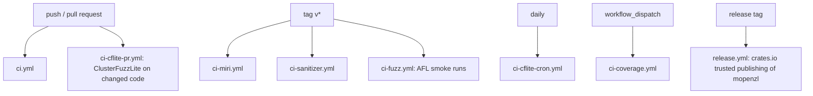

# Continuous integration

Every workflow checks out with `submodules: true` (non-recursive: OpenZL,
zstd and lz4 for `openzl-ffi`) and runs with read-only permissions.

`ci.yml`: formatting; clippy with `--all-features`, default features, the
hotpath features and a feature matrix including builds without codec
features; documentation builds with `-D warnings` per feature set; `cargo
package`; `scripts/check_codec_features.py`; a `thumbv7em-none-eabi` no_std
check; release-mode tests on Linux x86-64, Linux arm64 and macOS with default
features, `--all-features` (alloc-only) and without codec features; MSRV
1.89; formatting, clippy and `cargo afl test` of the fuzz packages.

`ci-miri.yml` and `ci-sanitizer.yml` run `scripts/check_simd_uninit.py`: the
XXH3 kernel, the uninitialized-output modules and the `simd_backends` and
`uninit` tests, under Miri (x86-64 with `-Ctarget-cpu=x86-64-v3`, arm64 at its
Neon baseline; tests that call the C library are skipped or filtered to
`rust_only_*`) and AddressSanitizer. `ci-coverage.yml` runs `cargo llvm-cov`
and gates function coverage.
