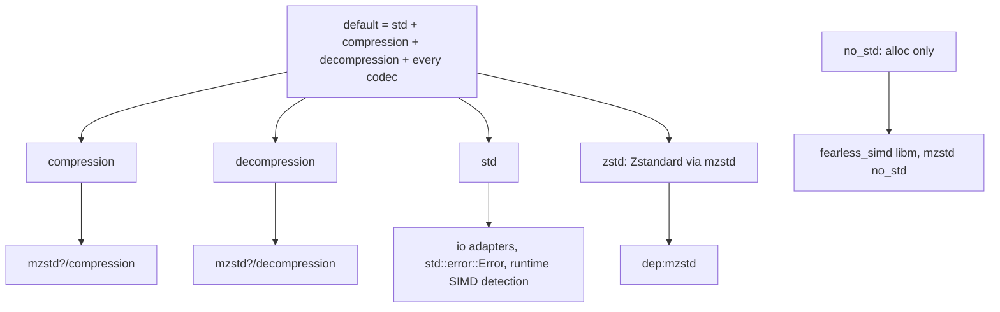
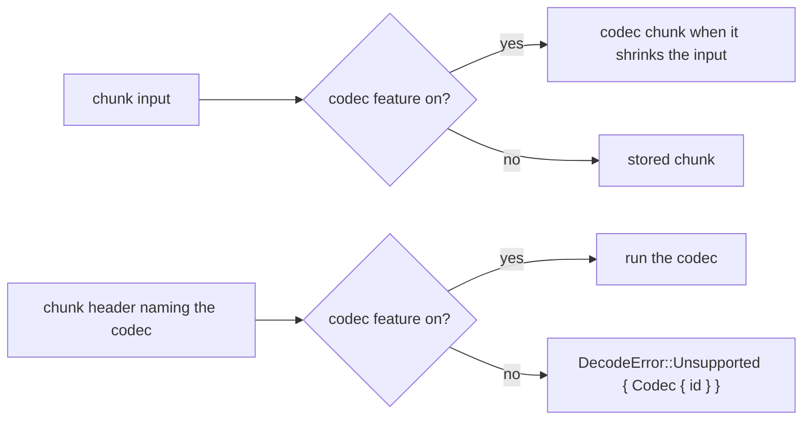

# Codec features

## Directions

- `compression` exposes `compressor` and its root re-exports; `decompression`
  exposes `decompressor` and its re-exports. `Backend`, `RetentionPolicy` and
  `FormatVersion` exist with either direction; with neither the crate is
  empty.
- `io` exists only with a direction and without `no_std`. `no_std` selects the
  compile-time baseline SIMD level and wins over `std` when both are set
  (as `--all-features` does); `hotpath*` anchors are compiled out with it.

## Codecs

Each OpenZL codec has its own feature, and every codec feature is in
`default`. Codec features change behaviour, not the public API:

| Feature | Codec | Dependency | Gated items |
| --- | --- | --- | --- |
| `zstd` | `ZL_StandardTransformID_zstd` (22) | `mzstd` | `compressor::core::zstd`, `Engine::zstd`, the zstd branch of `write_chunk`, `CoreError::Internal`; `decompressor::core::zstd`, `Codec::Zstd`, `Engine::run_zstd`, `Out::zstd`; `wire::CODEC_ZSTD`, `MIN_STREAM_SIZE` |

Without `zstd` the encoder stores every chunk (still a valid frame the
reference decodes, but no longer byte-identical to its default graph), and the
decoder rejects the reference's Zstandard chunks. The chunk layout is parsed
in full either way, so an unsupported codec is reported before any stream is
wired.

## Checks

Shared helpers carry per-direction `cfg`s so single-direction builds have no
dead code. `scripts/check_codec_features.py` builds an isolated consumer for
every mode × direction × codec-set combination and probes which public items
exist; it fails on a codec feature missing from `default` or a feature it does
not classify. CI runs clippy over the same matrix and the test suite without
codec features.
