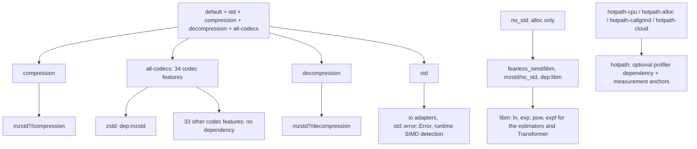
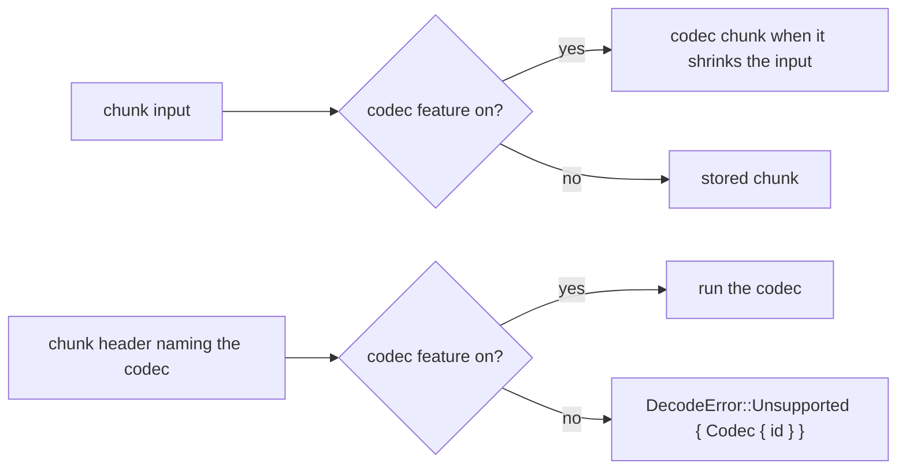

# Codec features

## Directions

`framed` is opt-in and independent of codec features and directions. With a
direction it exposes `framing` (resource metadata, directory and limits), the
corresponding framed owner and borrowed sessions. Std adds resource writers,
sequential readers and seek readers; alloc-only builds keep one-shot and native
sessions. `framed` alone enables no dependencies or public modules and is not
in `default` or `all-codecs`. See [framed containers](framing.md).

- `compression` exposes `compressor`, `graph`, `input` and the root re-exports;
  `decompression` exposes `decompressor` and its re-exports; `dict` exists with
  either direction. `Backend`, `RetentionPolicy`, `FormatVersion` and `DataType`
  exist with either direction; with neither the crate is empty.
- `io` exists only with a direction and without `no_std`. `no_std` selects the
  compile-time baseline SIMD level and wins over `std` when both are set
  (as `--all-features` does); `hotpath*` anchors are compiled out with it.
- `libm` is an optional dependency enabled by `no_std`. It supplies `log`,
  `exp`, `pow` and `expf` to `shared::estimate` and the Transformer
  (`graphs::transformer::math`), and `sqrt` to the ML selector's features. With
  `std` those functions are the platform's, which is what the reference links;
  a `no_std` build has no byte-identity guarantee for decisions that depend on
  them (see [transformer](transformer.md)). `shared::estimate` is compiled with
  `compression` in every build.

The `custom-codec` feature exposes `custom_codec` with either direction, encoder
contexts and graph registration with `compression`, and decoder contexts and
registration with `decompression`. It is enabled by `all-codecs`. Without it,
custom wire IDs decode as `Unsupported::CustomCodec`. See [custom codecs](custom-codecs.md).

## Profiling features

Profiling is opt-in and independent of codec selection. `hotpath` enables the
optional profiler and library measurement anchors. `hotpath-cpu`,
`hotpath-alloc`, `hotpath-callgrind` and `hotpath-cloud` each imply `hotpath`
and forward the corresponding upstream feature: CPU sampling, allocation
tracking, instruction counts and authenticated report uploads respectively.
The library anchors remain disabled with `no_std`.

The dev-dependency additionally enables `hotpath/criterion-0-8`, used by the
compression and decompression benchmarks. This adapter does not reach normal
library consumers. See [CI](ci.md#hotpath-reports) for report ownership,
the fixed-count native/Callgrind data flow and the pull request relay.

## Codecs

Each OpenZL codec has its own feature; `all-codecs` enables every one and is in
`default`. Codec features change behaviour, not the public API:

Without a codec's feature the encoder never writes it (a node row selects
`codecs::DISABLED`, which fails the node, so the engine stores the chunk, falls
back under permissive mode, or skips a trial) and the decoder reports it as
`Unsupported`. The chunk layout is parsed in full either way, so an unsupported
codec is reported before any stream is wired. Frames of a build without
`zstd` are valid but no longer match the reference's default graph.

| Feature | Codec IDs | Decoder module (`decompressor::core::codecs`) | Encoder module (`compressor::core::codecs`) | Encoder graphs needing it |
| --- | --- | --- | --- | --- |
| `custom-codec` | application u32 IDs (separate namespace) | `custom_codec::core` callback adapter | `custom_codec::core` callback adapter | application graphs |
| `zstd` | 22 | `zstd`, `core::zstd`, `State::zstd`, `Out::zstd` | `zstd_node`, `core::zstd` | `zstd` 9, default fast path |
| `conversion` | 5-14 | `conversion` | `conversion` (always compiled; rows gated) | stores, routers |
| `delta` | 1 | `delta` | `numeric::delta` | transformer |
| `zigzag` | 3 | `zigzag` | `numeric::zigzag` | transformer |
| `divide-by` | 53 | `divide_by` | `numeric::divide_by` | transformer |
| `quantize` | 25, 26 | `quantize` | `quantize` | `field_lz` graph, `compress_small_lengths` |
| `range-pack` | 35 | `range_pack` | `numeric::range_pack` | transformer |
| `bitsplit` | 63 | `bitsplit` | `numeric::bitsplit` | |
| `float-deconstruct` | 33 | `float_deconstruct` | `numeric::float_deconstruct` | |
| `sparse-num` | 66 | `sparse_num` | `numeric::sparse_num` | transformer |
| `merge-sorted` | 43 | `merge_sorted` | `numeric::merge_sorted` | `merge_sorted` 63 |
| `sentinel` | 18 | `sentinel` | `numeric::sentinel` | `compress_small_lengths` |
| `partition` | 64 | `partition` | `numeric::partition` | `partition_bitpack` 23 |
| `constant` | 44, 45 | `constant` | `constant` | `constant` 8, transformer |
| `prefix` | 46 | `prefix` | `structure::prefix` | |
| `transpose` | 2, 4, 30-32 | `transpose` | `structure::transpose` | `transpose_split` selector 64, `field_lz` literals |
| `split` | 40, 47, 48 | `split` | `structure::split` | entropy graph (32 KiB chunks), `split_*` |
| `split-by-struct` | 41 | `split_by_struct` | `structure::split_by_struct` | `sddl2` |
| `dispatch` | 42, 54 | `dispatch` | `structure::dispatch` | `sddl`, `try_parse_int` |
| `concat` | 55, 57-59 | `concat` | `structure::concat` | `cluster` |
| `dedup` | 56 | `dedup` | `structure::dedup` | |
| `interleave` | 61 | `interleave` | `structure::interleave` | |
| `tokenize` | 36-38 | `tokenize` | `structure::tokenize` | entropy graph, transformer |
| `parse-int` | 60 | `parse_int` | `structure::parse_int` | `try_parse_int` 19 |
| `bitpack` | 27, 28 | `bitpack` | `bitpack` | `bitpack` 10, entropy graph |
| `bitunpack` | 34 | `bitunpack` | `bitunpack` | |
| `flatpack` | 29 | `flatpack` | `flatpack` | `flatpack` 11, entropy graph |
| `mux-lengths` | 65 | `mux_lengths` | `mux_lengths` | `lz` 28 |
| `entropy` | 49-52 | `entropy` | `entropy` (needs `compression`) | graphs 3-7, 44 |
| `pivco-huffman` | 67 | `pivco_huffman` | `pivco_huffman` (needs `compression`) | `huffman_pivco` 6 |
| `lz4` | 62 | `lz4` | `lz4` | `lz4` 22 |
| `lz` | 19 | `lz` | `lz`, `lz_common` | `lz` 28 (also needs `entropy`) |
| `field-lz` | 24 | `field_lz` | `field_lz`, `lz_common` | `field_lz` 12, 45, 46 (also needs `entropy`) |

Each decoder module is one registry arm in `codecs::standard`; the
[decoder catalogue](decoder-codecs.md) gives every signature and the
[encoder catalogue](encoder-codecs.md) every node. Frames from the reference's
typed graphs carry conversion codecs (storing a numeric stream converts it to
serial), so differential tests of most codecs also need `conversion`.

Graphs that need several features alias `UNPORTED_FUNCTION` /
`UNPORTED_SELECTOR` when any is off (`field_lz` family: `field-lz` and `entropy`;
`lz`: `lz` and `entropy`; `partition_bitpack`: `partition`; `merge_sorted`:
`merge-sorted`; the five entropy graphs: `entropy`). The store graphs, the
generic routers, the segmenters, `small_lengths`, `bitpack`, `constant`, the
ML selector, clustering, SDDL and the Transformer graphs are ungated; they fail
at run time on the first node whose feature is off.

## Shared modules by feature

`shared` is private and compiled when either direction is on; each item is gated
to its users.

| Module | Compiled with |
| --- | --- |
| `wire`, `varint`, `bitpack`, `xxh3`, `destination`, `sha256`, `dictwire` | either direction (`wire::CODEC_ZSTD`, `MIN_STREAM_SIZE` need `zstd`; parts of `dictwire` need `decompression`) |
| `cbor`, `estimate`, `numeric` | `compression` |
| `bitpack_kernels` | `compression` and (`bitpack` or `bitunpack`) |
| `entropy`, `stats` | `compression` and (`entropy` or `pivco-huffman`) |

## Checks

Shared helpers carry per-direction `cfg`s so single-direction builds have no dead
code. `scripts/check_codec_features.py` builds an isolated consumer for every
mode (none, `std`, `no_std`) x direction x codec-set combination and probes which
public items exist (`DataType`, `TypedOutput` included); `CODECS` is read from
the `all-codecs` feature, so a new codec feature is picked up automatically, and
the script fails on a feature missing from `default` or one it does not classify.
The consumer inherits the root `[patch.crates-io]` table when there is one (a
dependency checked out locally during development). CI runs clippy over
`std`, `no_std` and direction combinations (the codec set there is `zstd` or none,
not every codec subset) and the test suite without codec features.

## Known gaps

- The probe list of `check_codec_features.py` covers the root re-exports; it does
  not probe `graph`, `input` and `dict` items.
- CI's feature matrix toggles `zstd` and "no codecs" only; individual codec
  features are exercised by the probe script and by the default build.
- Codec subsets that disable a codec another one's graph depends on (for
  example `entropy` without `bitpack`) compile and fail at run time, like a
  failing codec of the reference.

The `compressor::parallel` API is included with `compression` unless `no_std` is
enabled. It uses exactly the serial encoder codec gates (including stored chunks
when `zstd` is absent), adds no executor dependency or codec feature, and supports
batches, random-access sources and deferred-output streaming. See
[parallel compression](parallel-compression.md).

The parallel builder accepts the same `CompressorGraph` as the serial builder.
Explicit codec nodes follow serial feature/version errors and permissive
fallbacks, while the default parallel graph continues to store chunks without
`zstd`. `ParallelCompressorBuilder` follows the same std/compression gate.
