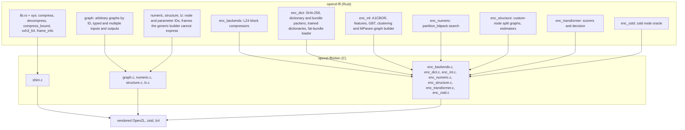
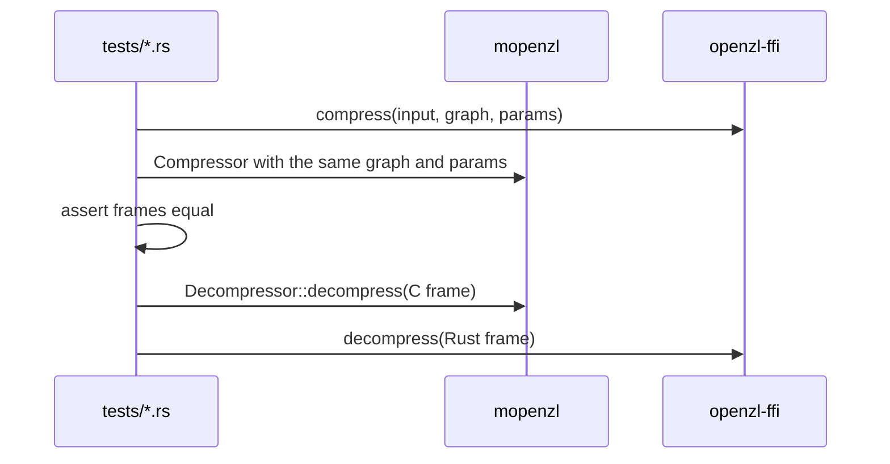

# Compatibility

`openzl-ffi` builds the pinned OpenZL v0.3.0 (with zstd 1.5.7 and lz4 1.10.0)
from `openzl-ffi/vendor/` and exposes it as the test and benchmark oracle. The
build compiles every C file of `openzl-ffi/shim/` into one static library; a new
shim file reruns the build script. The vendored tree is never edited.

## Oracle map

The shims flatten OpenZL's by-value `ZL_Report` into a `size_t` result and an
error code; the safe wrappers own every buffer they hand to C. Graphs are
named by the numeric IDs of `ZL_StandardGraphID_*`, `ZL_StandardNodeID_*` and
the private IDs, so a test reaches every codec the C library has.

## Test files

| File | Covers |
| --- | --- |
| `differential_c.rs` | Default graph: every format version 21..=27, levels -50 to 22, every checksum combination, whole and segmented chunking (32 KiB, 100 000 bytes), empty, small, incompressible, text, zeros and mixed inputs; `Compressor::max_compressed_size` against `ZL_compressBound` |
| `custom_codec.rs` | Registered XOR codec: custom ID boundaries and standard ID collisions, private headers, C byte identity and decoding both ways; typed/variable ports, callback failures, sessions and registration lifetime |
| `graph_engine.rs` | Graph engine byte identity: stores, conversions, min stream size, store on expansion, permissive and trial compression, segmenters, typed and multiple inputs, comments, user graphs |
| `standard_graphs.rs` | Every standard graph the C library accepts over serial, struct, numeric and string inputs at several levels and versions: C frames decode here, Rust frames equal C's |
| `encode_zstd.rs` | Zstandard node: local parameter lists, levels, decompression level 1, block splitting vs `enc_zstd`, formats |
| `encode_numeric.rs` | Numeric nodes (delta, zigzag, range_pack, divide_by, merge_sorted, partition, sparse_num, sentinel, bitSplit, float deconstruct) at every width, v21/24/27; `partition_bitpack` and `merge_sorted` graphs; static numeric pipelines |
| `encode_structure.rs` | tokenize, split, split_by_struct, dispatch, concat, dedup, interleave, prefix, parse_int, transpose nodes and their graphs; estimators |
| `encode_backends.rs` | lz4 (fast, HC, optimal), bitpack, bitunpack, flatpack nodes and graphs |
| `encode_entropy.rs` | fse, huffman, 16-bit huffman, pivco, constant, fse_ncount nodes; graphs 3 to 8 |
| `encode_lz.rs` | `field_lz`, `lz`, `mux_lengths`, `quantize_*` nodes |
| `encode_lzgraphs.rs` | Graphs 12, 28, 45, 46, 69 and `compress_generic` on struct and numeric input |
| `encode_transformer.rs` | Graphs 16, 30, 70 to 90 over widths 1, 2, 4, 8 and many data shapes |
| `encode_ml.rs` | ML selector and clustering graphs, CBOR codec, configuration behaviour |
| `encode_sddl.rs` | SDDL, SDDL2 and the chunk graph, hand-built programs from `tests/support/sddl.rs` |
| `encode_dict.rs` | Dictionary bundles: byte identity for zstd nodes with dictionaries, round trips through both decoders |
| `codecs_numeric.rs`, `codecs_packing.rs`, `codecs_structure.rs`, `codecs_entropy.rs`, `codecs_lz.rs` | Decoders against frames the C encoder writes, including damaged frames (accepted or rejected as C does, never a panic) |
| `typed_outputs.rs` | Typed and multi-output frames against the C library |
| `docs_examples.rs` | Every Rust example of `README.md` and `docs/*.md`, generated by `scripts/gen_docs_examples.py` |
| `public_api.rs`, `io.rs`, `streaming.rs`, `uninit.rs`, `simd_backends.rs` | Public error contracts, adapters, sessions, uninitialized destinations, every host SIMD backend |

Rules the tests follow: comparisons are strict (the "skip when a node is not
ported" probes of the early packages are gone); frames are compared before timing
in benchmarks ([comparison](benchmark-comparison.md)); decoder-only unit tests do
not depend on the Rust encoder. Unit tests in `shared::xxh3` compare every
length from 0 to 2 100 and several block boundaries with the C hash.

## Known gaps

- Miri cannot call C, so oracle tests do not run under it (see [CI](ci.md)).
- `prefix` on an all-empty string input cannot be compared (the C encoder
  crashes).
- Segmented multi-chunk dictionary frames are round-trip tested only.
- `targetCBlockSize` is accepted by C zstd and refused by `mzstd`; not compared.

## Parallel frames

`tests/parallel.rs`, `parallel_stream.rs` and `parallel_io.rs` validate the
mbrotli-style scheduling API, independent OpenZL chunks and one-frame assembly.
The C oracle decodes versions 21–27 with all checksum combinations, negative and
positive levels, smaller serial chunking and nondefault encoder parameters.
Output is deterministic across scheduling, task count, source/staging and
available backends, but matching reference serial bytes is not required.
See [parallel compression](parallel-compression.md).

`parallel_graphs` tests selected standard graphs and individual codec pipelines,
parameterized Zstandard nodes, registered XOR application nodes and dictionary
headers against C decoding. It also compares serial fallback and local-parameter
frames with the serial API and checks graph errors before destination writes.
