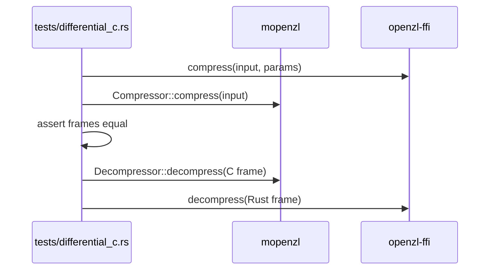

# Compatibility

`openzl-ffi` builds the pinned OpenZL v0.3.0 (with zstd 1.5.7 and lz4 1.10.0)
from `openzl-ffi/vendor/` and exposes `compress` (with level, format version,
both checksum switches and the serial segmenter's chunk size),
`decompress`, `compress_bound` and `xxh3_64` through `shim/shim.c`.

Covered: every format version 21..=27; levels -50 to 22; every checksum
combination; whole and segmented chunking (32 KiB and 100 000 bytes); inputs
that are empty, below the minimum stream size, exactly ten bytes,
incompressible, text, zeros and mixed. `shared::xxh3` compares every length
from 0 to 2 100 and several block boundaries with the C hash, and
`Compressor::max_compressed_size` with `ZL_compressBound`.

Decoder-only checks use C frames (`decompressor` unit tests do not depend on
the Rust encoder) and hand-made frames for unsupported codecs, malformed
graphs and size mismatches.
