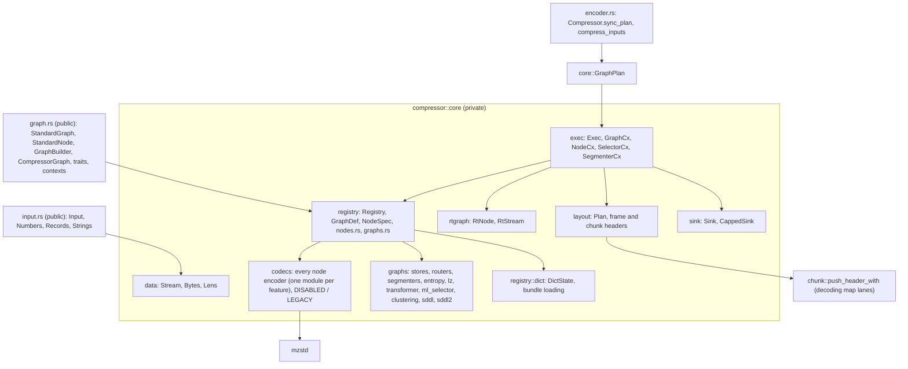
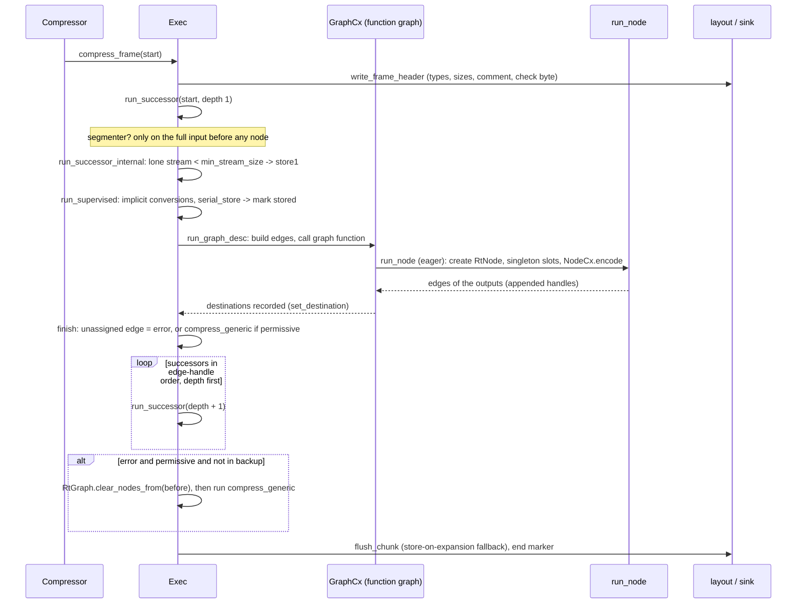
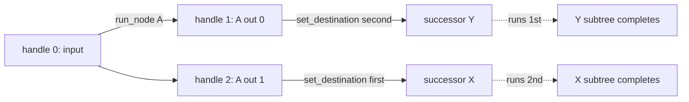
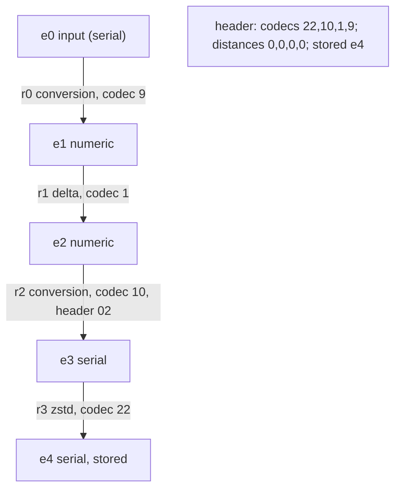
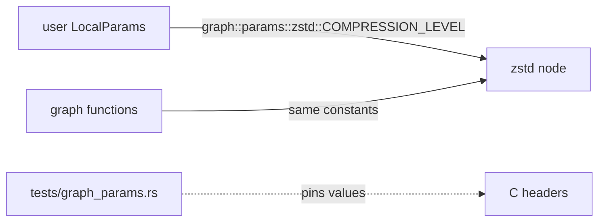
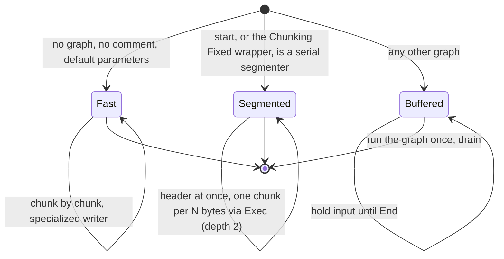

# Compression graphs

The graph engine runs OpenZL's compression graphs over typed, possibly
multiple inputs and produces the frame the reference's `ZL_CCtx_compress`
family writes. The specialized default-graph path (`compressor::core::chunk`,
`frame`) still serves plain serial input with the default parameters; the
engine writes the same bytes for it (a differential test checks this) and is
used for everything else.

## Ownership

Public items never expose `core` types: the contexts handed to user graphs are
thin wrappers over private object-safe traits (`GraphApi`, `SelectorApi`,
`SegmenterApi`), and `GraphError` carries the message of the private
`ExecError`, not the type.

Custom application nodes use a shared owned `NodeSpec` and callback; parameterized
standard nodes keep a borrowed static spec. The runtime graph preserves whether
a wire ID is standard or custom. See [custom codecs](custom-codecs.md) for the
callback contexts, signatures, registration and error mapping.

## Engine flow

`Exec` is the port of `ZL_CCtx` (`cctx.c`). Each function cites its C
original.

### Successor order

Nodes run at the moment the graph function asks; successors run after it
returns, in the order of the **edge handles**: the graph's inputs first, then
node outputs in creation order. A destination for several edges triggers at its
first edge's handle. The order of `set_destination` calls is irrelevant.

## Chunk layout

Stream index `e` is creation order: chunk inputs `0..n`, then each node's outputs
as one block (declared singletons first, variable outputs appended in
creation order). The chunk lists codecs in decoding order (reverse creation) and
addresses a codec's inputs by distance from its first output.

Header lanes: `varint(T+1)`, `varint(nbStored)`, custom flags, standard IDs
(6 or 7 bits), private header sizes, variable-output counts, input counts, the
dictionary lane (written in every chunk of a frame whose compressor loaded a
bundle, format 25 and newer; see [dictionaries](dictionaries.md)), distances,
stored sizes. The stored list is the
private-header stream followed by the `to_store` streams from the last created
to the first.

## Stores, conversions, fallbacks

* `ZL_GRAPH_STORE` sends each input to `store1`, which picks `serial_store`
  (the stream is marked stored) or `string_store`
  (`separate_string_components`, two `serial_store`s). A numeric or struct
  stream reaches `serial_store` through an implicit conversion node
  (numeric to struct, struct to serial, numeric to serial, first match), so
  storing typed data emits a codec.
* **min stream size**: a lone non-string stream below
  `EncoderConfig::min_stream_size` (10) goes to `store1`.
* **Store on expansion**: when `header + stored >= inputs (+ 4 per string)` or
  the chunk header does not fit a capped sink, the chunk is rebuilt as
  `ZL_GRAPH_STORE` at depth 1.
* **Permissive**: a failing successor outside a segmenter is rolled back with
  `RtGraph::clear_nodes_from` (store marks of earlier streams stay, as in the
  reference) and rerun through `compress_generic`.
* **Trial compression** (`Exec::try_graph`): a derived `Exec` with checksums off
  and no comment compresses a whole frame into a `CappedSink` of
  `ZL_compressBound` bytes; the result is the frame length. `brute_force`
  uses it.

## Registry

`registry::nodes::STANDARD_NODES` has every standard node of
`ER_standardNodes` (IDs 2 to 87, 85 rows: codec ID, version range, port types,
default local parameters, encoder). `registry::graphs::STANDARD_GRAPHS` has every
graph of `GR_standardGraphs` (IDs 1 to 90). Custom IDs start at 88 (nodes) and
91 (graphs) and carry the owning registry.

| Status | Nodes | Graphs |
| --- | --- | --- |
| Ported | all 75 non-legacy nodes (IDs 2 to 75, 86, 87 except 56) | all 90 standard graphs ([standard graphs](standard-graphs.md)) |
| Feature off | the row's encoder is `DISABLED` and fails with `NodeError::Disabled` | the row aliases `UNPORTED_FUNCTION` / `UNPORTED_SELECTOR` and fails with `ExecError::Unported` (`field_lz`, `lz`, `partition_bitpack`, `merge_sorted` and the entropy graphs) |
| Legacy | deprecated nodes 76 to 85 (`LEGACY`, `NodeError::Legacy`, never reachable at v21+) | none |

The node catalogue is in [encoder codecs](encoder-codecs.md). A node of a
disabled family fails the node run; the engine then reacts like the reference to
a failing codec (permissive fallback, skipped trial, stored chunk).
`UnportedSegmenter` exists only for tests of the engine.

### Plugging a codec in

1. **Node encoder.** Write `fn(&mut NodeCx<'_, 'a>, &[Stream<'a>]) -> Result<(), NodeError>`
   in `core/codecs/<family>.rs`, wrap it in `FnEncoder`, and point the node's row
   in `registry/nodes.rs` at it:
   `if cfg!(feature = "x") { &codecs::x::ENCODER } else { &codecs::DISABLED }`.
   Create outputs with `cx.emit`, `cx.emit_with_metadata`, `cx.emit_strings`,
   `cx.reference` (zero-copy) or `cx.reference_strings`; send at most one header
   with `cx.send_header`; set output metadata with `cx.set_output_metadata`; read
   parameters with `cx.int`, `cx.copy_param`, `cx.ref_param`, `cx.level()`,
   `cx.decompression_level()`, `cx.format_version()` and, for dictionaries,
   `cx.dictionary`. Fail exactly where the C codec fails: permissive mode and
   trial compressions depend on it.
2. **Graph function, selector or segmenter.** Implement `GraphFn`, `SelectFn` or
   `SegmentFn` and point the row in `registry/graphs.rs` at it. Inside, use
   `GraphCx::run_node`, `set_destination`, `set_metadata`, `int_metadata`,
   `mparam`, `is_node_supported`, `SelectorCx::try_graph` and
   `SegmenterCx::process_chunk`.
3. Add the codec feature to `Cargo.toml` (`all-codecs`), to `scripts/check_codec_features.py`
   (`CODECS` is read from `all-codecs`), gate modules, tests and dependencies
   together ([codec features](codec-features.md)), and add a differential test
   (`tests/encode_*.rs` for byte identity, `tests/standard_graphs.rs` for
   graphs).

## Parameter IDs

`graph::params` names every local-parameter ID a standard node or graph
reads (`ZSTD_c_*`, `ZL_LzParam_*`, the field LZ override and successor
indices, the entropy minimum gains, the segmenter chunk sizes, the SDDL and
clustering parameters, and so on), one module per codec or graph, each
constant citing the reference macro. The encoders and graph functions read
their parameters through the same constants, so the public names and the
values the engine looks up cannot drift; `tests/graph_params.rs` pins the
values to the C headers.

## Sessions and `ChunkPlan`

`Compressor::sync_plan` chooses the engine path before every operation.

`SegmentFn::serial_chunk` lets the registry detect a serial segmenter
structurally, so incremental chunks go through the same `process_chunk` logic
(depth `segmenter_depth + 1`, runtime graph reset per chunk) and match the
one-shot bytes. Buffered plans ignore a declared input size until the end, then
check it.

## Differences from the reference

* The header comment stays set until changed (the reference clears it after
  each compression); setting one below format 22 is a `ConfigError`.
* Numeric inputs are always little-endian bytes (`Numbers` takes bytes).
* `compress_inputs` without a graph starts at `compress_generic`.
* Streams are kept until the chunk ends instead of being freed when consumed.
* A node run that fails is removed from the runtime graph immediately (the
  reference leaves a half-built node if a user graph ignores the error).

## Known gaps

* **Zstandard.** `targetCBlockSize != 0` is refused by `mzstd` while the
  reference accepts it. Block splitting of struct input is ported but
  unreachable from node 62 at v21 and newer. The zstd node takes serial input
  only (the reference registers it for serial too, accepting struct only
  internally).
* **Parameters.** Parser-function and callback parameters of nodes (custom
  tokenizers, parsed-int callbacks) are unsupported and fail the node;
  `set_string_lens` takes lengths through `LocalParams::with_string_lengths`.
* **Recursion depth.** A graph chain of 1000 successors recurses deeply; run it
  on a large stack.
* **Memory.** Streams are kept until the chunk ends instead of being freed when
  consumed.
* **Dictionaries.** Only Zstandard dictionaries materialize
  ([dictionaries](dictionaries.md)).
