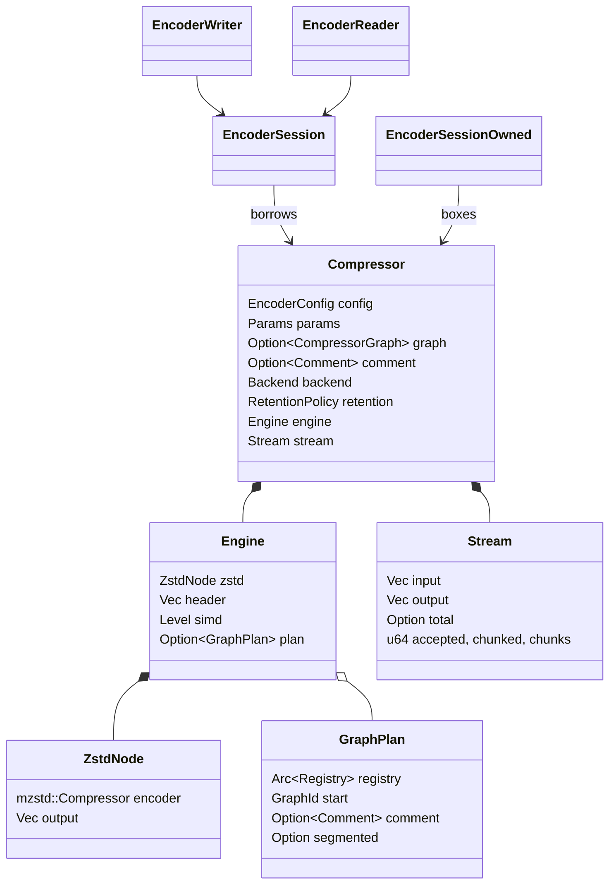
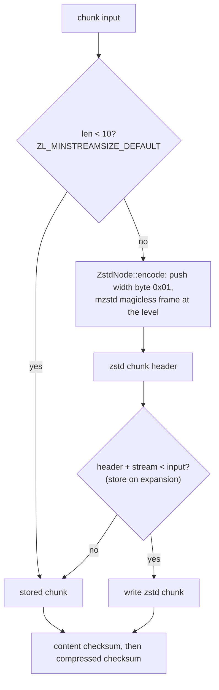
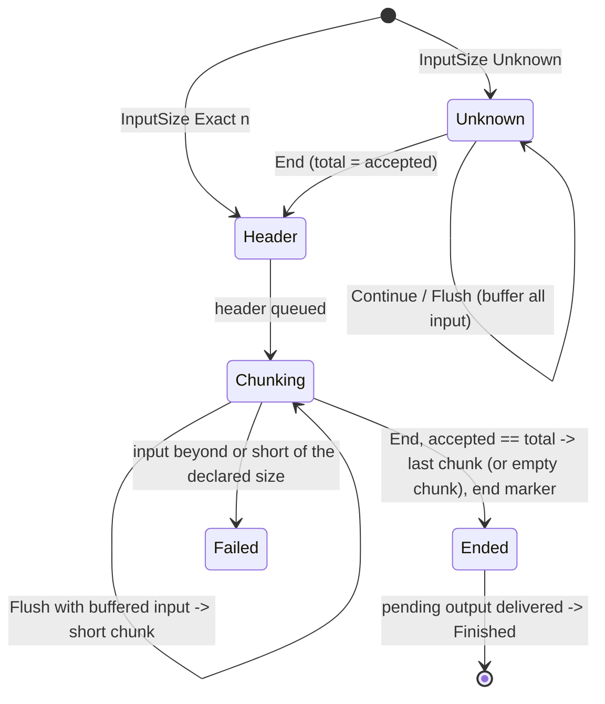

# Compressor

## Ownership

`compressor` owns the public API: `EncoderConfig` (level, format version,
chunking, both checksum switches), `Level`, `ChunkSize`, `Chunking`,
`Compressor`/`CompressorBuilder`, the sessions and `EncodeError`.
`compressor::core` owns everything that touches bytes. `Params` is the
resolved copy of the configuration the core reads.

## The default graph (specialized path)

`Compressor` has two execution paths. The specialized writer described here
serves plain serial input with default parameters, no graph and no comment (the
common case, and the one the benchmarks measure). Everything else goes through
the graph engine ([compression graphs](compressor-graphs.md)); both write the
same bytes for the default graph, which a differential test checks.

`ZL_CCtx_compress` without a compressor runs `ZL_GRAPH_SERIAL_COMPRESS`, a
selector that always picks `ZL_GRAPH_ZSTD` (the Zstandard node followed by
store). The engine reproduces the decisions around it per chunk:

`mzstd` writes `ZSTD_compress2`'s bytes in the magicless frame format
(`FrameFormat::Magicless`, the reference's `ZSTD_f_zstd1_magicless`) natively, so
the node pushes the element-width varint `0x01` and appends the frame with
`compress_into`; no magic is written and overwritten any more.

Frames are a header with the total size, chunks, and the end marker.
`Chunking::Whole` (default, as `ZL_compress`) makes the input one chunk;
`Chunking::Fixed(size)` cuts every `size` bytes as `SEGM_serial` does. Whole
inputs are still cut every 2 GiB because stored streams must stay below 4 GiB.
An empty input is one empty stored chunk.

## Sinks

`core::sink::Sink` abstracts the destination: `VecSink` appends to a caller's
`Vec` (`compress_into`, sessions' pending buffer), `SliceSink` fills a
caller's slice (`compress_to_slice`, failing with `Full`) and `UninitSink`
fills uninitialized memory (`compress_to_uninit`; see
[uninitialized output](uninit-output.md)). The compressed
checksum hashes back the chunk just written through `Sink::since`.
`compress` and `compress_inputs`, which return a new `Vec`, reserve
`Compressor::max_compressed_size` of the input bytes (content plus four bytes
per string length) before writing, as C sizes its destination with
`ZL_compressBound`: the frame is then written without reallocation, and pages
of the reservation the frame never reaches are never touched. The `_into`
variants append to the caller's `Vec` as it is.

## Sessions

`core::stream::Stream::process` drains pending output first, then advances at
most one chunk per loop iteration, so pending output holds at most a header and
one chunk. A chunk that lies whole in the caller's input is compressed in
place. Chunk boundaries depend only on the total size and flushes, so a session
writes the one-shot frame for any split of input and output; `Flush` with an
unknown size has no effect because no byte can precede the header.

`EncoderSession` borrows the compressor, `EncoderSessionOwned` boxes it
(`reinit`, `into_compressor`). Finishing or failing resets the stream and
applies the retention policy. `io::EncoderWriter`/`EncoderReader` adapt
sessions to `Write`/`Read`; a writer whose sink fails after the session
accepted input reports the input as written and keeps the compressed bytes
pending.

## Errors

`CoreError` (`OutputFull`, `Internal`) and `StreamError` (`SizeMismatch`,
`Core`) stay private and map to `EncodeError` (`OutputTooSmall`,
`InputSizeMismatch`, `InvalidState`, `Bound`, `Internal`).

## SIMD

The backend is chosen once in `CompressorBuilder::build`; its level is stored
in `Engine` and passed to every `xxh3::hash32` call, and the matching
`mzstd::Backend` (same name) is handed to the Zstandard node.

## Known gaps

- `compress_to_slice` and `compress_to_uninit` stage the zstd stream in the
  node's buffer and copy it, as the reference does.
- Only the serial default-graph path is incremental in the specialized writer;
  other graphs buffer their input until `End`, except serial segmenters
  (see below).
- No parallel compression; no C ABI.
- Parameters the public configuration does not expose (zstd local parameters,
  dictionaries) are reachable only through `graph::GraphBuilder`.

## Graphs, typed inputs and comments

Beyond the default graph the compressor runs the graph engine described in
[compression graphs](compressor-graphs.md):

- `CompressorBuilder::with_graph(CompressorGraph)` selects the graphs;
  `Compressor::compress_inputs(&[Input])` (and `_into`) compresses typed and
  multiple inputs; `Compressor::set_comment(Option<Comment>)` writes a header
  comment (format 22 or newer; the comment stays until changed).
- `EncoderConfig` gains `decompression_level`, `min_stream_size`,
  `store_on_expansion` and `permissive` (`0` selects the default of the two
  numeric ones, as in the reference). The specialized path is used only when
  they equal the defaults, no graph or comment is set and the decompression
  level is not 1.
- `Compressor::sync_plan` runs before each operation and gives the engine a
  `GraphPlan`: the registry, the start graph (wrapped in `segment_serial` for
  `Chunking::Fixed`), the comment and, for a serial segmenter, the chunk size
  and successor, which keeps sessions incremental. Any other graph buffers its
  input until `End`.
- Errors: `EncodeError::Graph(GraphError)` carries failures of the graph engine
  (a codec whose feature is off, a graph that rejects its input, a malformed
  configuration, a segmenter placement error, dictionary errors);
  `CompressorBuilder` is no longer `Copy`.
- Dictionaries: a graph with a loaded bundle writes the bundle ID and the
  dictionary lane ([dictionaries](dictionaries.md)).
- The graphs available through `with_graph` are every standard graph, user
  `Selector`/`FunctionGraph`/`Segmenter` implementations, `brute_force`,
  `ml_selector`, `clustering`, `sddl` and `sddl2` ([standard graphs](standard-graphs.md)).

## Parallel serial inputs

The std-only `compressor::parallel` module schedules independent segments on
caller-selected executors and assembles one compatible OpenZL frame. Its byte
contract differs from this serial API; see [parallel compression](parallel-compression.md)
for ownership, dispatch, staging, source validation and the streaming lifecycle.

The private `Compressor::frame_header_into` resolves the current graph plan and
delegates header writing to `Engine::header` without executing the graph. The
parallel encoder uses it for exact chunk extraction and dictionary-aware assembly;
no low-level types or new methods are exposed by the serial public API.
