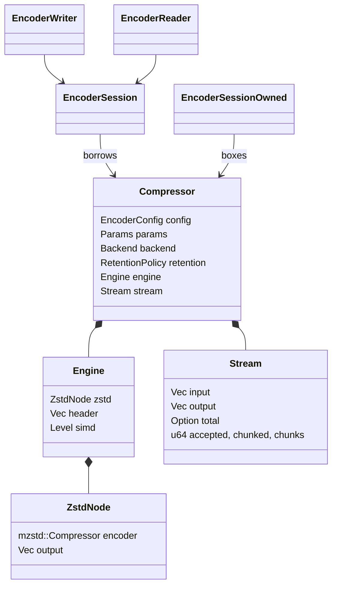
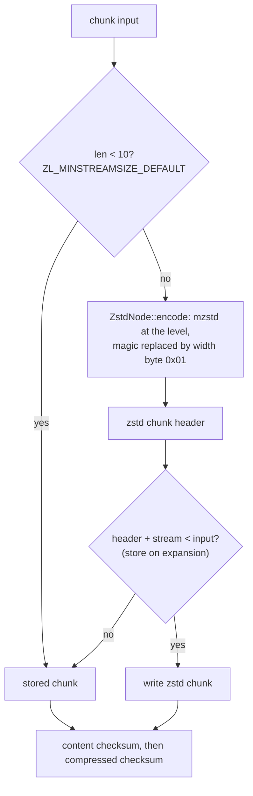

# Compressor

## Ownership



`compressor` owns the public API: `EncoderConfig` (level, format version,
chunking, both checksum switches), `Level`, `ChunkSize`, `Chunking`,
`Compressor`/`CompressorBuilder`, the sessions and `EncodeError`.
`compressor::core` owns everything that touches bytes. `Params` is the
resolved copy of the configuration the core reads.

## The default graph

`ZL_CCtx_compress` without a compressor runs `ZL_GRAPH_SERIAL_COMPRESS`, a
selector that always picks `ZL_GRAPH_ZSTD` (the Zstandard node followed by
store). The engine reproduces the decisions around it per chunk:



`mzstd` writes the bytes of `ZSTD_compress2` with the magic number; the
reference sets `ZSTD_f_zstd1_magicless`, which writes the same frame without
it, so the node overwrites the magic's last byte with the element-width varint
and stores the slice from there.

Frames are a header with the total size, chunks, and the end marker.
`Chunking::Whole` (default, as `ZL_compress`) makes the input one chunk;
`Chunking::Fixed(size)` cuts every `size` bytes as `SEGM_serial` does. Whole
inputs are still cut every 2 GiB because stored streams must stay below 4 GiB.
An empty input is one empty stored chunk.

## Sinks

`core::sink::Sink` abstracts the destination: `VecSink` appends to a caller's
`Vec` (`compress_into`, sessions' pending buffer), `SliceSink` fills a
caller's slice (`compress_to_slice`, failing with `Full`) and `UninitSink`
fills uninitialized memory (`compress_to_uninit`; see
[uninitialized output](uninit-output.md)). The compressed
checksum hashes back the chunk just written through `Sink::since`.

## Sessions

```mermaid
stateDiagram-v2
    [*] --> Unknown: InputSize::Unknown
    [*] --> Header: InputSize::Exact(n)
    Unknown --> Unknown: Continue / Flush (buffer all input)
    Unknown --> Header: End (total = accepted)
    Header --> Chunking: header queued
    Chunking --> Chunking: chunk_limit bytes buffered (or whole chunk in caller input) -> chunk
    Chunking --> Chunking: Flush with buffered input -> short chunk
    Chunking --> Ended: End, accepted == total -> last chunk (or empty chunk), end marker
    Chunking --> Failed: input beyond or short of the declared size
    Ended --> [*]: pending output delivered -> Finished
```

`core::stream::Stream::process` drains pending output first, then advances at
most one chunk per loop iteration, so pending output holds at most a header and
one chunk. A chunk that lies whole in the caller's input is compressed in
place. Chunk boundaries depend only on the total size and flushes, so a session
writes the one-shot frame for any split of input and output; `Flush` with an
unknown size has no effect because no byte can precede the header.

`EncoderSession` borrows the compressor, `EncoderSessionOwned` boxes it
(`reinit`, `into_compressor`). Finishing or failing resets the stream and
applies the retention policy. `io::EncoderWriter`/`EncoderReader` adapt
sessions to `Write`/`Read`; a writer whose sink fails after the session
accepted input reports the input as written and keeps the compressed bytes
pending.

## Errors

`CoreError` (`OutputFull`, `Internal`) and `StreamError` (`SizeMismatch`,
`Core`) stay private and map to `EncodeError` (`OutputTooSmall`,
`InputSizeMismatch`, `InvalidState`, `Bound`, `Internal`).

## SIMD

The backend is chosen once in `CompressorBuilder::build`; its level is stored
in `Engine` and passed to every `xxh3::hash32` call, and the matching
`mzstd::Backend` (same name) is handed to the Zstandard node.

## Known gaps

- Only the default graph; no custom graphs, other codecs, typed or multiple
  inputs, header comments or dictionaries.
- `compress_to_slice` and `compress_to_uninit` stage the zstd stream in the
  node's buffer and copy it, as the reference does.
