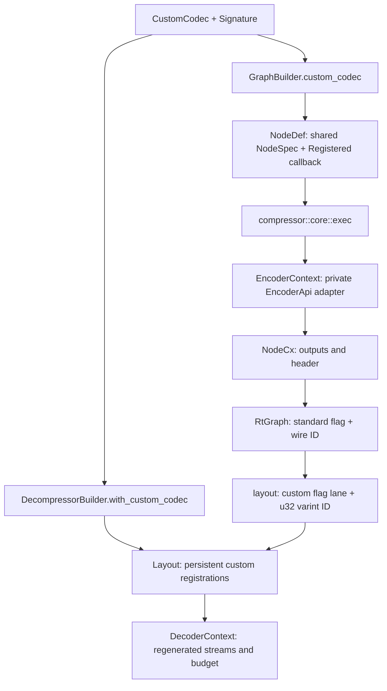
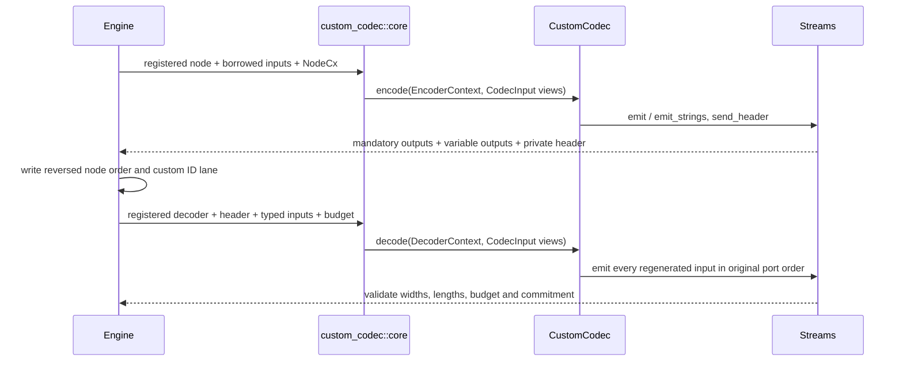
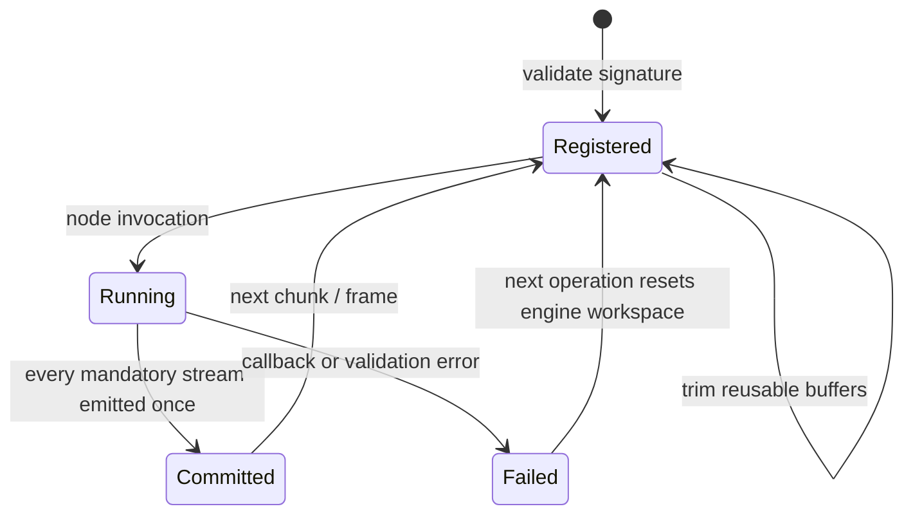

# Custom codecs

The `custom-codec` feature, included in `all-codecs` and the defaults, exposes
`custom_codec`. Applications implement `CustomCodec::signature`, plus `encode`
and/or `decode` according to enabled directions. `Signature` borrows static
type slices; registration validates and freezes it. `CodecInput` borrows
typed content, widths and string lengths without exposing engine types.
Callbacks are `Send + Sync + 'static`, owned through `Arc`, and may be shared
by cloned graphs or decoder builders. Per-call contexts borrow engine state.

## Registration and identity

`GraphBuilder::custom_codec(id, codec)` returns an ordinary builder-owned
`NodeId`. It works with static graphs, pipelines, function graphs and node
parameterization. A custom node owns its spec; standard specs remain borrowed
static entries. Parameterized nodes clone the shared spec and callback while
replacing parameters. Multiple encoder nodes may use the same wire ID and
signature with different configuration; conflicting signatures are rejected.
Decoder registration rejects duplicate custom IDs. All `u32` IDs, including
zero, are supported independently of the standard codec namespace.

The decoder resolves custom IDs before laying out any stream; an unregistered
ID or a build without the feature returns `Unsupported::CustomCodec`. Custom
descriptors are copied into the per-chunk layout. Registration remains in the
layout when reusable buffers are released, so `ReleaseAll` drops workspaces
without dropping callbacks. `retained_bytes` counts workspaces rather than
persistent configuration, as it does for dictionary stores.

## Ports, headers and execution

The encoder requires at least one declared input port. The final port may
repeat zero or more times. Singleton output outcomes must each be created
once; variable outcomes may be emitted repeatedly, in creation order. Variable
outcomes have distinct types because the decoder records only their type mask.
The existing engine bounds input/output counts and validates each input type.

`EncoderContext` exposes compression level, format version, local integer and
byte parameters, fixed/string output creation and a single private header of
at most 1 MB. Fixed outputs reject zero/invalid widths and incomplete elements;
strings require lengths summing to their content. It delegates output placement
to `NodeCx`, preserving singleton order and variable creation order.

`DecoderContext` exposes the private header, regenerated stream count and the
engine's per-stream byte budget (including four bytes per string length).
Its emit methods enforce type, width, budget and exactly one commit per stream.
Callbacks should check the budget before allocating their own workspace;
the library cannot bound allocations made inside application code. The engine
validates regenerated streams again after the callback, then applies the usual
frame size and checksum checks. Custom ID 22 bypasses the standard Zstandard
direct-output optimization even when `zstd` is enabled.

## State, dispatch and errors

Application dispatch occurs once per node, outside application inner loops.
No SIMD type crosses the public callback boundary; the application chooses its
own kernels. Existing standard codecs retain the compressor/decompressor's
selected backend. No new SIMD or uninitialized-memory kernel is introduced.

`CodecError` is the public, non-exhaustive registration/callback error. Encoder
callback and context failures retain it through private `NodeError::Custom`
and public `GraphError::CustomCodec`; decoder failures retain it as the source
of `DecodeError::CustomCodec { id, source }`. I/O adapters classify custom
decoder errors as `InvalidData`. Other engine failures retain their existing
high-level error mapping. Permissive fallback, minimum-stream-size handling and
store-on-expansion apply to custom nodes just as to standard ones.

## Verification and known gaps

`tests/custom_codec.rs` compares a serial XOR codec and its one-byte private
header with the independently implemented C codec in
`openzl-ffi/shim/custom_codec.c`: versions 21–27, IDs 0/22/127/128/1000/u32::MAX,
empty and small inputs, byte identity and decoding both ways. Rust tests cover
typed regeneration, variable ports, parameterization, fragmented sessions,
registration lifetime, duplicate IDs and invalid callback output. The AFL and
libFuzzer `custom_codec` adapters share a bounded byte-identity/round-trip target.

Custom dictionary materializers, callback access to reference parameters and
stream metadata, and borrowed/zero-copy custom outputs are not implemented.
Only built-in Zstandard dictionaries materialize. Custom codecs are not
serialized as executable code: the receiving application must register them.
