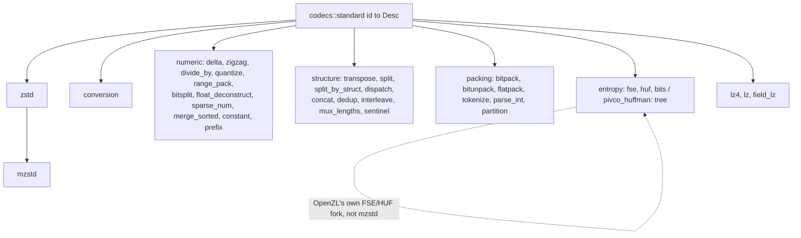
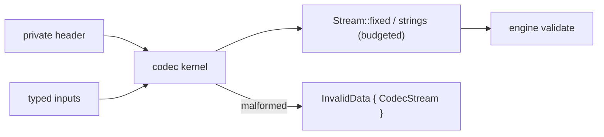

# Decoder codecs

Every standard codec valid at format versions 21–27 has a decoder in
`decompressor::core::codecs`, one module per Cargo feature. This page lists
their signatures, formats and invariants. [The decompressor](decompressor.md)
describes the engine that runs them, and [codec features](codec-features.md)
the gating.

## Module map

Each codec is a function `fn(&mut Ctx, &[Input], &mut [Stream])`. `Ctx`
carries the codec's private header, the reusable `State` (only zstd keeps any)
and the codec's materialized dictionary (`Ctx::dict`, set from the chunk's
dictionary lane; only the zstd codec reads it, see
[dictionaries](dictionaries.md)). No codec keeps state across chunks; none needs the format version,
since every version-dependent branch predates v21.

## Signatures

Reading the table:
- **Regenerates**: the streams the decoder rebuilds, i.e. the encoder's inputs. A trailing `…` means the codec rebuilds a variable number of them (`lastInputIsVariable`).
- **Inputs**: listed in reference order. Input `i` is stream `end - 1 - i`. `VO T` means a variable number of `T` inputs.

| ID | Codec | Feature | Since | Regenerates | Inputs |
| --- | --- | --- | --- | --- | --- |
| 1 | delta_int | `delta` | 3 | Numeric | Numeric |
| 2 | transpose | `transpose` | 3 | Struct | Struct |
| 3 | zigzag | `zigzag` | 3 | Numeric | Numeric |
| 4 | transpose_split | `transpose` | 11 | Struct | VO Serial |
| 5–14 | conversions | `conversion` | 3/10/21 | see `conversion.rs` | |
| 18 | sentinel | `sentinel` | 24 | Numeric | Numeric values, Numeric exceptions |
| 19 | lz | `lz` | 24 | Serial | Serial literals, Numeric offsets, literal lengths, match lengths |
| 22 | zstd | `zstd` | 3 | Serial | Serial |
| 24 | field_lz | `field-lz` | 3 | Struct | Struct literals, Struct tokens (w2), Numeric offsets, extra literal and match lengths (w4) |
| 25, 26 | quantize_offsets / lengths | `quantize` | 3 | Numeric (u32) | Numeric codes (w1), Serial extra bits |
| 27 | bitpack_serial | `bitpack` | 3 | Serial | Serial |
| 28 | bitpack_int | `bitpack` | 3 | Numeric | Serial |
| 29 | flatpack | `flatpack` | 3 | Serial | Serial alphabet, Serial packed |
| 30–32 | transpose_split2/4/8 | `transpose` | 3 | Struct | 2/4/8 Serial |
| 33 | float_deconstruct | `float-deconstruct` | 4 | Numeric | Struct sign+fraction, Serial exponent |
| 34 | bitunpack | `bitunpack` | 6 | Serial | Numeric |
| 35 | range_pack | `range-pack` | 8 | Numeric | Numeric |
| 36 | tokenize_fixed | `tokenize` | 8 | Struct | Struct alphabet, Numeric indices |
| 37 | tokenize_numeric | `tokenize` | 8 | Numeric | Numeric alphabet, Numeric indices |
| 38 | tokenize_string | `tokenize` | 11 | String | String alphabet, Numeric indices |
| 40, 47, 48 | splitn / _struct / _num | `split` | 9/14/14 | Serial / Struct / Numeric | VO of the same type |
| 41 | splitByStruct | `split-by-struct` | 9 | Serial | VO Struct |
| 42 | dispatchN_byTag | `dispatch` | 9 | Serial | Numeric tags, Numeric sizes, VO Serial |
| 43 | merge_sorted | `merge-sorted` | 9 | Numeric | Numeric bitsets, Numeric merged |
| 44, 45 | constant_serial / fixed | `constant` | 11 | Serial / Struct | one element |
| 46 | prefix | `prefix` | 11 | String | String suffixes, Numeric match sizes (u32) |
| 49 | fse_v2 | `entropy` | 15 | Serial | Numeric counts (w2), Serial bits |
| 50 | huffman_v2 | `entropy` | 15 | Serial | Numeric weights (w1), Serial bits |
| 51 | huffman_struct_v2 | `entropy` | 15 | Struct (w2) | Numeric weights (w1), Serial bits |
| 52 | fse_ncount | `entropy` | 15 | Numeric (w2) | Serial |
| 53 | divide_by | `divide-by` | 16 | Numeric | Numeric |
| 54 | dispatch_string | `dispatch` | 16 | String | Numeric indices, VO String |
| 55, 57–59 | concat_serial / num / struct / string | `concat` | 16–18 | T … | Numeric sizes (w4), T |
| 56 | dedup_num | `dedup` | 16 | Numeric … | Numeric |
| 60 | parse_int | `parse-int` | 19 | String | Numeric (w8) |
| 61 | interleave_string | `interleave` | 20 | String … | String |
| 62 | lz4 | `lz4` | 23 | Serial | Serial |
| 63 | bitSplit | `bitsplit` | 24 | Numeric | VO Numeric |
| 64 | partition | `partition` | 24 | Numeric | Numeric bucket IDs (w1), Serial offset bits |
| 65 | mux_lengths | `mux-lengths` | 24 | Numeric, Numeric | Serial muxed, Numeric long lengths |
| 66 | sparse_num | `sparse-num` | 26 | Numeric | Numeric, Numeric |
| 67 | pivco_huffman | `pivco-huffman` | 27 | Serial | Numeric weights (w1), Serial bits |

Legacy codecs whose newest format is below 21 are not registered and decode as `Unsupported`:
- rolz (20) and fastlz (21);
- zstd_fixed (23);
- the deprecated FSE and Huffman codecs (15–17).

Transpose 2 and 30–32 still decode, as in the reference, even though no v21+ encoder writes them.

## Formats and invariants

### Numeric

**delta_int**
- The header is the first element.
- An empty header means zero elements, and then the delta stream must also be empty.
- Sums wrap at the element width.

**zigzag**
- Each value is decoded as `(z >> 1) ^ -(z & 1)`, truncated to the element width.

**divide_by**
- The header is a varint divisor, which must be non-zero and must fit the element width.
- Each quotient must satisfy `quotient ≤ MAX / divisor`.

**quantize**
- Codes are 1 byte wide and must be below 32 (offsets) or 44 (lengths).
- Extra bits are read least significant bit first.
- Offsets: base `1 << c`, with `c` extra bits.
- Lengths: below code 16 the value is the code itself; from 16 on it is base `1 << (c - 12)` with `c - 12` extra bits.
- The output is u32.

**range_pack**
- The header is the destination width, optionally followed by a little-endian minimum.
- Each value is zero-extended, then the minimum is added with wrapping.

**bitSplit**
- The header is the output width followed by the field widths.
- `n` stored widths with `n` input streams means partial coverage; with `n + 1` streams it means full coverage.
- Each stream uses the smallest of 1, 2, 4 or 8 bytes that fits its field.
- Values are joined in 512-element blocks.

**float_deconstruct**
- The header is one byte: 0 for float32 (3-byte sign + fraction), 1 for bfloat16, 2 for float16.
- Both inputs must have the same length.

**sparse_num**
- Distances are 1, 2 or 4 bytes wide.
- There are as many distances as values, or one more for a trailing run.
- The header holds the dominant symbol.

**merge_sorted**
- The header is one varint per list, up to 64 lists.
- Each list must end exactly full.

**constant**
- The input is a single element.
- The header is a varint repeat count, at least 1, that fills the header exactly.

**prefix**
- A match length cannot exceed the previous string's length, so the first one is 0.

### Structure

**transpose (2)**
- The input is `w` columns of `n` bytes.
- The output is `n` records of width `w`.

**transpose_split**
- All columns must have equal length.
- The output width is the number of columns; zero columns is corrupt.

**splitn family**
- All inputs share one width.
- With zero inputs the width comes from the header: an empty header means 1, otherwise a varint.

**splitByStruct**
- There is at least one field, and all fields have the same element count.

**dispatchN_byTag**
- Tags and sizes have the same length, and tags are at most 2 bytes wide.
- Every tag must be below the stream count.
- The segment sizes for each stream must sum exactly to that stream's length.

**dispatch_string**
- Indices are 16-bit, with at most 2048 streams.
- For each `i`, the count of index `i` must equal the number of strings in stream `i`.

**concat**
- The sizes have width 4, there is at least one, and there is one per regenerated stream.
- The sizes must sum to the element count.

**dedup**
- Every regenerated stream is a copy of the input.

**interleave**
- The header is 4 bytes, little-endian: `n`, with 1 ≤ `n` ≤ 512.
- `n` is also the regenerated stream count.
- Stream `j` takes strings `j`, `j + n`, and so on.

**mux_lengths**
- The header byte holds `split = h & 15` (at most 8) and `bias = h >> 4`.
- Literal overflow is consumed before match overflow.
- Every long length must be consumed.

**sentinel**
- The sentinel is either all ones or a varint header.
- Each hit consumes one exception, and every exception must be used.

**Input count**
- A codec reads at most 100 000 streams (`ZL_transformOutStreamsLimit`).

### Packing

**bitpack**
- The header is `[log2(w) << 6 | (nbBits - 1)]`, optionally followed by an extra-elements byte.
- `count = floor(8 * len / nbBits) - extra`.
- Fields are packed least significant bit first.

**bitunpack**
- The header is `[nbBits]` or `[nbBits, remBits]`.

**flatpack**
- Indices take `ceil(log2(alphabet))` bits, or 1 bit for a one-symbol alphabet.
- A sentinel `1` bit ends the stream.
- The alphabet has at most 256 symbols.

**tokenize**
- Fixed-width tokens: an out-of-range index decodes as entry 0, as in the reference.
- Strings: indices are validated, and there must be at least as many indices as alphabet entries.

**parse_int**
- Values are printed as canonical decimal.

**partition** header flags:
- bits 0–1: log2 of the output width;
- bit 2: preset, with `id = flags >> 3` (0 quantize offsets, 1 quantize lengths, 2 varbyte16);
- bit 3: the range starts at zero;
- bit 5: power-of-two sizes, with `numBits = (flags >> 6) + 3`; without it, sizes are varints.

**partition** decoding:
- There are 1 to 256 partitions.
- Each value is `base + offset`, truncated to the output width.

### Entropy

All entropy codecs use OpenZL's own FSE and Huffman fork; nothing is shared with mzstd. `bits::Reverse` replaces `BIT_DStream_t`.

**FSE**
- The header is `[states 2|4]` followed by the size, little-endian, in 1 to 8 bytes.
- There are 2 to 256 counts, which sum to a power of two with log between 5 and 12.
- Decoding:
  1. initialise every state;
  2. decode round-robin across the states;
  3. tail: keep emitting while a state needs no bits;
  4. flush the remaining `states - 1` symbols.
- The decoded size must match exactly.

**fse_ncount**
- A 4-bit `log - 5`, then variable-width counts, with 2-bit zero-repeat codes.
- It must consume the whole stream.

**Huffman v2**
- The header is `[x4 flag][size]`.
- There are 2 to 256 weights, each at most 12, with table log at most 12.
- With `x4`: a jump table of three u16 values, then four streams.

**Huffman struct**
- Up to 65 536 weights, with table log at most 20.
- The stream is one or four blocks of `[count u32][size u32][payload]`.

**pivco**
- The header is the decoded size as a varint, plus an optional block size: 0 is invalid, and so is anything above 2^28.
- The tree is built from the weights.
- The bitstream is read forward, least significant bit first, and must be consumed exactly.

### LZ

**lz4**
- The header is the decoded size as a varint, at most `INT_MAX`.
- The block is decoded by a safe port of `LZ4_decompress_safe` (lz4 1.10.0). It enforces the same end-of-block rules and is differentially tested on mutated blocks.

**lz**
- The header is the varint size.
- The sequence count is the length of the offset stream, and all three numeric streams must be that length.
- Matches may overlap their own output.

**field_lz**
- The header is the capacity, in fields.
- Each token is 16 bits: bits 0–1 are the offset code, 2–5 the literal-length code, 6–9 the match-length code.
- Offset code 3 is an explicit offset, which is pushed onto the repeat stack. Codes 0–2 pick a repeat offset and move it to the front.
- The repeat offsets start as 1, 2 and 4.
- A length code of 15 adds an extra length.
- Every side stream must be consumed.

## Deviations from the reference

All of these concern malformed frames only:
- **Offset 0** (lz4, lz, field_lz): rejected here. The reference copies memory it has not written yet.
- **partition**: a bucket ID at or above the partition count is rejected. The reference reads out of bounds.
- **flatpack**: an out-of-range index is rejected. The reference's SIMD path does not check it.
- **huffman_struct_v2**: over-reads are rejected.
- **quantize**: reading past the end of the extra-bits stream is rejected. The reference reads up to 56 zero-padded bits there.
- **bitunpack**: a value wider than `nbBits` is masked to the field width; the reference's pack kernel requires that it fits.
- **Entropy**: only the X1 Huffman decoders and the generic FSE symbol spread are ported (the reference's X2, assembly and AVX2 paths decode the same output); struct Huffman over-reads are rejected where the reference reads garbage; the PivCo merge is generic and bounded.
- **Overflow**: arithmetic the reference lets wrap silently on corrupt sizes is reported as an error.

## Known gaps

- The kernels are scalar. The reference's SSE, AVX2, NEON and BMI2 decoder variants are not ported. Decoding follows the reference's portable algorithms.
- The partition+bitpack decoder fusion is not ported. It is an optimization only.
- Huffman tables are built for every call. A struct table at log 20 takes 4 MiB.
- Copies are made where the reference passes streams by reference.
- Only Zstandard consumes a dictionary; the other codecs ignore `Ctx::dict`.
- The encoder-side counterpart is [encoder codecs](encoder-codecs.md).
