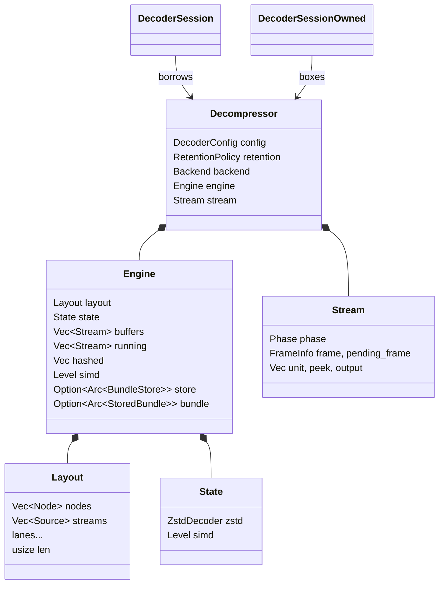
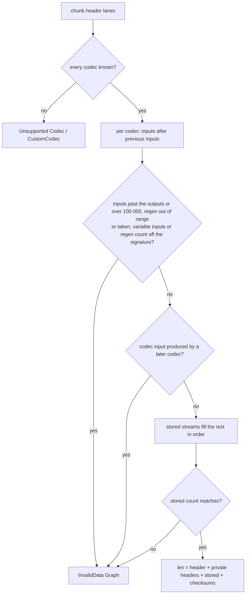
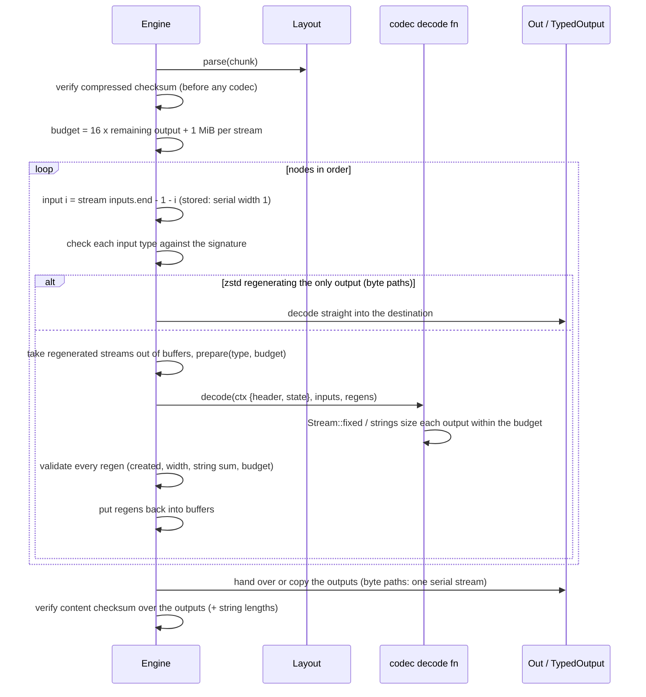
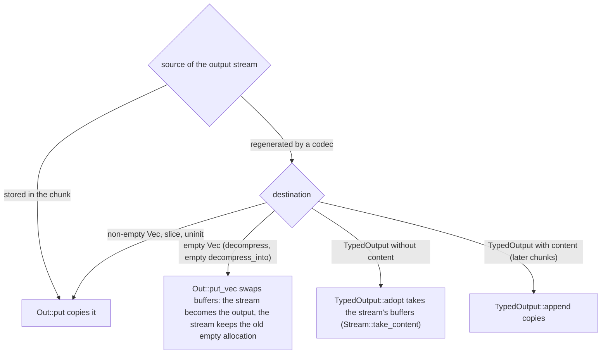
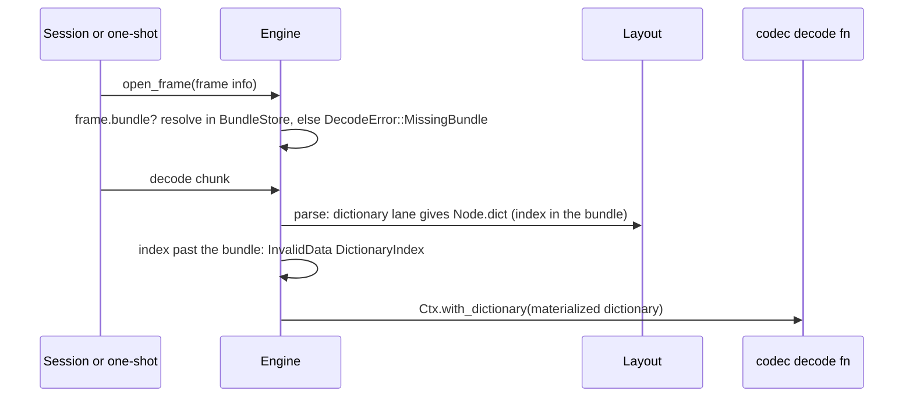
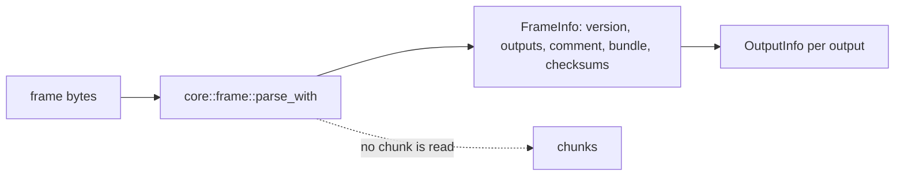
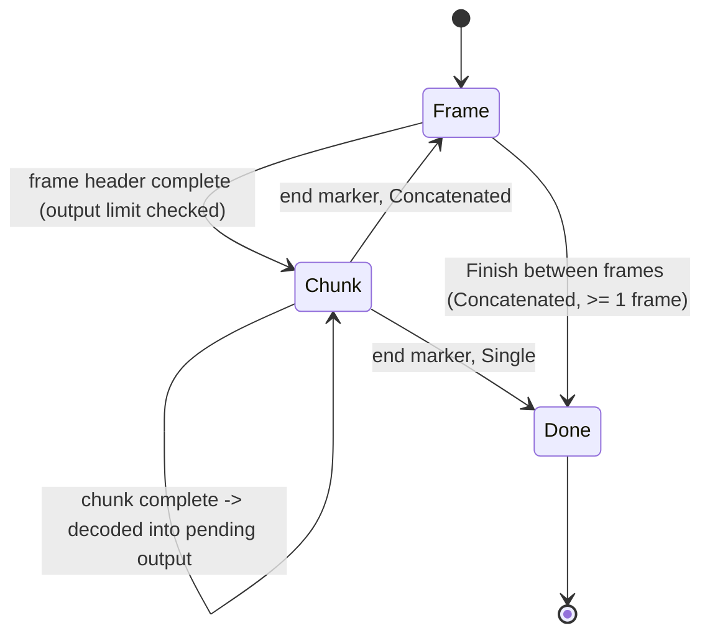

# Decompressor

## Ownership

`DecompressorBuilder::with_dictionaries(store)` gives the engine the
[`BundleStore`](dictionaries.md) frames may name. `DecoderConfig` selects `FrameMode` (`Single`, the default, rejects trailing
bytes like `ZL_decompress`; `Concatenated`), `DecodeLimits` (input and output
caps) and both checksum checks (on by default, as the reference).

## Parsing

`core::reader::Reader` returns `Parse::Truncated` when bytes run out and
`Parse::Failed` for invalid or unsupported data, so the same parsers serve
one-shot calls (truncation is `UnexpectedEndOfInput`) and sessions (truncation
means "wait"). `frame::parse_with` validates the magic, flags, output count
and types (`DFH_decoderOutputTypes`), known sizes, string counts, comment and
check byte, reporting each output's `OutputSpec`; `frame::parse` wraps it for
the byte-oriented paths and rejects frames that are not one serial output
(`Unsupported::MultipleOutputs` / `TypedOutput`). `Layout::parse` reads a
chunk header's lanes, maps each standard ID or registered custom ID to its codec descriptor
(`codecs::standard`; a disabled feature or unknown ID is `Unsupported`, a
codec newer than the frame's version is a header error), then wires streams
as `fillStoredStreams` and `DCTX_validateNodeStatic` do and computes the
chunk's length. Each node owns `inputs` (a stream range) and `regens` (a
range of `Layout::regenerated`, one stream per regenerated input); the last
`outputs` streams of the chunk are its outputs and may not feed a codec:

## Chunk execution

Codecs are described by `codecs::Desc`: the types of the streams they
regenerate (`regens`, the last repeating when `variable_regens`), of their
fixed inputs and the type mask of variable inputs, the first format version
that has them, and a `decode` function. Each codec family lives in
`codecs/<feature>.rs` (or a directory) behind its feature; the
[codec catalogue](decoder-codecs.md) lists them all.

How the last stream reaches the destination:

`data::Stream` mirrors `ZL_Data` for regenerated streams: a type, an element
width (`STREAM_validateTypeWidth`: serial and string 1, numeric 1/2/4/8,
struct any non-zero), the content, string lengths for strings, and the
budget. Numeric content is little-endian on every host. Codecs read
`data::Input` views and may only create outputs through `Stream::fixed` and
`Stream::strings`, which reserve within the budget, so no frame can make the
decoder allocate beyond 16 times its declared output plus slack per stream.
`Stream::fixed`, `Stream::strings`, `Stream::copy_of` and `Input::len` are
compiled only with the codec features that call them (a `#[cfg(any(..))]`
list each, plus `test`), not kept under `expect(dead_code)`: Rust 1.89 treats
an expected-dead function as used and its callees as live. Codecs report malformed data as `InvalidData { CodecStream }` and never
panic; differential tests check that they accept what the reference accepts
on damaged frames, apart from the documented cases where the reference reads
uninitialized memory.

`Decompressor::decompress_typed` returns one `TypedOutput` per frame output
(`ZL_DCtx_decompressMultiTBuffer`): `Engine::decode_typed` decodes a single
frame, appends each chunk's output streams (output `n` is stream
`total - 1 - n`) after checking their type, width and declared size and
string count, and checks the content checksum over every output's content
followed by its string lengths (`STREAM_hashLastCommit_xxh3low32`). A
regenerated output stream is moved into an output that has no content yet
(`TypedOutput::adopt`, with `append`'s width rules) rather than copied; the
engine's buffer for that stream is reallocated by the next chunk. With a single
output and no string lengths the checksum is computed over the output in place;
otherwise the hashed bytes are staged in `Engine::hashed`.

On the byte paths the last regenerated stream is not read again after the
chunk's codecs run, so `Out::put_vec` lets a `Vec` destination that is still
empty take the buffer by swapping it with its own (empty) allocation instead of
copying. Destinations that already hold bytes, slices and `MaybeUninit`
buffers copy through `Out::put`.

The zstd fast path decodes the magicless frame where it lies: `mzstd` reads
`FrameFormat::Magicless` natively, the content size is read first with
`FrameHeaderInfo::parse` (its absence is invalid, as in `DI_zstd`), and the
decoder writes straight into the sized destination; no staging buffer holds a
`magic + frame` copy any more. A node carrying a dictionary index decodes with
`decompress_with_dictionary` (slice, uninit and Vec destinations all take the
dictionary).

## Dictionaries

Only Zstandard dictionaries are materialized. The bundle ID is read from the
frame header (`FrameInfo::bundle`, length byte plus ID with trailing zeros
trimmed); a frame without one skips the lane.

## Frame metadata

`Decompressor::frame_info` and `TryFrom<&[u8]> for FrameInfo`
(`decompressor::info`) read a frame header without decoding any chunk, as
the reference's `ZL_FrameInfo_*` getters do: the format version, every
output's `OutputInfo` (type, content size, string count for strings and
`None` for struct and numeric outputs), the checksum flags, the header
comment and the dictionary bundle ID. The public type wraps the parser's
`core::frame::FrameInfo`, which keeps the comment's bytes for it.
`tests/frame_info.rs` compares every accessor with the C getters through
`openzl-ffi`'s `frame_info` shim.

## Sessions

A unit (frame header, chunk or end marker) is decoded once all its bytes are
present: in place when it lies whole in the caller's input, otherwise from the
`unit` buffer. Its length comes from its header alone. A header split across
calls is measured over the buffered prefix plus a window of new input that
doubles from 64 bytes, so the session never accepts bytes past the unit it
builds (trailing data after a `Single` frame stays with the caller) and
measuring stays linear in the header's length. The frame header found while
measuring is kept, not parsed again.

`DecoderSession`/`DecoderSessionOwned` add a sticky failure flag
(`InvalidState` afterwards), counters (`total_in`, `total_out`,
`frames_decoded`) and retention on completion. `io::DecoderReader` and
`io::DecoderWriter` wrap sessions with an 8 KiB buffer each.

## Errors

`DecodeError`: `InvalidData { kind }` (`Magic`, `FrameHeader`,
`HeaderChecksum`, `ChunkHeader`, `Graph`, `CodecStream`, `DictionaryIndex`), `Unsupported
{ feature }` (`FormatVersion`, `Codec`, `CustomCodec`, `UnknownSize`,
`MultipleOutputs`, `TypedOutput`: the last two only from the byte-oriented
APIs), `MissingBundle { bundle }` (the frame names a dictionary bundle the
store lacks), `UnexpectedEndOfInput`,
`TrailingData`, `OutputTooSmall`, both checksum mismatches,
`ContentSizeMismatch`, both limits and `InvalidState`. It converts to
`std::io::Error` with matching kinds.

## Known gaps

- Only Zstandard dictionaries are materialized; custom dictionary materializers
  are not implemented. See [custom codecs](custom-codecs.md) for callback registration.
- Sessions and the byte APIs read frames with one serial output only;
  typed and multi-output frames go through one-shot `decompress_typed`.
- The partition+bitpack decoder fusion is not ported; see each codec's
  specification for which kernels are vectorized.
- Regenerated streams are copied where the reference references their
  inputs (conversions, dedup, concat).
- Session output is decoded into the pending buffer and copied out; one-shot
  calls decode in place (see [uninitialized output](uninit-output.md)).
- Slice and uninit destinations decode Zstandard through
  `mzstd::decompress_to_slice`, which trails the C library by about 15% on
  records-like data, while `Vec` destinations (`mzstd::decompress_into`) are
  ahead of it (see [the comparison](benchmark-comparison.md)).

Registered application codecs use the same chunk layout, regenerated-stream
budgets and checksum validation. `DataType` also serves as the private stream
type, avoiding conversion at the callback boundary; its wire helpers remain
private. See [custom codecs](custom-codecs.md).
