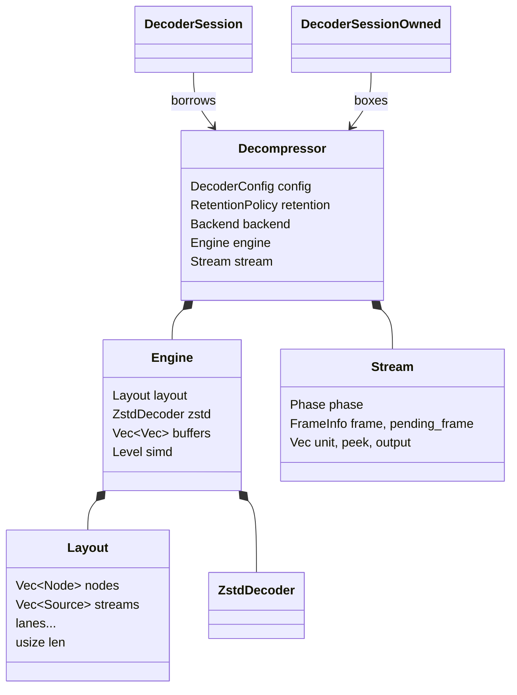
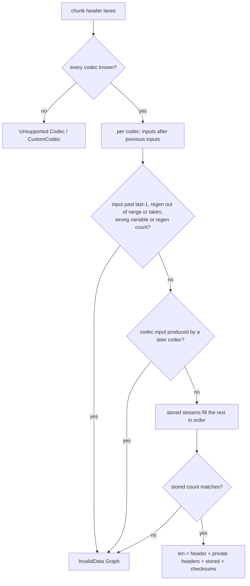
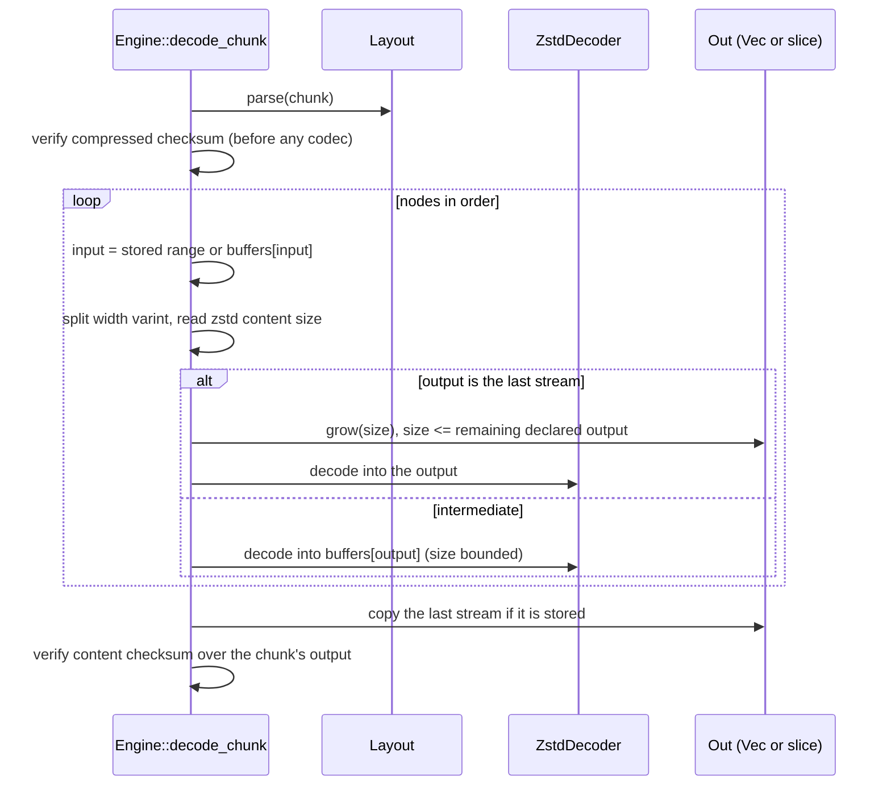
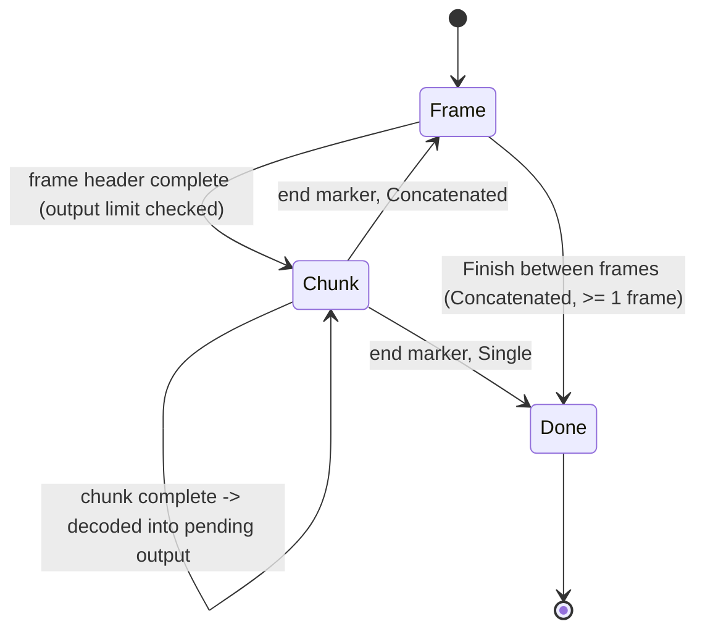

# Decompressor

## Ownership

`DecoderConfig` selects `FrameMode` (`Single`, the default, rejects trailing
bytes like `ZL_decompress`; `Concatenated`), `DecodeLimits` (input and output
caps) and both checksum checks (on by default, as the reference).

## Parsing

`core::reader::Reader` returns `Parse::Truncated` when bytes run out and
`Parse::Failed` for invalid or unsupported data, so the same parsers serve
one-shot calls (truncation is `UnexpectedEndOfInput`) and sessions (truncation
means "wait"). `frame::parse` validates the magic, flags, single serial
output, known size, comment and check byte. `Layout::parse` reads a chunk
header's lanes, rejects unknown codecs before laying out anything, then wires
streams as `fillStoredStreams` does and computes the chunk's length:

## Chunk execution

The zstd decoder stages `magic + frame` and decodes straight into the sized
destination with `mzstd` in single-frame mode; the content size is read from
the magicless header first, and its absence is invalid, as in `DI_zstd`.
Intermediate streams may exceed the remaining output only by 1/128 plus
64 KiB, which a Zstandard chain never needs.

## Sessions

A unit (frame header, chunk or end marker) is decoded once all its bytes are
present: in place when it lies whole in the caller's input, otherwise from the
`unit` buffer. Its length comes from its header alone. A header split across
calls is measured over the buffered prefix plus a window of new input that
doubles from 64 bytes, so the session never accepts bytes past the unit it
builds (trailing data after a `Single` frame stays with the caller) and
measuring stays linear in the header's length. The frame header found while
measuring is kept, not parsed again.

`DecoderSession`/`DecoderSessionOwned` add a sticky failure flag
(`InvalidState` afterwards), counters (`total_in`, `total_out`,
`frames_decoded`) and retention on completion. `io::DecoderReader` and
`io::DecoderWriter` wrap sessions with an 8 KiB buffer each.

## Errors

`DecodeError`: `InvalidData { kind }` (`Magic`, `FrameHeader`,
`HeaderChecksum`, `ChunkHeader`, `Graph`, `CodecStream`), `Unsupported
{ feature }` (`FormatVersion`, `Codec`, `CustomCodec`, `UnknownSize`,
`Dictionary`, `MultipleOutputs`, `TypedOutput`), `UnexpectedEndOfInput`,
`TrailingData`, `OutputTooSmall`, both checksum mismatches,
`ContentSizeMismatch`, both limits and `InvalidState`. It converts to
`std::io::Error` with matching kinds.

## Known gaps

- Only store and Zstandard chunks decode; see the module map's gaps.
- Session output is decoded into the pending buffer and copied out; one-shot
  calls decode in place (see [uninitialized output](uninit-output.md)).
- Slice and uninit destinations decode Zstandard through
  `mzstd::decompress_to_slice`, which trails the C library by about 15% on
  records-like data, while `Vec` destinations (`mzstd::decompress_into`) are
  ahead of it (see [the comparison](benchmark-comparison.md)).
