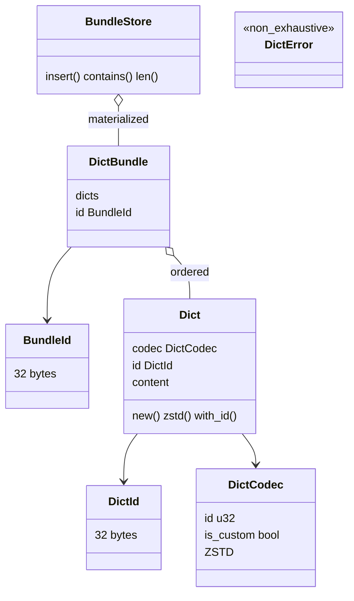
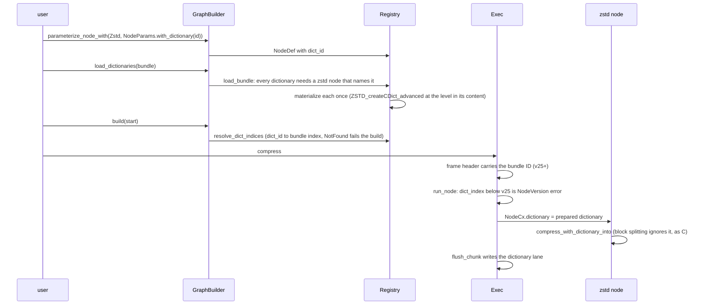
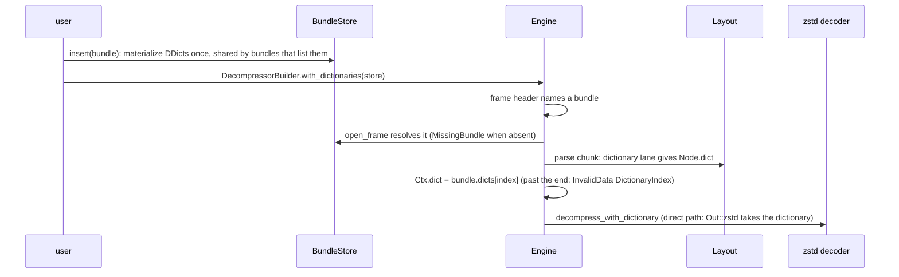

# Dictionaries

A *dictionary* is opaque side information for one codec, today a Zstandard
dictionary. Dictionaries travel in a *bundle*; a frame names the bundle it was
compressed with and each codec instance of a chunk names its dictionary by index
in the bundle. Supported from format version 25. The public surface is
`mopenzl::dict` (compression or decompression feature) plus the graph builder
methods; the wire formats live in `shared::dictwire` and `shared::sha256`.
Tests: `tests/encode_dict.rs` (byte identity with the reference for single and
chained nodes, several dictionaries per bundle, raw and trained dictionaries,
levels and versions) with the `openzl_ffi::enc_dict` oracle.

## Public types



- A dictionary ID defaults to the SHA-256 of its content; a bundle ID is the
  SHA-256 of the concatenated dictionary IDs, so the order of a bundle is part of
  its identity. `Dict::zstd(raw, level)` wraps raw content in the trained-content
  header (`LE32 1 | LE32 level | raw`).
- `DictBundle` converts to and from the *fat bundle* (`Vec::from(&bundle)`,
  `TryFrom<&[u8]>`), OpenZL's interchange format; bytes after the last dictionary
  are ignored, as in the reference.
- `DictError` (`#[non_exhaustive]`): malformed data, too many dictionaries (more
  than 65 535 per bundle), content over 4 GiB - 1, `ConflictingId` (two contents
  sharing an ID), `NoMaterializer` (only the standard Zstandard codec has one),
  `Materialization`, `StoreFull`.

## Wire formats

```text
dictionary   = LE32 0x4944CCDA | id (32) | LE32 codec | custom flag (1) | LE32 size | content
bundle info  = LE32 0x4942CCDA | bundle id (32) | fat flag (1) | LE32 count | ids (32 each)
fat bundle   = bundle info | dictionary * count
zstd content = LE32 1 | LE32 level | raw dictionary
```

In the frame ([frame format](frame-format.md)): flag bit 3 and, from v25, the
bundle ID as a length byte plus the ID with trailing zero bytes trimmed (an
all-zero ID is refused). In every chunk, the dictionary lane: a has-dictionary
bit per codec, then behind a width byte (`nextPow2(max + 1)`) the bit-packed
indices of the flagged codecs. The lane is written in **every** chunk of a frame
that has a bundle, including stored and empty chunks.

## Encoder flow



- `GraphBuilder::load_dictionaries` must come after the nodes are parameterized
  (the reference quirk: `CDictMgr_findMaterializer` needs a node that references
  the dictionary), loads one bundle per compressor and reports
  `GraphError::{Dictionary, BundleAlreadyLoaded, DictionaryNotFound}`.
- Only Zstandard nodes (codec 22) materialize; a dictionary no such node
  references cannot be loaded. Without the `zstd` feature nothing materializes.
- `DictState` (`registry::dict`) holds the bundle ID, the dictionary IDs in
  order and the prepared dictionaries (`Prepared::Zstd`).

## Decoder flow



- `BundleStore::insert` materializes at insertion (a Zstandard `DecodeDictionary`),
  shares a dictionary listed by several bundles, is a no-op for a bundle already
  held, caps at 128 bundles and 65 535 dictionaries, and leaves the store
  unchanged on error. `BundleStore: TryFrom<&DictBundle>`.
- `DecompressorBuilder::with_dictionaries(store)` takes `impl Into<Arc<BundleStore>>`
  (the builder is no longer `Copy`). Errors: `DecodeError::MissingBundle { bundle }`
  and `InvalidDataKind::DictionaryIndex`; `Unsupported::Dictionary` no longer
  exists.

## Known gaps

- Only Zstandard dictionaries are materialized (encoder and decoder); other
  codecs, custom codecs and custom materializers are `NoMaterializer`.
- No dictionary training; trained dictionaries come from the reference's tools.
- The multi-chunk (segmented) dictionary path is covered by round-trip tests
  only, not by byte-identity tests against the reference.
- The block-splitting zstd route ignores the dictionary (as the reference).
