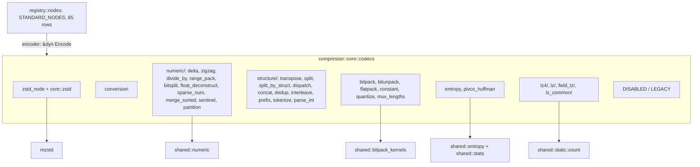
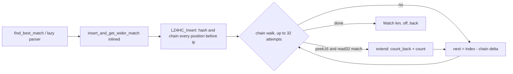

# Encoder codecs

Every standard node of OpenZL v0.3.0 has an encoder in
`compressor::core::codecs`, behind the Cargo feature of its codec. This page is
the encoder-side counterpart of the [decoder catalogue](decoder-codecs.md): it
maps registry node IDs to wire codec IDs, lists their ports, and records the
mechanics and deviations of each family. The engine that runs them is described
in [compression graphs](compressor-graphs.md); the graphs that wire them
together in [standard graphs](standard-graphs.md).

## Module map

Each encoder is a `FnEncoder` static wrapping
`fn(&mut NodeCx, &[Stream]) -> Result<(), NodeError>`. A registry row selects
`if cfg!(feature = "x") { &codecs::x::ENCODER } else { &codecs::DISABLED }`;
families with several features (`numeric`, `structure`) alias the single nodes
to `DISABLED` inside their module. `DISABLED` fails the node with
`NodeError::Disabled`, `LEGACY` (deprecated nodes 76 to 85, never reachable at
v21 and newer) with `NodeError::Legacy`. There is no "not ported" encoder any
more: every standard node runs.

The key invariants every encoder keeps:

- The output bytes equal the reference's for the same input, parameters and
  format version (`tests/encode_*.rs` compare node by node).
- A node fails exactly where the C encoder fails, because permissive mode,
  trial compression and the store-on-expansion fallback depend on it.
- At most one codec header per run (`NodeCx::send_header`); outputs are created
  with `emit`, `emit_with_metadata`, `emit_strings`, `reference` or
  `reference_strings`, and integer output metadata with `set_output_metadata`.
- Local parameters follow `ZL_Encoder_getLocalParam`: `NodeCx::int`, `ints`,
  `copy_param`, `ref_param` (reference parameters carry `Arc`-shared Rust values
  instead of C pointers). Parser-function and callback parameters are not
  supported and fail the node.

## Node table

Generated from `registry/nodes.rs` (node IDs are the registry's, not the wire
codec IDs). "Versions" is the format-version range the node exists in.

| Node | Name | Codec | Versions | Inputs | Outputs | Feature |
| --- | --- | --- | --- | --- | --- | --- |
| 2 | `delta_int` | 1 | 3-27 | Numeric | Numeric | `delta` |
| 3 | `transpose_split` | 4 | 11-27 | Struct | variable Serial | `transpose` |
| 4 | `zigzag` | 3 | 3-27 | Numeric | Numeric | `zigzag` |
| 5 | `dispatchN_byTag` | 42 | 9-27 | Serial | Numeric, Numeric; variable Serial | `dispatch` |
| 6 | `float32_deconstruct` | 33 | 4-27 | Numeric | Struct, Serial | `float-deconstruct` |
| 7 | `bfloat16_deconstruct` | 33 | 5-27 | Numeric | Struct, Serial | `float-deconstruct` |
| 8 | `float16_deconstruct` | 33 | 5-27 | Numeric | Struct, Serial | `float-deconstruct` |
| 9 | `field_lz` | 24 | 3-27 | Struct | Struct, Struct, Numeric, Numeric, Numeric | `field-lz` |
| 10 | `convert_struct_to_serial` | 6 | 3-27 | Struct | Serial | `conversion` |
| 11 | `convert_num_to_struct_le` | 8 | 3-27 | Numeric | Struct | `conversion` |
| 12 | `convert_num_to_serial_le` | 10 | 3-27 | Numeric | Serial | `conversion` |
| 13 | `convert_serial_to_struct` | 5 | 3-27 | Serial | Struct | `conversion` |
| 14 | `convert_serial_to_struct2` | 5 | 3-27 | Serial | Struct | `conversion` |
| 15 | `convert_serial_to_struct4` | 5 | 3-27 | Serial | Struct | `conversion` |
| 16 | `convert_serial_to_struct8` | 5 | 3-27 | Serial | Struct | `conversion` |
| 17 | `convert_struct_to_num_le` | 7 | 3-27 | Struct | Numeric | `conversion` |
| 18 | `convert_struct_to_num_be` | 13 | 21-27 | Struct | Numeric | `conversion` |
| 19 | `convert_serial_to_num8` | 9 | 3-27 | Serial | Numeric | `conversion` |
| 20 | `convert_serial_to_num_le16` | 9 | 3-27 | Serial | Numeric | `conversion` |
| 21 | `convert_serial_to_num_le32` | 9 | 3-27 | Serial | Numeric | `conversion` |
| 22 | `convert_serial_to_num_le64` | 9 | 3-27 | Serial | Numeric | `conversion` |
| 23 | `convert_serial_to_num_be16` | 14 | 21-27 | Serial | Numeric | `conversion` |
| 24 | `convert_serial_to_num_be32` | 14 | 21-27 | Serial | Numeric | `conversion` |
| 25 | `convert_serial_to_num_be64` | 14 | 21-27 | Serial | Numeric | `conversion` |
| 26 | `separate_string_components` | 12 | 10-27 | String | Serial, Numeric | `conversion` |
| 27 | `bitunpack` | 34 | 6-27 | Serial | Numeric | `bitunpack` |
| 28 | `range_pack` | 35 | 8-27 | Numeric | Numeric | `range-pack` |
| 29 | `merge_sorted` | 43 | 9-27 | Numeric | Numeric, Numeric | `merge-sorted` |
| 30 | `prefix` | 46 | 11-27 | String | String, Numeric | `prefix` |
| 31 | `divide_by` | 53 | 16-27 | Numeric | Numeric | `divide-by` |
| 32 | `dispatch_string` | 54 | 16-27 | String | Numeric; variable String | `dispatch` |
| 33 | `concat_serial` | 55 | 16-27 | Serial (variable count) | Numeric, Serial | `concat` |
| 34 | `concat_num` | 57 | 17-27 | Numeric (variable count) | Numeric, Numeric | `concat` |
| 35 | `concat_struct` | 58 | 17-27 | Struct (variable count) | Numeric, Struct | `concat` |
| 36 | `concat_string` | 59 | 18-27 | String (variable count) | Numeric, String | `concat` |
| 37 | `dedup_num` | 56 | 16-27 | Numeric (variable count) | Numeric | `dedup` |
| 38 | `parse_int` | 60 | 19-27 | String | Numeric | `parse-int` |
| 39 | `interleave_string` | 61 | 20-27 | String (variable count) | String | `interleave` |
| 40 | `tokenize_struct` | 36 | 8-27 | Struct | Struct, Numeric | `tokenize` |
| 41 | `tokenize_numeric` | 37 | 8-27 | Numeric | Numeric, Numeric | `tokenize` |
| 42 | `tokenize_string` | 38 | 11-27 | String | String, Numeric | `tokenize` |
| 43 | `quantize_offsets` | 25 | 3-27 | Numeric | Numeric, Serial | `quantize` |
| 44 | `quantize_lengths` | 26 | 3-27 | Numeric | Numeric, Serial | `quantize` |
| 45 | `bitsplit_top8` | 63 | 24-27 | Numeric | variable Numeric | `bitsplit` |
| 46 | `bitsplit_fp` | 63 | 24-27 | Numeric | variable Numeric | `bitsplit` |
| 47 | `bitsplit_bf16` | 63 | 24-27 | Numeric | variable Numeric | `bitsplit` |
| 48 | `partition` | 64 | 24-27 | Numeric | Numeric, Serial | `partition` |
| 49 | `split_byrange` | 48 | 24-27 | Numeric | variable Numeric | `split` |
| 50 | `sentinel_byte` | 18 | 24-27 | Numeric | Numeric, Numeric | `sentinel` |
| 51 | `sentinel_num` | 18 | 24-27 | Numeric | Numeric, Numeric | `sentinel` |
| 52 | `lz` | 19 | 24-27 | Serial | Serial, Numeric, Numeric, Numeric | `lz` |
| 53 | `mux_lengths` | 65 | 24-27 | Numeric, Numeric | Serial, Numeric | `mux-lengths` |
| 54 | `sparse_num` | 66 | 26-27 | Numeric | Numeric, Numeric | `sparse-num` |
| 55 | `sparse_num_auto` | 66 | 26-27 | Numeric | Numeric, Numeric | `sparse-num` |
| 57 | `set_string_lens` | 11 | 10-27 | Serial | String | `conversion` |
| 58 | `fse_v2` | 49 | 15-27 | Serial | Numeric, Serial | `entropy` |
| 59 | `huffman_v2` | 50 | 15-27 | Serial | Numeric, Serial | `entropy` |
| 60 | `huffman_struct_v2` | 51 | 15-27 | Struct | Numeric, Serial | `entropy` |
| 61 | `fse_ncount` | 52 | 15-27 | Numeric | Serial | `entropy` |
| 62 | `zstd` | 22 | 3-27 | Serial | Serial | `zstd` |
| 63 | `bitpack_serial` | 27 | 3-27 | Serial | Serial | `bitpack` |
| 64 | `bitpack_int` | 28 | 3-27 | Numeric | Serial | `bitpack` |
| 65 | `flatpack` | 29 | 3-27 | Serial | Serial, Serial | `flatpack` |
| 66 | `splitN` | 40 | 9-27 | Serial | variable Serial | `split` |
| 67 | `splitN_struct` | 47 | 15-27 | Struct | variable Struct | `split` |
| 68 | `splitN_num` | 48 | 15-27 | Numeric | variable Numeric | `split` |
| 69 | `split_by_struct` | 41 | 9-27 | Serial | variable Struct | `split-by-struct` |
| 70 | `constant_serial` | 44 | 11-27 | Serial | Serial | `constant` |
| 71 | `constant_fixed` | 45 | 11-27 | Struct | Struct | `constant` |
| 72 | `tokenize_sorted` | 37 | 8-27 | Numeric | Numeric, Numeric | `tokenize` |
| 73 | `tokenize_string_sorted` | 38 | 11-27 | String | String, Numeric | `tokenize` |
| 74 | `dedup_num_trusted` | 56 | 16-27 | Numeric (variable count) | Numeric | `dedup` |
| 75 | `bit_split` | 63 | 24-27 | Numeric | variable Numeric | `bitsplit` |
| 76 | `rolz_deprecated` | 20 | 3-12 | Serial | Serial | legacy |
| 77 | `fast_lz_deprecated` | 21 | 3-12 | Serial | Serial | legacy |
| 78 | `fse_deprecated` | 15 | 3-14 | Serial | Serial | legacy |
| 79 | `huffman_deprecated` | 16 | 3-14 | Serial | Serial | legacy |
| 80 | `huffman_fixed_deprecated` | 17 | 3-14 | Struct | Serial | legacy |
| 81 | `zstd_fixed_deprecated` | 23 | 3-10 | Struct | Serial | legacy |
| 82 | `transpose_deprecated` | 2 | 3-10 | Struct | Struct | legacy |
| 83 | `transpose_split2_deprecated` | 30 | 3-10 | Struct | Serial, Serial | legacy |
| 84 | `transpose_split4_deprecated` | 31 | 3-10 | Struct | Serial, Serial, Serial, Serial | legacy |
| 85 | `transpose_split8_deprecated` | 32 | 3-10 | Struct | Serial, Serial, Serial, Serial, Serial, Serial, Serial, Serial | legacy |
| 86 | `lz4` | 62 | 23-27 | Serial | Serial | `lz4` |
| 87 | `pivco_huffman` | 67 | 27-27 | Serial | Numeric, Serial | `pivco-huffman` |

Node 56 does not exist in the reference table. Nodes 72 and 73 (`tokenize_*_sorted`)
share the tokenize encoders with a default local parameter that sorts the
alphabet. `bit_split` (75) and `bitsplit_top8/fp/bf16` (45 to 47) share one
encoder with different splits. Numeric, struct and string conversion nodes 10 to
26 are the implicit conversions of the engine (`conversion` feature).

## Mechanics by family

### Zstandard (node 62, `zstd`)

- Output stream is `varint(element width)` followed by the *magicless* Zstandard
  frame: `mzstd` writes `FrameFormat::Magicless` natively, so no staging or
  magic overwrite exists. The default-graph fast path (`ZstdNode::encode`) pushes
  `[0x01]` then `compress_into`.
- Parameters are applied in the reference's order: the global level, then
  `literalCompressionMode = Disabled` when the decompression level is 1, then the
  node's local integer parameters (raw `ZSTD_c_*` IDs) through
  `CParameter::try_from`, `check_memory_cap(3)` and `with_parameter`. `format`
  (10) and `contentSizeFlag` (200) are refused; window, hash, chain and
  long-distance hash logs stop three below their maximum.
- Block splitting (`encode_elements`: 2 to 8 elements of at least 1024 bytes,
  one flushed block per element with a pledged size) is ported and tested against
  the `enc_zstd` C oracle, but is unreachable from node 62 at v21 and newer
  (the registered node takes serial input only; the struct variant is v3 to 10).
- A node with a dictionary compresses through `refCDict` equivalent
  (`compress_with_dictionary_into`); the block-splitting route ignores it, as C
  does. See [dictionaries](dictionaries.md).

### Conversions (`conversion`)

Nodes 10 to 26 and `set_string_lens` (57): reinterpret between serial, struct,
numeric (little and big endian) and string without copying (`reference`),
`separate_string_components` splits a string into serial content and numeric
lengths. These are also the engine's implicit conversions.

### Numeric (`numeric/`)

| Codec | Format summary |
| --- | --- |
| `delta_int` | header carries the first element (an empty input has 0 elements); deltas wrap at the width |
| `zigzag` | `(v << 1) ^ (v >> (w-1))` |
| `divide_by` | varint divisor (`divide_by` plain `/` and `%`, no SIMD) |
| `range_pack` | header: destination width and, when needed, the little-endian minimum |
| `quantize_offsets/lengths` | codes (numeric w1) plus extra bits (serial); offsets base `1<<c`, lengths `c < 16` literal else `1<<(c-12)` |
| `bitSplit` | header: output width plus field widths, 512-element blocks, variable numeric outputs |
| `float_deconstruct` | header 0/1/2 for f32/bf16/f16; sign and fraction as struct, exponent as serial |
| `sparse_num`, `sparse_num_auto` | distances w1/2/4 and the dominant symbol in the header; `auto` chooses the dominant value |
| `merge_sorted` | varint per run, at most 64 runs; the engine's graph rejects wider or longer inputs to the backup |
| `sentinel` (byte and num) | exceptional values behind a sentinel; the sentinel and divisor indices travel in copy parameters |
| `partition` | header flags (log2 width, preset, pow2 sizes) plus varint or bit-packed sizes, 1 to 256 partitions; value is `base + offset`; generic kernel only |

Shared helpers live in `shared::numeric` (feature-gated by the codecs that call
them; unused `NUMOP_*` functions are `#[cfg(test)]`).

### Structure (`structure/`)

| Node | Notes |
| --- | --- |
| `tokenize` (struct, numeric, string, and the `*_sorted` rows) | alphabet plus index stream; the registry default local parameter `(0, 1)` selects the sort; custom tokenizer and parser functions fail the node |
| `splitN`, `splitN_struct`, `splitN_num`, `split_byrange` | segment sizes arrive as the reference parameter 323 (`Arc<Vec<usize>>`); a last size of 0 takes the rest; `split_byrange` reads parameter 324 |
| `split_by_struct` | field sizes as a reference parameter |
| `dispatchN_byTag`, `dispatch_string` | tags, sizes and one stream per tag, with metadata 83; `dispatch_string` writes the index stream first |
| `concat_*`, `dedup_num` (+ `trusted`), `interleave_string`, `prefix`, `parse_int` | multi-input nodes take a variable input count; `parse_int` accepts pre-parsed integers as a reference parameter |
| `transpose_split` | the only transpose still written (v11 and newer) |

Public helpers `GraphContext::run_split_node`, `run_dispatch_node` and
`run_dispatch_string_node` wrap the reference-parameter forms for user graphs.

### Packing

- `bitpack_serial` / `bitpack_int` (63, 64): `nbBits = 1 + highbit(max)`; header
  byte `log2(width) << 6 | (nbBits - 1)` plus a padding byte; values LSB first.
  `nbBits` comes from `bitpack_kernels::nb_bits`, an OR reduction over 64-byte
  `fearless_simd` lanes (the highest set bit of the OR is that of the maximum),
  dispatched once on `cx.simd` and folded onto the element's byte positions.
  Fields of up to 16 bits are packed eight at a time: eight fields are exactly
  `nbBits` bytes, composed in a `u128` and stored whole into a pre-sized buffer
  (`encode_groups`); wider fields use the one-field `encode_scalar`.
- `bitunpack` (27): width from `nbBits`; header `[nbBits]` plus trailing bits
  from v7.
- `flatpack` (65): sorted distinct alphabet and the indices plus a terminator;
  eight indices (exactly `bits` bytes) are composed in a `u64` per store, the
  `< 8` tail and the terminator bit are written separately.
- `constant` (70, 71): one element and a varint count.
- `mux_lengths` (53): multiplexes literal and match lengths; header
  `split | bias << 4`, the bias taken from the LZ metadata.
- Kernels live in `shared::bitpack_kernels` (encode, decode, `encode_bound`, and
  `writer::BitWriter`, the port of `ZS_BitCStreamFF`).

### Entropy and LZ

See [entropy](entropy.md) (`fse_v2`, `fse_ncount`, `huffman_v2`,
`huffman_struct_v2`, `pivco_huffman`) and [LZ](lz.md) (`lz4`, `lz`, `field_lz`,
`quantize`, `mux_lengths`).

## Deviations from the reference

- `divide_by` and `partition` use the portable kernels; `merge_sorted` scans
  k-way; SIMD variants of the reference are not ported (outputs are identical).
- Encoder-side `transpose` 2 and `transpose_split2/4/8` are not ported: the
  encoder's maximum useful version for them is 10, below the supported range.
- Custom tokenizers and parser-function parameters are unsupported.
- `tokenize` (struct and numeric) finds first occurrences with an open-addressing
  `TokenMap` (linear probing, load factor 1/2) and records each element's id
  while scanning, so sorting only remaps ids to ranks; strings still use a
  `BTreeMap`.
- `transpose_split` runs `shared::byte_transpose::split`: for widths 2, 4, 8 the
  elements are deinterleaved sixteen at a time with `log2(W)` rounds of
  `unzip_low/high` on `u8x16`, dispatched on `cx.simd`; the tail and other widths
  are scalar.

### lz4 (HC chain walk)

The graph level 6 maps to `lz4hc` hash chains (32 attempts, `<PATTERN = false,
SWAP = false>`). The hot path is `Hc::insert_and_get_wider_match`, which is
`#[inline(always)]` so each call site (`find_best_match`, the two
`insert_and_get_wider_match` calls of the lazy parser, the optimal parser) gets
its own copy: the lookback is a constant at the first-search site, and the call
needs no frame or `Match` return through memory (the C compiler inlines it the
same way). Reads in the chain loop are single-comparison checked: `peek16` tests
`at <= len - 2` once (a wrapped, negative position fails it and reads as `-2`),
`count` bounds both 8-byte reads with `limit <= len`, `p_match < p_in` and
`p_in + 8 <= limit`, and `count_back` slices `[ip - 8, ip)` and
`[matched - 8, matched)` after `matched <= ip <= len`. Anything outside those
cases falls to the unchanged `count_long` / `count_back_long` loops.

## Known gaps

- No SIMD in any encoder kernel except the XXH3 checksum; the `hotpath` anchors
  cover only the chunk writer, the zstd node and XXH3, so the new codecs have
  not been profiled.
- LZ4 has only the fresh-stream, not-limited entry points (no streaming or
  `limitedOutput` modes).
- Some shared helpers (`shared::bitpack_kernels::writer`, `shared::stats::count`
  and `data_stats`, parts of `shared::estimate`) carry `expect(dead_code)` gates
  for feature sets that do not use them.
- The C `prefix` encoder crashes on an all-empty string input, so the oracle
  tests cannot cover that shape.
