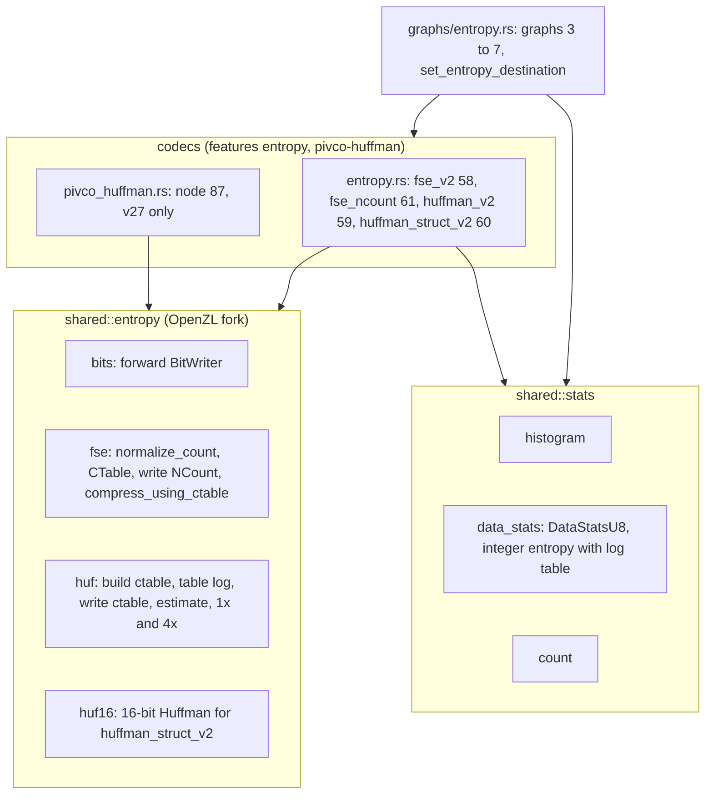
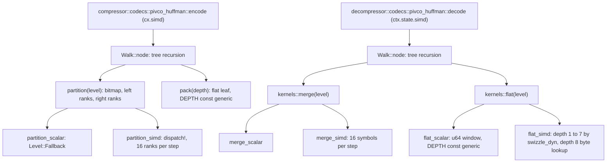
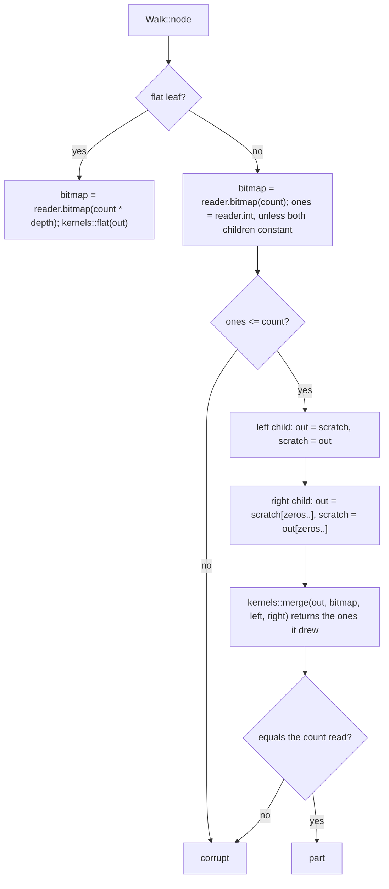
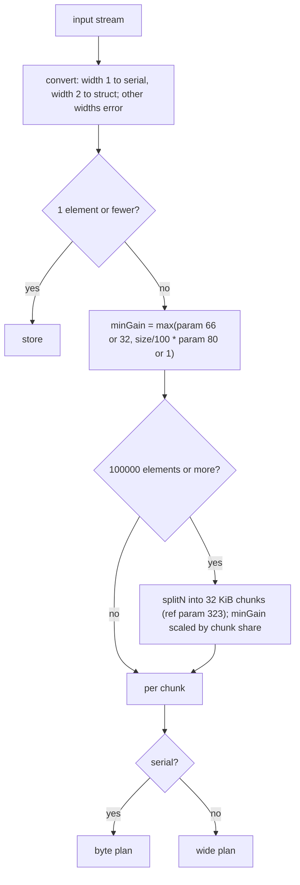
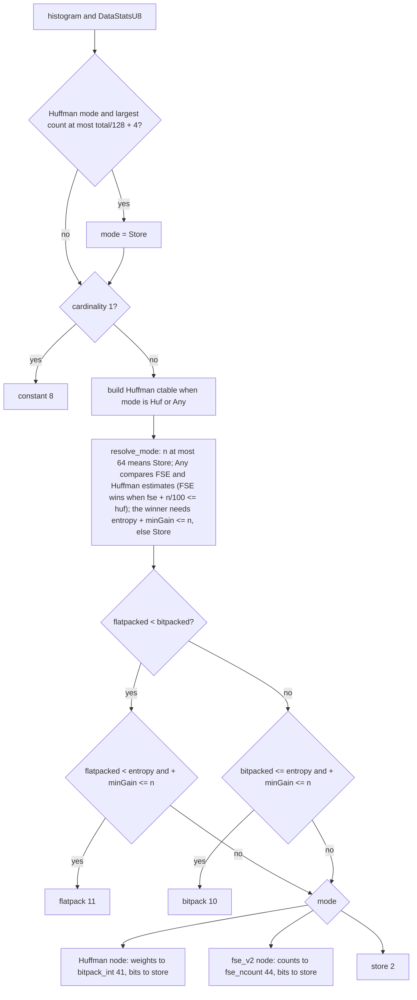
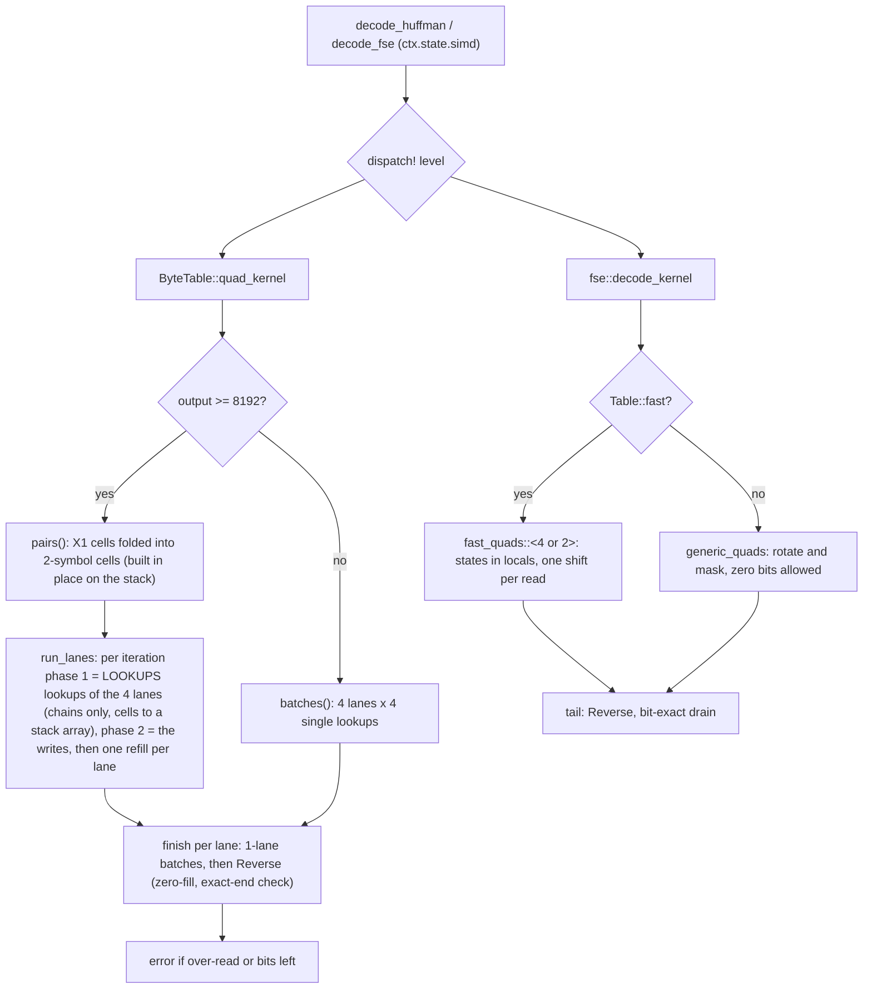

# Entropy coders

OpenZL carries its own FSE and Huffman libraries, forked from Zstandard 1.5.7
(configurable number of FSE states, table-log aware histogram, different
workspace layout), so `mzstd` cannot stand in for them. The decoder side lives
in `decompressor::core::codecs::entropy` and `pivco_huffman` (see the
[decoder catalogue](decoder-codecs.md)); this page covers the encoder side: the
shared FSE/HUF library, the five nodes and the entropy graph's plan.

## Module map

`shared::entropy` is compiled with `compression` and either `entropy` or
`pivco-huffman` (pivco only builds Huffman tables); `shared::stats` likewise.
All encoders write the reference's exact bytes. The reference's unrolled and
"fast" loop variants differ only in speed; the byte Huffman and FSE encoders use
`bits::WordWriter` (a 64-bit container flushed four symbols at a time, like
`BIT_flushBits`), the 16-bit Huffman the simpler `bits::BitWriter`. Both apply
the reference's buffer-capacity failure rules (`close`). Deviation: stable sort
for the 16-bit Huffman.

## Nodes

| Node | Codec | Inputs | Outputs | Header |
| --- | --- | --- | --- | --- |
| `fse_v2` 58 | 49 | Serial | Numeric counts (w2) with metadata 0 = table log, Serial bits | `[states 2 or 4][size]`, 2 states below 1000 symbols |
| `fse_ncount` 61 | 52 | Numeric (w2) | Serial `FSE_writeNCount` header | none |
| `huffman_v2` 59 | 50 | Serial | Numeric weights (w1) with metadata 0 = table log, Serial bits | `[x4][size]`, four streams from 256 bytes |
| `huffman_struct_v2` 60 | 51 | Struct (w2) | Numeric weights (up to 65536 symbols, log up to 20), Serial blocks | blocks `[count u32][size u32][payload]`, one or four streams |
| `pivco_huffman` 87 | 67 | Serial | Numeric weights (w1), Serial bit stream | varint decoded size, plus the block size when the input exceeds 32 KiB |

The size in the `[flag][size]` header is little endian in
`nextPow2(size + 1)` bits rounded up to bytes. Every coding node requires at
least two elements and refuses a single repeated value (`constant` handles it).
The graph passes precomputed state as reference parameters, `HISTOGRAM_PID` 246
(`Arc<Histogram>`) and `HUF_CTABLE_PID` 247 (`Arc<HufCTable>`), so the node
skips recomputing it; a node run on its own builds both itself (histograms exist
for widths 1 and 2).

PivCo-Huffman codes the input through the Huffman tree level by level: at each
tree node the ranks of the symbols below it are partitioned by the next code bit
into a bitmap (plus a one-count for internal nodes), then the halves recurse;
runs of equal-length codes become flat leaves coded as fixed-width indices. Max
256 symbols, table log 12, 32 KiB blocks. The kernels (partition and flat-leaf
packing on the encoder; merge and flat-leaf expansion on the decoder) have a
scalar baseline and a `fearless_simd` kernel, byte-equivalent by definition; see
[PivCo-Huffman kernels](#pivco-huffman-kernels).

## PivCo-Huffman kernels

Both directions walk the Huffman tree recursively (one `Walk` per stream: the
tree, the writer or reader, and the `fearless_simd::Level`) and call a kernel
per tree node. A node is recursion, so a kernel cannot be inlined into one
dispatched loop; instead each call matches the level once
(`Level::is_fallback`, else `dispatch!`) and everything inside the kernel is
`#[inline(always)]` generic code. Closures passed to the kernels are marked
`#[inline(always)]` too, or they lose the kernel's `target_feature` and every
vector operation becomes a call.

Encoder. `partition` splits the first `num` ranks of a node at the split rank:
it writes the bitmap, compacts the left ranks to the scratch buffer and the
right ranks over the source (the write position never passes the read
position), or to the scratch buffer when the left child is constant, or
nowhere when the right one is. The SIMD step compares 16 ranks, takes the
bitmap word with `to_bitmask`, and compacts each side with one `swizzle_dyn`
whose control comes from the 256-entry `COMPRESS` table (lane numbers of the
set bits of a byte), the upper half's control offset by 8; the two halves are
stored as two words, the second after the first's count. Stores may write junk
past the ranks they keep, so both rank buffers hold `block + 64` bytes. Flat
leaves pack eight ranks into a `u64` window (`pack_depth::<DEPTH>`). The
specialization on "left kept" and "right destination" is a const-generic
parameter of `partition_kernel`.

Decoder. `merge` interleaves the children by the node's bitmap. A step loads
16 symbols from each source at its running offset, computes the exclusive
prefix popcount of the 16 bitmap bits from the 256-entry `PREFIX` table (the
right source's gather index at set lanes; `lane - prefix` is the left source's
at clear lanes), gathers both with `swizzle_dyn` and selects by the bitmap. A
constant child replaces its gather by a splat. `flat` unpacks 16 `DEPTH`-bit
indices per step (gather the two bytes holding each field, multiply by
`2^(8 - shift)` and shift to align it, mask, narrow to bytes) and looks them up
in the symbol table held as pages of 16 entries (one `swizzle_dyn` per page,
depth 1 to 7); depth 8 is a plain byte-indexed table lookup, as in the
reference.

Slack invariant. Every `out` and `scratch` buffer holds `count + SLACK` (64)
bytes, from the work buffers (`block + SLACK` each) down to every child's
share, and a vector source is the whole buffer from its first symbol, so a
kernel reads a source a whole step (16 or 64 bytes) past its last symbol; the
load checks the bytes are there and falls back to a zero-padded copy
otherwise. The bitmap is checked against the count of ones by the merge itself
(it returns the ones it drew), after the children decoded: a disagreeing
bitmap reads other bytes of the buffers, which is safe, and ends in the same
error. A block is decoded straight into the output when the rest of the
output has `SLACK` bytes behind the block (the blocks to come overwrite what
the children scribble there); only the last block uses a work buffer and a
copy. `flat` is given the stream from its bitmap to the end, so its vector
loads run into the following bytes (lanes past the count are discarded)
instead of a padded copy.

Wide kernels. The AVX-512 level (`is_wide`) merges 64 bytes per step with
`expand` (one `vpexpandb` per source, masks straight from the bitmap word) and
partitions 64 ranks per step with `compress` (one `vpcompressb` per side, a
full-width store, the cursor advanced by the popcount); the rank translation
there is two `concat_swizzle_dyn` lookups of 128 entries and a select per 64
symbols. Every other level takes the 16-byte path. Its merge control comes from
two 256-entry tables (`CONTROLS`) whose sum gives, per lane, the source index
at the lane's own side and a byte with the high bit set at the other side, so
two zeroing shuffles and an OR replace the select (`shuffle` uses `pshufb`
directly on SSE4.2/AVX2, where out-of-range indices zero the lane, and the
precise variant elsewhere). The 16-byte partition produces both sides with one
shuffle, as the reference: right ranks ascending then left ranks descending
(`PARTITION`, the upper half's row read through a window offset by the lower
half's left count and merged by `min`), stored as is for the right side and
byte-reversed for the left. `pack` merges neighbouring fields three times
(bytes into 16-, 32- and 64-bit lanes) and stores the two 64-bit lanes `depth`
bytes apart. `Tree::new` (both directions) builds leaves as runs of the
symbols grouped by weight in fixed arrays, with no allocation.

Tests: the kernels are compared with the scalar baseline at every available
backend (merge in all four constant/vector shapes with short sources, flat at
depths 1 to 8 against the definition, partition for every destination mode,
whole-stream encode across backends), and C frames are decoded at every backend
(`tests/codecs_entropy.rs`). The modules are in `scripts/check_simd_uninit.py`
for Miri and AddressSanitizer.

## The entropy graph

Graphs `fse` (3), `huffman` (4), `huffman_huf0` (5), `huffman_pivco` (6) and
`entropy` (7) are one function graph, `entropyDynamicGraph`, with a backend mode
(FSE, Huffman, or whichever is estimated smaller) and a Huffman mode (`huffman_v2`
or `pivco_huffman`). Graph 6 selects PivCo at format 27 and newer; graphs 4 and
7 always use `huffman_v2`; below v27 PivCo falls back to `huffman_v2`. The
deprecated pre-15 codecs are not supported (the minimum format is 21).

Byte plan (`plan_byte_chunk`), for serial chunks:

Wide plan (`plan_wide_chunk`), for 16-bit struct chunks: one value ->
`constant`; bit-packing when it beats the Huffman estimate and store by `minGain`
-> `bitpack`; store when the entropy exceeds 15 bits or the estimate does not
pay -> `store`; fewer than 256 distinct values -> `tokenize`, alphabet bit-packed
(when the maximum value needs fewer than 16 bits, else stored) and indices to `huffman`; else
`huffman_struct_v2` with its weights to `fse` and bits to `store`.

`set_entropy_destination(cx, edge, graph, min_gain_bytes, min_gain_pct)`
(`ZL_Edge_setEntropyDestination`) sends an edge to an entropy graph with
optional minimum-gain parameters; the LZ graphs use it and fall back to the
default graph when an override index is invalid (see [LZ](lz.md)).

## Hot loops (FSE and byte Huffman)

Encoder nodes pass `cx.simd`, decoders `ctx.state.simd`, to the kernels, which
dispatch once per call (`dispatch!`) into an `#[inline(always)]` kernel. The
kernels are scalar code; compiling them inside the dispatch target is what
lets LLVM use BMI2 `shlx`/`shrx` on the AVX2 level. Every level produces the
same bytes (tests loop over `Backend::available()`).

- Backward bit reader: `bits::refill` loads the 8 bytes holding the cursor and
  left-aligns them, giving at least 56 valid bits; four lookups of at most 12
  bits (`BYTE_BATCH`) fit. A batch runs only while the cursor has 56 bits, so
  the fast loop reads exactly what `Reverse::peek` would; the last symbols use
  `Reverse`, which keeps the zero-fill and the over-read/exact-end rules
  (`remaining() < 0` is corruption, as is leftover with `exact`).
- Byte Huffman: `ByteTable` holds a fixed 4096-cell `[u16; 4096]` (symbol,
  bits) so the masked index needs no bounds check. For outputs of 8192 bytes
  or more `pairs()` derives a table indexed by the first `log` bits (the
  cells past `2^log` stay zero), each cell holding two symbols when
  both codes fit in the log-bit prefix (the content of the reference's `X2`
  table for the codes it covers), written in runs like the reference's: each
  first symbol's run is filled with the symbol alone, then the part of the run
  whose next bits start with a short enough second code gets the pair (the
  base table lists the longest codes first, so those codes are a suffix); the
  bits count sits in the low byte so a shift by the cell is a shift by the
  bits. `pair_lanes()` fills a `[u32; 4096]` on the stack (so its address
  needs no register) and `run_lanes()` runs four `PairLane`s over the shared
  body and the output split in its four quarters. The lookup index is
  `bits >> shift` with `shift` clamped to 52..=63, so LLVM sees an index below
  4096 (no check) and, on the BMI2 levels, uses the non-destructive `shrx`.
  The lane keeps its unread bits left-aligned with a 1 bit under them, so the
  bits eaten since the last load are `trailing_zeros` and the refill is one
  8-byte load at the new end of the lane's input. The input of a lane is the
  prefix of the body that ends with the 8 bytes its bits came from; a refill
  shortens it by `tz >> 3` (at most 8) after one length check, and
  `last_chunk::<8>` then needs none. The output of a lane is the unwritten
  rest of its quarter: a window `first_chunk_mut::<WINDOW>()` is taken once
  per iteration (one length check) and the rest shrinks by the symbols written
  (`split_at_mut_checked`), so no offset is kept. Lookups per refill are 6, 5
  or 4 by log (as many as fit in 56 bits; 4 instead of 5 at log 11 was
  measured 20% slower, the refill is the dearest part of an iteration); the
  iteration count is fixed up front from input bytes and output room. Each
  iteration has two phases: phase 1 does the lookups of all four lanes (lookup
  `j` of every lane before `j + 1`, so the four dependent-load chains sit next
  to each other) and only stores the cell, so the four bit words stay in
  registers; phase 2 then writes each lane's symbols (two bytes per cell,
  advance by the symbol count). Doing both in one pass spilled the bit words
  between dependent lookups. An order lane after lane was about 9%
  slower; two lanes at a time, 20%). The tail (`finish`) converts back to a
  cursor. 16-bit Huffman (`WideTable`) decodes two symbols per refill; the
  four blocks of an `x4` payload (whose headers give every block's size and
  symbol count up front) decode in lockstep into four parts of the output, as
  the byte lanes do.
- FSE decoder: `Table` is a fixed `[Cell; 4096]` plus a `fast` flag, set when
  no symbol owns more than half of the table (the reference's
  `FSE_decompress_usingDTable_fast` condition), which is exactly when no cell
  reads zero bits. Four symbols per refill (a state reads at most 12 bits per
  step), states cycling 0..4 or 0,1,0,1. `fast_quads::<STATES>` keeps the
  states in locals (a dynamic lane index would put them in memory), extracts
  the low bits with one shift of the left-aligned word and writes the four
  symbols as one chunk; `generic_quads` keeps the rotate-and-mask read for
  tables with zero-bit cells. A table without low-probability symbols spreads
  its symbols with the reference's fast spread (symbols laid down in order,
  then scattered by the step).
- Encoders: `HufCTable` carries `entries`, two `[u64; 256]` tables of
  `TopWriter` entries (`[0]` the code left-aligned with the code length in the
  low byte, `[1]` the code alone; two scale-8 lookups per symbol). `TopWriter`
  is the reference's `HUF_addBits` scheme: add is one shift by the entry, one
  `or` and one add; `add_group` adds a whole group with independent shifts
  (each code shifted by the lengths that follow it, the old container by all of
  them), so the chain through the container is one shift and one `or` per
  group; five symbols per flush when the table log is 11 or less, four
  otherwise. The four streams of `compress4x` share one writer and buffer
  (`close_into`). `fse::CTable` has fixed `[u16; 4096]` and
  `[SymbolTransform; 256]` tables, borrowed once per call (`Tables`) so the
  loop does not reload them through the struct, and `compress_states::<STATES>`
  keeps the states in locals and writes four symbols between flushes into a
  `WordWriter` whose buffer is sized up front (its flush never allocates, so
  the writer's fields stay in registers; a flush with no room fails the stream
  exactly where the reference's destination would overflow). `count8` loads
  eight bytes per step into four tables.

## Known gaps

- No vector instructions: the kernels are scalar, compiled under the
  dispatched level for BMI2 only. The reference's assembly Huffman loop and
  its sub-table `X2` symbols (longer than the prefix) are not ported; the
  pair table covers the symbols whose codes fit one 12-bit prefix.
- Huffman decode is below the reference (about 0.7 to 0.8x in the
  comparison harness): the four-lane loop is bound by the chain of dependent
  lookups and registers (a lane needs its bits, a write position and a
  window; sixteen general registers do not hold four of them, so some spill),
  and the reference's assembly loop addresses memory by absolute pointers. A
  three-symbol cell table (fewer lookups per byte) and a per-store bounds
  check instead of windows were both measured slower. The byte Huffman
  encoder is at about 0.86 to 1.0x (the histogram, which is in `shared::stats`,
  is a fifth of it); FSE is at about 0.9 to 1.05x (see
  `benchmark-comparison.md` for the current numbers).
- Per-call tables: a struct Huffman table at log 20 costs 4 MiB per call.
- The 16-bit Huffman uses a stable sort and a single bit writer replaces the
  reference's unrolled variants.
- PivCo: the dispatch is per tree node (the recursion cannot carry a
  `target_feature`), the 16-byte path is the only one below AVX-512, and
  `flat` at depth 8 and the rank translation below AVX-512 are scalar
  lookups, as in the reference. The work buffers are zeroed per node call.
