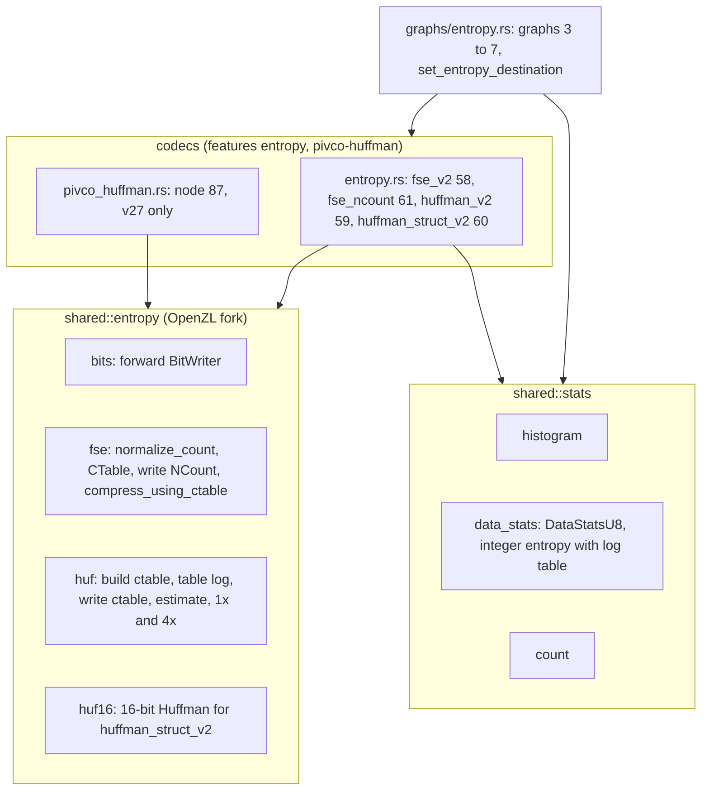
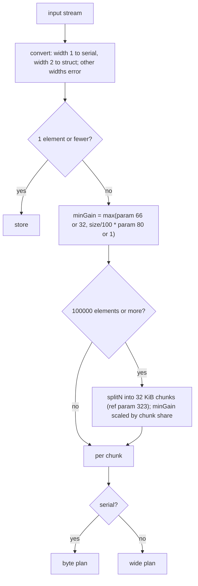
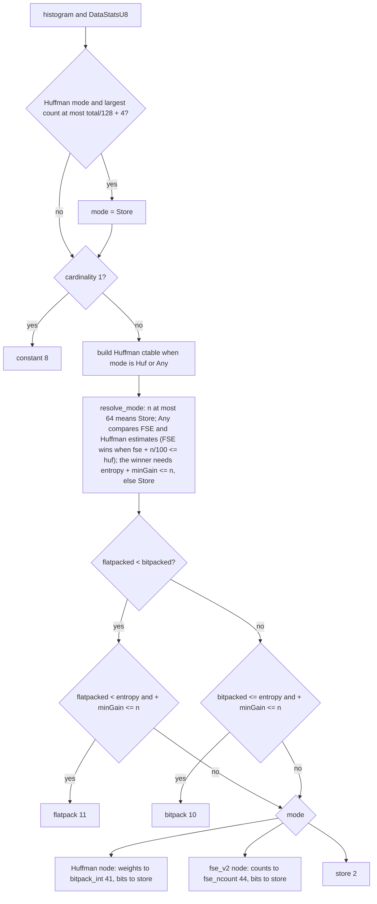

# Entropy coders

OpenZL carries its own FSE and Huffman libraries, forked from Zstandard 1.5.7
(configurable number of FSE states, table-log aware histogram, different
workspace layout), so `mzstd` cannot stand in for them. The decoder side lives
in `decompressor::core::codecs::entropy` and `pivco_huffman` (see the
[decoder catalogue](decoder-codecs.md)); this page covers the encoder side: the
shared FSE/HUF library, the five nodes and the entropy graph's plan.

## Module map

`shared::entropy` is compiled with `compression` and either `entropy` or
`pivco-huffman` (pivco only builds Huffman tables); `shared::stats` likewise.
All encoders write the reference's exact bytes. The reference's unrolled and
"fast" loop variants differ only in speed, so one straightforward bit writer
replaces them; the buffer-capacity failure rules are kept
(`bits::BitWriter::close`). Deviations: stable sort for the 16-bit Huffman,
scalar PivCo.

## Nodes

| Node | Codec | Inputs | Outputs | Header |
| --- | --- | --- | --- | --- |
| `fse_v2` 58 | 49 | Serial | Numeric counts (w2) with metadata 0 = table log, Serial bits | `[states 2 or 4][size]`, 2 states below 1000 symbols |
| `fse_ncount` 61 | 52 | Numeric (w2) | Serial `FSE_writeNCount` header | none |
| `huffman_v2` 59 | 50 | Serial | Numeric weights (w1) with metadata 0 = table log, Serial bits | `[x4][size]`, four streams from 256 bytes |
| `huffman_struct_v2` 60 | 51 | Struct (w2) | Numeric weights (up to 65536 symbols, log up to 20), Serial blocks | blocks `[count u32][size u32][payload]`, one or four streams |
| `pivco_huffman` 87 | 67 | Serial | Numeric weights (w1), Serial bit stream | varint decoded size, plus the block size when the input exceeds 32 KiB |

The size in the `[flag][size]` header is little endian in
`nextPow2(size + 1)` bits rounded up to bytes. Every coding node requires at
least two elements and refuses a single repeated value (`constant` handles it).
The graph passes precomputed state as reference parameters, `HISTOGRAM_PID` 246
(`Arc<Histogram>`) and `HUF_CTABLE_PID` 247 (`Arc<HufCTable>`), so the node
skips recomputing it; a node run on its own builds both itself (histograms exist
for widths 1 and 2).

PivCo-Huffman codes the input through the Huffman tree level by level: at each
tree node the ranks of the symbols below it are partitioned by the next code bit
into a bitmap (plus a one-count for internal nodes), then the halves recurse;
runs of equal-length codes become flat leaves coded as fixed-width indices. Max
256 symbols, table log 12, 32 KiB blocks. Only the portable kernel is ported (the
SSE/AVX2/AVX-512/NEON kernels are byte-equivalent by definition).

## The entropy graph

Graphs `fse` (3), `huffman` (4), `huffman_huf0` (5), `huffman_pivco` (6) and
`entropy` (7) are one function graph, `entropyDynamicGraph`, with a backend mode
(FSE, Huffman, or whichever is estimated smaller) and a Huffman mode (`huffman_v2`
or `pivco_huffman`). Graph 6 selects PivCo at format 27 and newer; graphs 4 and
7 always use `huffman_v2`; below v27 PivCo falls back to `huffman_v2`. The
deprecated pre-15 codecs are not supported (the minimum format is 21).

Byte plan (`plan_byte_chunk`), for serial chunks:

Wide plan (`plan_wide_chunk`), for 16-bit struct chunks: one value ->
`constant`; bit-packing when it beats the Huffman estimate and store by `minGain`
-> `bitpack`; store when the entropy exceeds 15 bits or the estimate does not
pay -> `store`; fewer than 256 distinct values -> `tokenize`, alphabet bit-packed
(when the maximum value needs fewer than 16 bits, else stored) and indices to `huffman`; else
`huffman_struct_v2` with its weights to `fse` and bits to `store`.

`set_entropy_destination(cx, edge, graph, min_gain_bytes, min_gain_pct)`
(`ZL_Edge_setEntropyDestination`) sends an edge to an entropy graph with
optional minimum-gain parameters; the LZ graphs use it and fall back to the
default graph when an override index is invalid (see [LZ](lz.md)).

## Known gaps

- No SIMD: the reference's X2 and assembly Huffman decoders and AVX2/BMI2
  kernels are not ported (output is the same).
- Per-call tables: a struct Huffman table at log 20 costs 4 MiB per call.
- The 16-bit Huffman uses a stable sort, the PivCo kernel is the portable one,
  and a single bit writer replaces the reference's unrolled variants.
