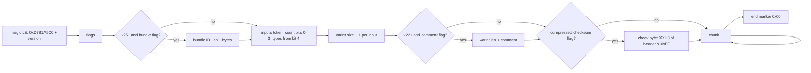
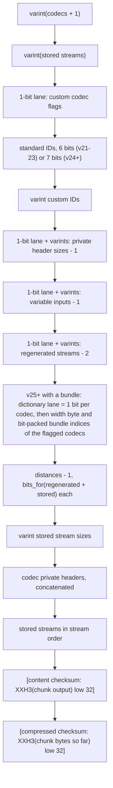
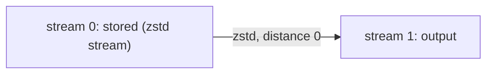
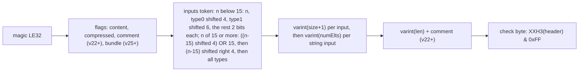

# Frame format

Both codecs follow the reference's `src/openzl/common/wire_format.h`. This page
describes the subset the crate reads and writes (versions 21 to 27), in
`shared::wire`, `compressor::core::{frame, chunk}` and
`decompressor::core::{frame, chunk}`.

## Frame

- Flags: bit 0 content checksums, bit 1 compressed checksums (and the header
  check byte), bit 2 comment (v22+), bit 3 bundle ID (v25+).
- Bundle ID (flag bit 3, v25+): one length byte, then that many leading bytes of
  the 32-byte ID; trailing zero bytes are trimmed on write and restored on read
  (an all-zero ID is refused by the encoder). See [dictionaries](dictionaries.md).
- A first size byte of `0x00` means "unknown sizes", which the reference
  decoder rejects; neither codec writes or accepts it.
- The header lists any number of inputs of any type (the general form is below).
  The default graph writes one serial input, token `0x01`. The decoder rejects
  zero inputs as invalid; the byte-oriented APIs report more than one input, or a
  non-serial one, as unsupported, while `Decompressor::decompress_typed` returns
  every output.
- Magics from version 8 to 20, and up to 16 versions past 27, are OpenZL but
  unsupported; anything else is not OpenZL.

## Chunk

Codecs are listed in decoding order. Codec `t` takes `fixed + variable` input
streams starting right after codec `t - 1`'s inputs; each stream it regenerates
lies `distance` streams past the end of its inputs. Streams no codec
regenerates are stored, in index order. The last stream is the chunk's output.
The compressed checksum covers the chunk header, streams and the content
checksum; it is verified before any codec runs.

The two chunks the encoder writes:

| Chunk | Header bytes | Streams |
| --- | --- | --- |
| Stored | `01 01 varint(n)` | the input |
| Zstandard | `02 01 00 16 00 00 00 00 varint(n)` | `01` (element width) + magicless zstd frame |

## Limits

Codec count below 20 000 (`ZL_runtimeNodeLimit`), streams below 110 000
(`ZL_runtimeStreamLimit`), at most 2 048 regenerated streams per codec, stored
streams and private headers below 4 GiB, comments of 1 to 10 000 bytes.

## Typed and multiple inputs, comments

The encoder writes the general v21+ header (`layout::write_frame_header`):

Types are 2-bit codes (serial 0, struct 1, numeric 2, string 3). A string's
size is the sum of its lengths. Content checksums hash every chunk input in
order and, for strings, their little-endian length array after the content.
The chunk header and its stored-stream order are described in
[compression graphs](compressor-graphs.md). The dictionary lane
(`push_header_with` on the encoder, `dictionary_lane` on the decoder) is present
in every chunk of a frame that has a bundle (flag bit 3), including stored and
empty chunks; the decoder reads it exactly when the frame header named a bundle.
The decoder reads a multi-output chunk's outputs as its last `n` streams
(output `k` is stream `total - 1 - k`); the content checksum covers each
output's content followed, for strings, by its length array.

## Known gaps

- Formats below 21 are not read or written (the supported range is 21 to 27).
- A comment is accepted and written from v22; only a single bundle per frame
  exists in the format.
- Unknown-size frames (`0x00` first size byte) are rejected as in the reference.
