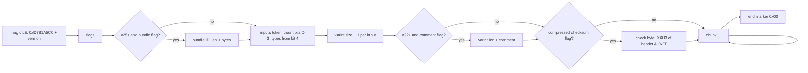
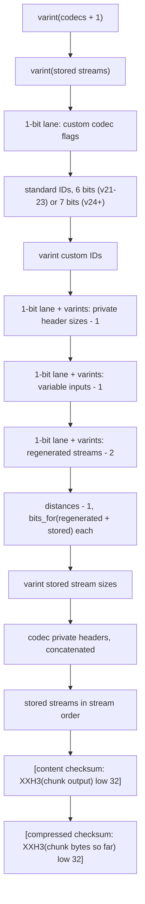
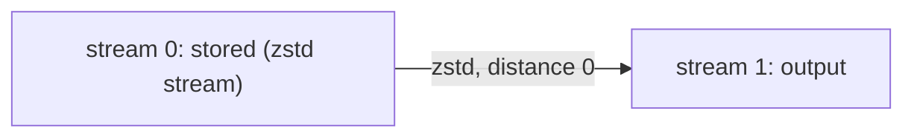

# Frame format

Both codecs follow the reference's `src/openzl/common/wire_format.h`. This page
describes the subset the crate reads and writes (versions 21 to 27), in
`shared::wire`, `compressor::core::{frame, chunk}` and
`decompressor::core::{frame, chunk}`.

## Frame

- Flags: bit 0 content checksums, bit 1 compressed checksums (and the header
  check byte), bit 2 comment (v22+), bit 3 bundle ID (v25+).
- A first size byte of `0x00` means "unknown sizes", which the reference
  decoder rejects; neither codec writes or accepts it.
- The encoder writes one serial input: token `0x01`. The decoder rejects zero
  inputs as invalid and more than one, or a non-serial type, as unsupported.
- Magics from version 8 to 20, and up to 16 versions past 27, are OpenZL but
  unsupported; anything else is not OpenZL.

## Chunk

Codecs are listed in decoding order. Codec `t` takes `fixed + variable` input
streams starting right after codec `t - 1`'s inputs; each stream it regenerates
lies `distance` streams past the end of its inputs. Streams no codec
regenerates are stored, in index order. The last stream is the chunk's output.
The compressed checksum covers the chunk header, streams and the content
checksum; it is verified before any codec runs.

The two chunks the encoder writes:

| Chunk | Header bytes | Streams |
| --- | --- | --- |
| Stored | `01 01 varint(n)` | the input |
| Zstandard | `02 01 00 16 00 00 00 00 varint(n)` | `01` (element width) + magicless zstd frame |

## Limits

Codec count below 20 000 (`ZL_runtimeNodeLimit`), streams below 110 000
(`ZL_runtimeStreamLimit`), at most 2 048 regenerated streams per codec, stored
streams and private headers below 4 GiB, comments of 1 to 10 000 bytes.
