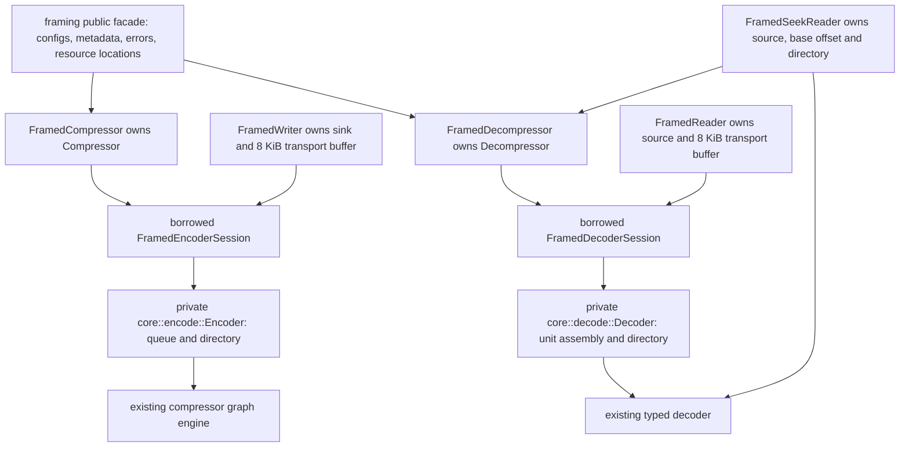
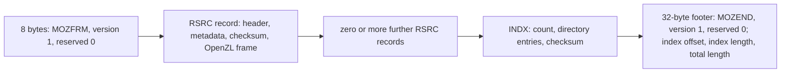
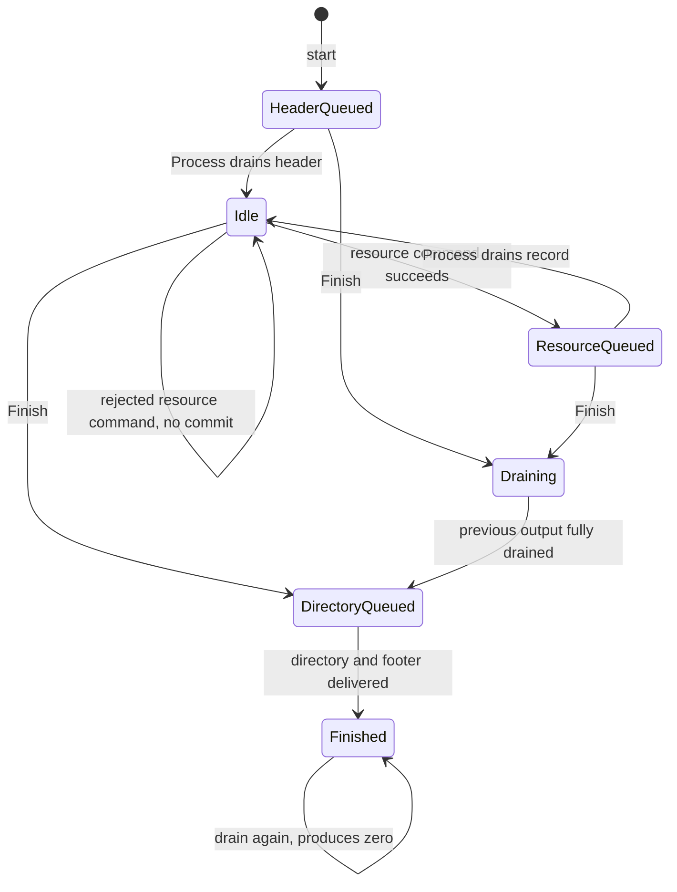
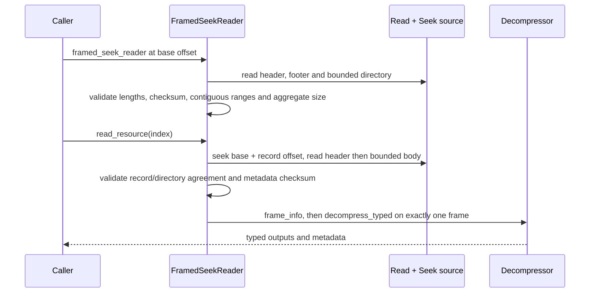

# Framed resource containers

The opt-in `framed` feature exposes `framing` with either codec direction.
It adds a mopenzl-specific resource container around ordinary OpenZL frames;
it does not change the OpenZL wire format or either serial codec's defaults.
One resource is exactly one frame, including typed and multiple inputs. Its
graph is selected independently through `FramedResource::graph`. The outer
container itself is not accepted by `ZL_decompress` or `FrameMode::Concatenated`.

## Ownership and API



`FramedEncodeConfig` combines `EncoderConfig` and `FramingConfig`;
`FramedDecodeConfig` combines `DecoderConfig` and `FramingConfig`. Construct
with `new`, or convert an existing raw codec with `From` to keep its backend,
retention, graph (encoder), dictionary store and registered codecs (decoder).
`reconfigure` changes container limits transactionally for later containers.

`FramedInput` borrows ordered `FramedResource` values. Each resource borrows
serial bytes or a slice of `Input`, metadata fields, and an optional
`CompressorGraph`. `None` uses the underlying compressor's configured graph.
An override is installed only around the raw compression call and restored on
both success and failure. The registry is shared by the graph's normal clone;
frame bytes equal an ordinary compression call with that graph and config.
The encoder's private `replace_graph` is not a new public raw codec API.

`compress` and append-with-rollback `compress_into` drive the same borrowed
session as `framed_writer`. A resource command takes complete borrowed inputs
and queues a complete encoded frame; it keeps no caller input borrow.
`FramedDecoderSession::process` consumes wire bytes until one resource is
ready, then yields an owned `DecodedResource` with metadata and typed outputs.
`decompress` collects those events and returns only after validating EOF.
The decoder does not accept a graph: frames describe their codec layouts.

## Wire format (version 1)

All integers are fixed-width little-endian; all offsets are relative to the
first container byte. There are no alignment bytes, flags, padding records,
implicit dictionaries or optional fields.



| Structure | Fields |
| --- | --- |
| Container header (8) | ASCII `MOZFRM`, byte `1`, byte `0`. Future version bytes are UnsupportedVersion; a bad signature or reserved byte is invalid. |
| Resource fixed header (24) | ASCII `RSRC`, u32 metadata byte length, u64 OpenZL frame byte length, u64 sum of decoded content bytes. |
| Metadata | Repeated two-byte code, u32 value length, value bytes, with no field count. Uppercase ASCII codes may repeat. `id` is a unique UTF-8 name; `mt` is a unique signed i64 microsecond Unix timestamp. |
| Resource header checksum (4) | Low 32 bits of XXH3-64, seed 0, over the fixed header followed by serialized metadata. The OpenZL frame follows immediately; its own configured checksums protect content. |
| Directory | ASCII `INDX`, u32 resource count, then 24 bytes per resource: u64 record offset, u64 record length including metadata/checksum/frame, u64 decoded content size; finally low 32 bits of XXH3-64 over the directory before its checksum. |
| Footer (32) | ASCII `MOZEND`, byte `1`, byte `0`, u64 directory offset, u64 directory byte length including checksum, u64 complete container length. |

An empty container is 52 bytes. A resource without metadata adds 28 bytes of
record structure plus its unchanged OpenZL frame and 24 directory bytes.
String length arrays are part of the inner frame but not counted as decoded
content bytes. The directory must describe contiguous records starting at
offset 8 and ending exactly at the directory; the footer and EOF are mandatory.

## Encoder lifecycle and retries



`NeedsInput` admits another resource; `NeedsOutput` requires draining into
caller storage. A zero-sized output consumes no queued bytes. Finish closes
the resource list when prior output has drained and the suffix is queued;
retries should keep using Finish. A rejected resource (metadata, graph, limit
or allocation) leaves no directory entry or queued partial resource. Dropping
the borrowed session abandons the container without poisoning the owner.

The std writer first drains older bytes, then accepts a resource without
attempting to write its new bytes. Thus an error from `resource` means that
resource was not accepted and the same command can be retried. Transport
cursors advance only after successful writes; Interrupted is retried and
WouldBlock or WriteZero preserves pending bytes. `try_finish` retains the
writer; consuming `finish` returns `FramedFinishError` with the whole writer
on error. No output is written during Drop. Directory allocation failures
from native `process` do not carry a produced count; abandon that container.

## Decoder lifecycle and limits

```mermaid
stateDiagram-v2
    [*] --> Header
    Header --> Tag: validate magic
    Tag --> RecordHeader: RSRC
    RecordHeader --> RecordBody: validate bounded lengths and aggregate output
    RecordBody --> Tag: validate metadata checksum, inner size and frame; resource event
    Tag --> Index: INDX
    Index --> Footer: verify checksum, contiguous entries, equality with records
    Footer --> AwaitEOF: validate offsets and complete length
    AwaitEOF --> Finished: Finish with no trailing bytes
    Header --> Failed: malformed or incomplete at Finish
    RecordBody --> Failed: decode or checksum failure
    Index --> Failed: invalid directory
    AwaitEOF --> Failed: trailing bytes
    Failed --> Failed: InvalidState
```



Unit assembly copies only as far as the currently required header/body boundary,
so a resource event never accepts bytes of the next record. Host conversions,
offset arithmetic and reservations are checked. Defaults cap resources at
10,000, metadata at 1 MiB per resource, encoded frames at 64 MiB, aggregate
decoded content at 256 MiB and total wire input at 1 GiB. Untrusted lengths
are capped before body buffering; inner frame size must equal the resource
size before any codec executes. Raw `DecoderConfig` limits apply additionally
to each frame; the typed decoder always rejects trailing bytes regardless of
FrameMode. Codec workspace and string length storage follow existing typed
decoder budgets, not the outer content-byte cap.

Resource events are tentative until the session reaches Finished: a later
directory/footer failure invalidates the container. `FramedDecodeFailure`
preserves the exact accepted prefix of the failing call; further calls fail
with InvalidState. `FramedReader::read_resource` yields None only after the
index, footer and EOF validate. Transport errors preserve its state for retry.
After Finished, empty decoder calls stay Finished; further input fails with
InvalidState. This terminal state is distinct from the footer's AwaitEOF state.

## Seek and dispatch



The container extends from the source's initial position to its end. Loading
the index does not read/decode resource payloads; selecting a resource validates
that record and its frame. The source must remain unchanged while the reader
is alive. External dictionary bundles are resolved through the raw decoder's
BundleStore; there is no implicit dependency on earlier resources.

The raw codec chooses the SIMD backend once at construction. Framing checksums
use that same level; codec dispatch remains in the existing graph/decoder
engines. No new SIMD kernel, uninitialized buffer, FFI or unsafe code is added.
`FramedError` adds container/resource context and preserves typed ConfigError,
EncodeError, DecodeError and std I/O error sources.

## Verification and known gaps

`tests/framed.rs` covers frame identity and C interoperability, graph overrides,
typed/string/multiple inputs, metadata, empty resources/containers, every short
session split, malformed/truncated wire, limits, native/transport equivalence,
transport retries, embedded containers, seek and backend equality. Private
wire tests exercise checked arithmetic and checksum-valid malformed structures.
`framed_decode` and `framed_roundtrip` AFL/libFuzzer targets compare incremental
and one-shot parsing, random resource schedules, graph choices and C decoding.
`benches/framed.rs` records container and raw-frame sizes and measures full
containers against independent C frames; the C API has no outer container.

- Unlike the larger mbrotli/mzstd framing APIs, this version has no hidden
  resources, global/footer metadata, repeats, padding, internal dictionary
  references, owned native sessions or byte-oriented resource writers.
- Resource commands take complete inputs. One encoded resource is staged; the
  decoder stages one encoded record and its typed output. Split very large
  input into resources explicitly; the container does not split it for you.
- No partial-resource seeks or `Read` concatenation adapter: random access and
  sequential events return whole typed resources.
- Directory storage grows with the resource count. Checksums detect damage;
  they do not authenticate the container or provide a whole-container hash.

## Initial measurements

Apple M5 Pro, aarch64-apple-darwin, rustc 1.99.1, release, default level 6,
64 KiB resources, default checksums and graphs. Commands:

```sh
cargo bench --features framed --bench framed --locked -- --sample-size 10 --measurement-time 1 --warm-up-time 1
cargo bench --features framed --bench framed --locked -- rust-session --sample-size 10 --measurement-time 1 --warm-up-time 1
```

The first implementation has no pre-change framed baseline. C times are
end-to-end independent frames (`ZL_CCtx_compress` / `ZL_decompress`), including
context/output allocation, without the outer container that C does not support.
Rust reuses its raw codec and measures container/output allocation and framing.
Before timing, every embedded frame equals C's frame byte for byte and C decodes
it to the same content. The text corpus label says 1 MiB but the available C
source corpus contains 571,256 bytes. These short measurements ran on a loaded
development host and are initial evidence, not a performance guarantee.

| Corpus | Input bytes | Raw OpenZL bytes | Container bytes | Rust / C encode | Rust / C decode |
| --- | ---: | ---: | ---: | ---: | ---: |
| tiny | 64 | 84 | 188 | 2.128 / 8.826 µs | 0.443 / 0.497 µs |
| C source text | 571,256 | 116,328 | 116,848 | 2.963 / 3.108 ms | 0.290 / 0.266 ms |
| structured records | 1,048,576 | 142,713 | 143,597 | 4.207 / 3.673 ms | 0.620 / 0.542 ms |
| incompressible | 262,144 | 262,240 | 262,500 | 71.463 / 114.340 µs | 36.947 / 46.576 µs |

Native sessions (encoder drains through an 8 KiB output window; decoder receives
1 KiB input windows) write/read the same bytes. Encode/decode point estimates:
tiny 1.725/0.363 µs; text 3.047/0.295 ms; records 3.926/0.633 ms;
incompressible 71.372/24.193 µs. Separate runs have visible scheduling noise,
especially tiny and stored-frame decoding; no session speedup is claimed.

Verification on this host: Cargo fmt; std and all-feature workspace Clippy;
all-feature workspace tests; std framed integration tests; doctests and rustdoc
with warnings denied; direction-only framed feature builds; Rust 1.89 check;
100% function coverage in the new production modules (62 functions), plus the
private compressor graph swap. `cargo afl test --no-default-features` replays
the regression corpus, and both AFL binaries build in release mode.

Local AFL++ 4.40c / cargo-afl 0.18.2 campaigns could not start: macOS SysV
shared-memory allocation failed, also outside the sandbox. No system tuning
was performed. The same engine-neutral targets ran for 30 seconds each under
libFuzzer with AddressSanitizer (nightly 1.101.0, 2026-10-23): 411,538
decoder executions and 67,489 round-trip executions, no findings. Their input
corpora and generated findings stay outside the repository. CI adds bounded
15-second AFL smoke jobs on Linux, preserving findings and checking crash and
hang counts. A short smoke run is not an exhaustive fuzzing campaign.
