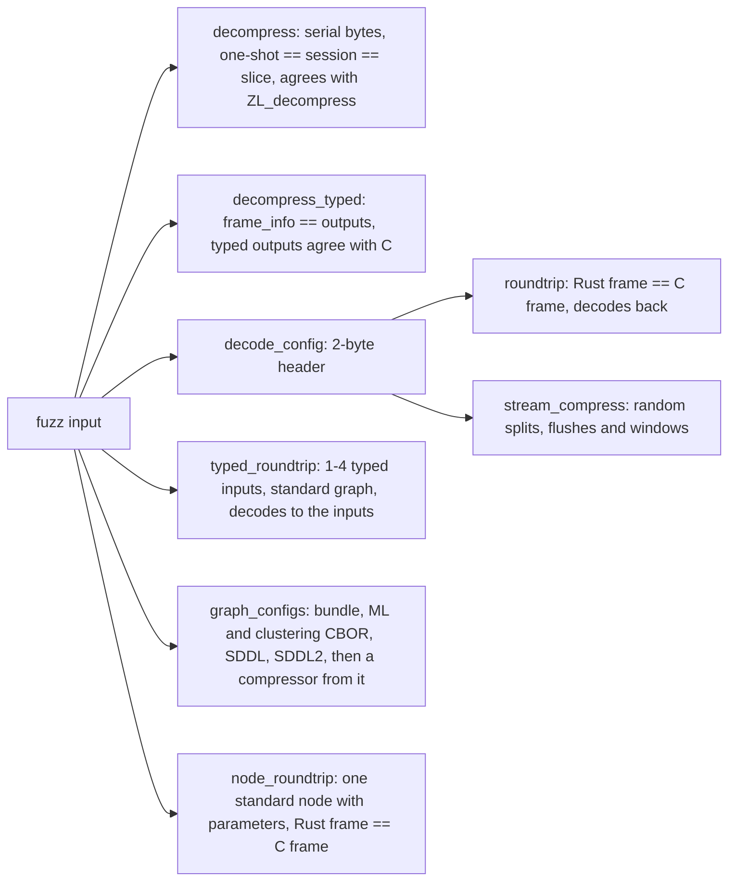
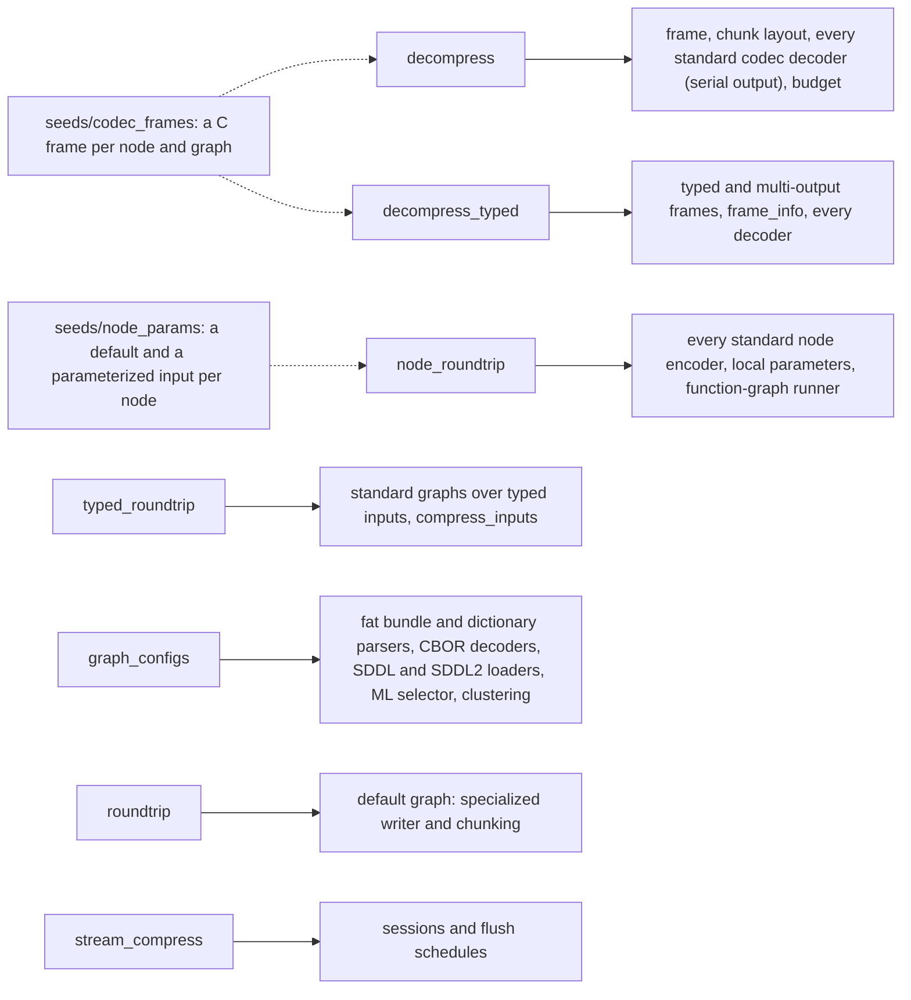
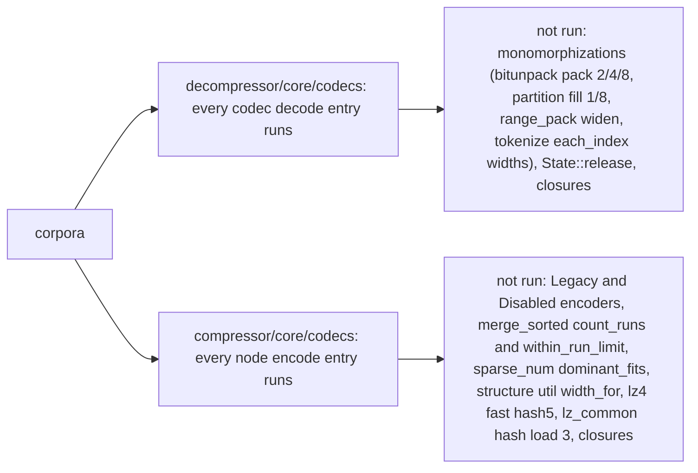

# Fuzzing

`fuzz/afl` holds the target bodies (`src/targets.rs`), thin AFL adapters,
the committed regression corpus replayed by `cargo afl test`, the seed
generators (`examples/prepare_seeds.rs`, `examples/codec_seeds.rs`) and
`campaign.sh`; `fuzz/libfuzzer` wraps the same bodies for ClusterFuzzLite
(`.clusterfuzzlite/`). Both packages are outside the workspace and link the C
oracle (`openzl-ffi`).

| Target | Oracle |
| --- | --- |
| `decompress` | Arbitrary bytes never panic; one-shot, session and slice decoding agree; content decoded by either mopenzl or `ZL_decompress` is decoded identically by the other unless mopenzl reports `Unsupported`, a limit or a size mismatch. |
| `decompress_typed` | Arbitrary bytes never panic `decompress_typed` or `frame_info`, under input (1 MiB) and output (16 MiB) limits. Where both succeed the header's output count, types and element counts match the decoded outputs; the typed outputs equal `openzl_ffi::graph::decompress` under the same out-of-scope exemptions as `decompress`. |
| `typed_roundtrip` | One to four typed inputs (serial, struct, numeric 1/2/4/8 bytes, strings with empty ones) go through one of 24 standard graphs at a chosen level and format version. Compression may fail; a frame it writes decodes with `decompress_typed`, and with C, to exactly the inputs (type, content, width, string lengths). |
| `graph_configs` | Selector byte `% 5`: `DictBundle::try_from` (then `BundleStore::insert` and a Zstandard node with the first dictionary), `MlSelectorConfig::try_from`, `ClusteringConfig::try_from`, `GraphBuilder::sddl`, `GraphBuilder::sddl2`. No parser panics; whatever parses is built into a compressor that compresses three fixed input sets, and each frame it writes decodes to them. |
| `node_roundtrip` | Any of the 75 standard node IDs, 0 to 3 integer parameters (the node's own IDs or raw ones) and an optional copy parameter, over a typed input (usually the node's type, sometimes a mismatched one), at a chosen level and format version 21 to 27. Both libraries run the node in a function graph that stores all outputs: both succeed or both fail, frames are equal bytes, and the frame decodes (mopenzl and C) to the inputs. |
| `roundtrip` | Byte identity with `ZL_CCtx_compress` for the header's level, version, checksums and chunking; round trip through one-shot and pieces. |
| `stream_compress` | Sessions finish, never over-report progress and write frames that decode to the payload; without a chunk-cutting flush the frame equals the one-shot frame. |

## What the targets reach

The decoders are reached through frames that name their codec, which mutation
rarely invents, so `examples/codec_seeds.rs` asks the C reference
(`openzl_ffi::structure::compress` with `Run::RawNode`, and
`openzl_ffi::graph::compress` with `Graph::Id`) for one small frame per
standard node (format versions 27 and 24 plus other widths) and per standard
graph over serial, numeric 1/2/4/8, struct, string and digit inputs. Frames
the reference refuses for the generated input (a node that needs a
specific configuration) are skipped. `prepare-seeds.sh` runs the generator;
with `REGRESSIONS_DIR=fuzz/afl/regressions` it also commits the frames under
4 KiB to `regressions/decompress_typed/codec-*.bin` and the node inputs to
`regressions/node_roundtrip/seed-n*.bin`.

Reach is measured by replaying a corpus through the target bodies under
`cargo llvm-cov`: `FUZZ_REPLAY=<target>=<dir>,... cargo llvm-cov test
--no-default-features --test regressions replays_corpora_named_by_the_environment`
in `fuzz/afl`.

## Running without AFL

AFL++ needs SysV shared memory; on macOS `shmget()` fails until `cargo afl
system-config` raises the limits (it needs `sudo`). The libFuzzer adapters run
the same bodies with AddressSanitizer
(`cargo +nightly fuzz run --fuzz-dir fuzz/libfuzzer ...`, see
`fuzz/libfuzzer/README.md`) and need no system change. `fuzz/afl` and
`fuzz/libfuzzer` form their own workspaces with their own lock files, so a
`[patch.crates-io]` added to the root manifest during development does not
reach them; pass it as `--config 'patch.crates-io.<crate>.path=...'`.

## Measured reach

Corpora replayed under `rust-cov` (`-Cinstrument-coverage`, release): the grown
libFuzzer corpora of `decompress` (2174 inputs), `decompress_typed` (1188),
`node_roundtrip` (11 468), `typed_roundtrip` (5171) and `graph_configs` (1307),
plus `seeds/codec_frames`, `seeds/frames`, `seeds/params`, `seeds/stream` and the
committed regressions. Of the 594 functions under `compressor/core/codecs` and
`decompressor/core/codecs` 551 run (92.8 %); the whole `src/` tree has 1629 of
2237 functions covered (these corpora alone, no unit tests).

Per codec family, functions run / functions (decoder files, then encoder files):

| Family | Decoder | Encoder |
| --- | --- | --- |
| zstd | 1/1 | 2/2 |
| entropy (fse, huffman, ncount), pivco huffman | 28/28, 11/13 + 11/11 | 18/18, 27/27 |
| lz, lz4, field_lz | 5/6, 5/5, 6/7 | lz 5/6 + 16/16, lz4 3/3 + 9/9 + 18/18 + 3/4 + 6/6, field_lz 13/13 + 5/5 + 14/14 |
| bitpack, bitunpack, flatpack, constant | 12/12, 2/5, 3/3, 2/2 | 2/2, 1/1, 3/3, 3/3 |
| delta, zigzag, divide_by, range_pack, bitsplit, float_deconstruct | 9/9, 9/9, 10/10, 15/16, 3/3, 1/1 | 2/2, 2/2, 4/5, 3/3, 11/11, 7/7 |
| sparse_num, sentinel, partition, merge_sorted, quantize, mux_lengths | 5/5, 2/3, 10/13, 3/4, 8/8, 9/9 | 8/10, 4/4, 18/18, 6/8, 6/6, 8/8 |
| conversion, split, split_by_struct, dispatch, concat, dedup, interleave | 6/7, 2/2, 2/2, 7/7, 5/5, 2/2, 1/1 | 19/20, 12/12, 2/3, 7/10, 2/2, 3/3, 3/3 |
| prefix, tokenize, parse_int, transpose | 4/4, 11/20, 4/4, 9/9 | 2/2, 7/7, 1/2, 2/2 |

Every uncovered function is a closure, a monomorphization of a covered generic
at another width, a helper behind a limit the corpora do not hit (the
`merge_sorted` run limit, `sparse_num` dominant value that does not fit,
`dispatchN_byTag` closures, `dispatch_string` tag errors), the `Legacy` and
`Disabled` encoders (unreachable by design at format versions 21 to 27 and with
all features) or `const fn conversion`, which runs at compile time. No codec is
unreached. Nodes the C reference refused to build a seed for (48 `partition`,
57 `set_string_lens`, 60 `huffman_struct_v2` at some widths, 61 `fse_ncount`,
75 `bit_split` and graph 19 `try_parse_int`, which need a specific
configuration) were reached by `node_roundtrip` mutation instead.

## Findings

The first libFuzzer runs (300 s each, ASan) found no crash in `roundtrip` and
`stream_compress`. `decompress` found decoder divergences from the reference:
frames without chunks and unused output-type bits were accepted (fixed, with
regression tests in `tests/public_api.rs`), and 19 frames whose mutated
Zstandard payload zstd 1.5.7 decodes but `mzstd` rejects with `HuffmanStream`.
The last class is fixed in `mzstd` 0.2.12 (its decoder now takes the
reference's verdict on Huffman stream ends).

The campaigns of the typed and configuration targets (libFuzzer, ASan, 300 s
each, 600 s for `decompress` and `node_roundtrip`) found:

- `decompress_typed`, `typed_roundtrip`, `graph_configs`: no crash (3.3 M, 0.7 M
  and 3.7 M executions).
- `decompress`: a 43-byte frame that `ZL_decompress` decodes to 65536 bytes and
  mopenzl rejected with `InvalidData { kind: Graph }`
  (`regressions/decompress/finding-reference-decodes-graph-rejected.bin`). The
  reference keeps a codec's variable-input and regenerated-stream counts in 32
  bits (`(uint32_t)varint + 1` / `+ 2`), so a huge count wraps to a valid one;
  the chunk parser now does the same. Fixed, with a regression test in
  `tests/public_api.rs`.
- `node_roundtrip`: `partition` (node 48) with a custom partition (copy
  parameter 121) holding a size above `2^63`: `size.next_power_of_two()` in
  `Partition::bits` (`src/compressor/core/codecs/numeric/partition.rs:137`)
  panics with `attempt to add with overflow` in a debug build (`cargo afl
  test`, libFuzzer) and wraps in release. Fixed: the widths follow
  `ZL_nextPow2` (64 above `2^63`); the input is
  `regressions/node_roundtrip/finding-partition-bits-add-overflow.bin`.
- `node_roundtrip`: `dispatch_string` (node 32) with a copy parameter of fewer
  than `2 * strings` bytes. The C encoder reads one `u16` per string without
  checking the parameter's size, so it succeeded on a read past the buffer where
  mopenzl returns an error. A harness artifact: the target pads the indices.
  The input stays as
  `regressions/node_roundtrip/finding-node32-dispatch-string-209-outputs.bin`.
  Trusted deduplication (`dedup_num_trusted`, `dedup_num` with
  `TRUST_IDENTICAL`) is lossy for unequal inputs by design, so the target
  feeds it equal inputs.

## Known gaps

- The graph engine is reached through standard graphs and a single function
  graph (`node_roundtrip`); user-written graph shapes, selectors and segmenters
  are not fuzzed beyond the fixed shapes of `graph_configs`.
- `typed_roundtrip` does not compare frames with C; byte identity is covered by
  `node_roundtrip` per node and by the tests per graph.
- Dictionary frames reach the decoders only through `graph_configs` round trips,
  not through `decompress`.
- AFL itself was not run on the development host (shared memory limits);
  libFuzzer ran the same bodies.
