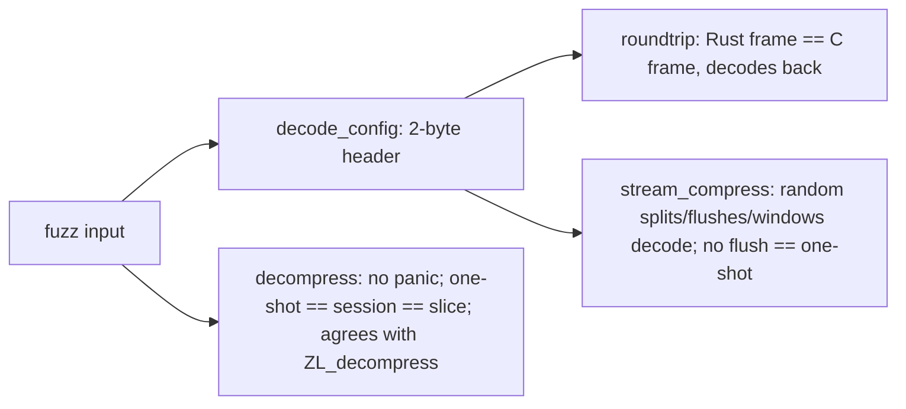

# Fuzzing

`fuzz/afl` holds the target bodies (`src/targets.rs`), thin AFL adapters,
the committed regression corpus replayed by `cargo afl test`, a seed generator
and `campaign.sh`; `fuzz/libfuzzer` wraps the same bodies for ClusterFuzzLite
(`.clusterfuzzlite/`). Both packages are outside the workspace and link the C
oracle.

| Target | Oracle |
| --- | --- |
| `decompress` | Arbitrary bytes never panic; one-shot, session and slice decoding agree; content decoded by either mopenzl or `ZL_decompress` is decoded identically by the other unless mopenzl reports `Unsupported`, a limit or a size mismatch. |
| `roundtrip` | Byte identity with `ZL_CCtx_compress` for the header's level, version, checksums and chunking; round trip through one-shot and pieces. |
| `stream_compress` | Sessions finish, never over-report progress and write frames that decode to the payload; without a chunk-cutting flush the frame equals the one-shot frame. |

## Findings

The first libFuzzer runs (300 s each, ASan) found no crash in `roundtrip` and
`stream_compress`. `decompress` found decoder divergences from the reference:
frames without chunks and unused output-type bits were accepted (fixed, with
regression tests in `tests/public_api.rs`), and 19 frames whose mutated
Zstandard payload zstd 1.5.7 decodes but `mzstd` rejects with `HuffmanStream`.
The last class is open in `mzstd`; until it is fixed a `decompress` campaign
reports them.
