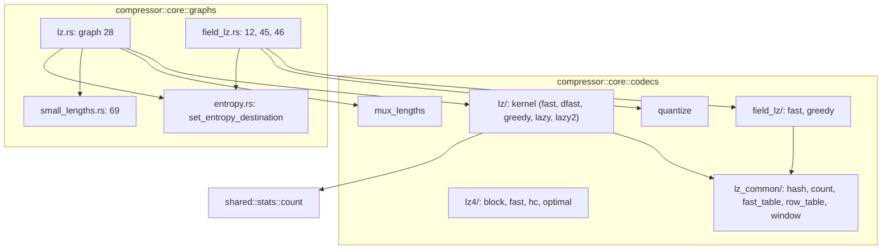
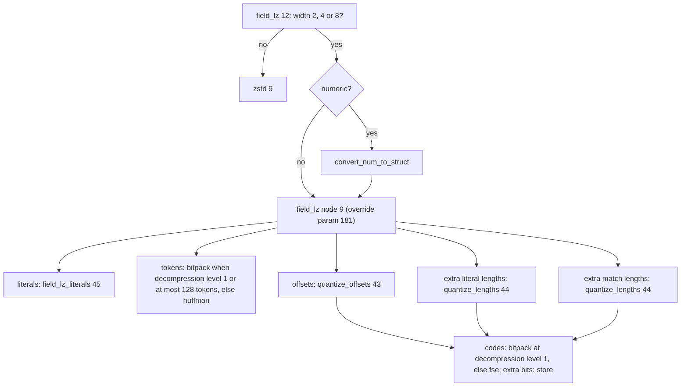
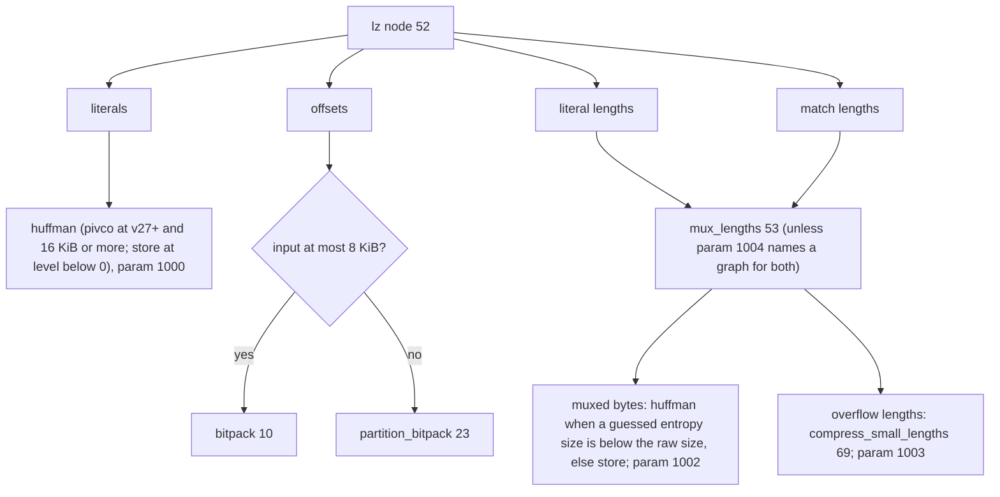

# LZ codecs and graphs

Four LZ-family encoders (`lz4`, `lz`, `field_lz`, plus the helper nodes
`quantize_*` and `mux_lengths`), the infrastructure they share and the graphs
that wire them to the entropy coders. Decoders are in the
[decoder catalogue](decoder-codecs.md). Tests: `tests/encode_lz.rs` (nodes),
`tests/encode_lzgraphs.rs` (graphs 12, 28, 45, 46, 69 and `compress_generic` on
struct and numeric inputs), `tests/encode_backends.rs` (lz4), all byte-identical
with the reference and round-tripped through both decoders.

## Module map

`lz_common` is compiled with `field-lz` or `lz`: the multiplicative hashes of
`shared/hash.h`, match-length counting (`ZS_count`, `ZS_countBack`), the
single-candidate `fast_table`, the 16-candidate `row_table` (three parallel
arrays for tags, heads and positions, visited in the reference's order) and a
single-segment `window` over indices (index 0 marks an empty slot). Dead code of
the reference (`fast_table16`, `fast_tag_table`, `copy.h`) is not ported.

## Nodes

| Node | Codec | Output | Header | Mechanics |
| --- | --- | --- | --- | --- |
| `lz4` 86 | 62 | raw LZ4 block | `varint(input size)` | level = global or local int 0; levels up to 1 use `LZ4_compress_fast` (acceleration `-level + 1`, clamped to 1..65537), above uses HC (level clamped to 12, below 1 means 9) |
| `lz` 52 | 19 | literals (serial), offsets (numeric, 16 or 32 bit), literal lengths and match lengths (numeric, 16 bit) | `varint(bytes)` | strategy fast, dfast, greedy, lazy or lazy2 from the level; parameters 1 and 100 to 106 override fields; offsets are 32-bit when the adjusted window log exceeds 16; lengths above 65535 are split across sequences; match lengths carry metadata 77 = 4 (minimum match) |
| `field_lz` 9 | 24 | literals (struct), tokens (struct w2), offsets, extra literal lengths, extra match lengths (numeric w4) | `varint(fields)` | fields of width 2, 4 or 8; token: bits 0-1 offset kind (0 to 2 repcode, 3 explicit), bits 2-5 literal length, bits 6-9 match length, saturating at 15 into the extra streams; fast finder for levels up to 3 (long hash from 2), greedy from 4; level override parameter 181, levels at or below 0 act as 3 and above 5 as 5 |
| `mux_lengths` 53 | 65 | muxed bytes, overflow lengths | `split_point` OR `bias << 4` | one byte per sequence: `split_point` bits of literal length and the rest of match length minus the bias; saturated fields write `length - mask` to the overflow stream, literal length first; the bias comes from the lz metadata |
| `quantize_offsets` 43, `quantize_lengths` 44 | 25, 26 | codes (numeric w1), extra bits (serial, LSB first) | none | offsets: one code per power of two (0 is an error); lengths: below 16 literal codes, else power-of-two buckets |

### lz4 details

- Fast: inputs under 65547 bytes use the `byU16` table with a 4-byte 13-bit
  hash; larger inputs `byU32` with a 5-byte 12-bit hash and 65535 maximum
  distance; under 13 bytes the result is one literal run.
- HC: positions are indexed with a 64 KiB offset; level 2 is `lz4mid` (two 14-bit
  tables), levels 3 to 9 hash chains, 10 to 12 the optimal parser (96, 512 and
  16384 candidates, target lengths 64, 128 and 4095).
- Only the fresh-stream, not-limited output mode is ported (all OpenZL uses); the
  limited-output, fill-output, dictionary and streaming entry points are not.

## Graphs

`field_lz` (12): widths other than 2, 4 and 8 go to zstd. A stream shorter than
the `min_stream_size` is stored, and local int parameter `i` (0 to 4) replaces
stream `i`'s graph with custom graph number `value`.

`field_lz_literals` (45): width 1 goes to the channel selector (46); wider
literals are transposed with `transpose_split` (or the deprecated width nodes
below v11) and each byte channel goes to the selector.

Channel selector (46), `ZS2_transposedLiteralStreamSelector`: at decompression
level 1 a fast choice among store, constant, bitpack, flatpack and
delta-flatpack by statistics. Otherwise: a constant channel -> `constant` (v11+)
or `huffman`; under 200 bytes -> store; delta-or-not decided by comparing the
Huffman estimate with the delta-Huffman estimate (fast estimates at level 3 or
below, exact estimates below 7, trial compressions from 7); if the best Huffman
saves less than 2 percent, store; else the smallest trial of store, Huffman and
zstd (delta variants when delta wins), each with a size penalty (`gainSize`,
wrapping like `size_t`).

`lz` (28): runs node 52 forwarding the graph's parameters, then

Parameters: level 1, graph indices 1000 (literals), 1001 (offsets), 1002 (muxed
bytes), 1003 (overflow lengths), 1004 (mux for both lengths), minimum gain 10000
bytes (default `input/200 + 50`) and 10001 percent (default off). An invalid
override index keeps the default graph (`setEntropyDestinationOrOverride`).
`compress_small_lengths` (69) is described in [standard graphs](standard-graphs.md).

## Deviations and known gaps

- Scalar ports only: the reference's AVX2/SVE2 `mux_lengths`, `ZS_Reps_update4`
  and row-table SIMD paths produce the same bytes and are not ported.
- LZ4 streaming and limited-output entry points are not ported.
- Decoders reject offset 0 everywhere (the reference reads unwritten memory);
  see [decoder codecs](decoder-codecs.md).
- `tests/codecs_lz.rs` decodes frames of the LZ4 graph and of the `lz` and
  `field_lz` nodes the C library writes; the standard `lz` (28) and `field_lz`
  (12) graphs are covered by `tests/encode_lzgraphs.rs` and
  `tests/standard_graphs.rs`.
