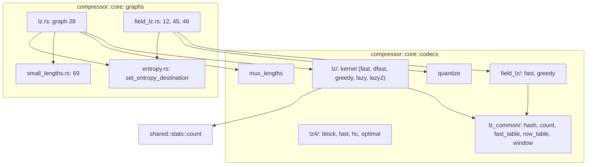
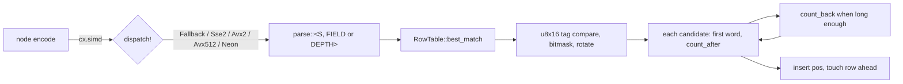
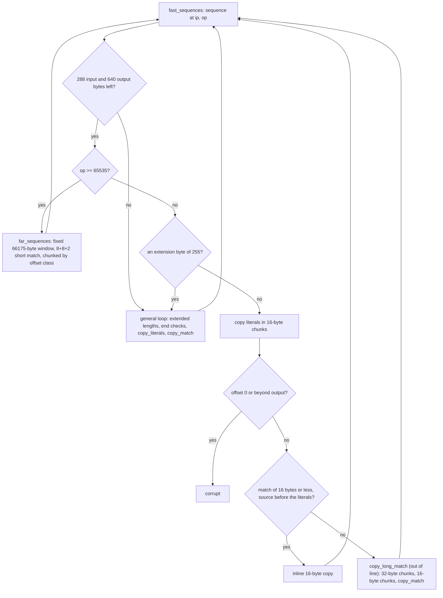
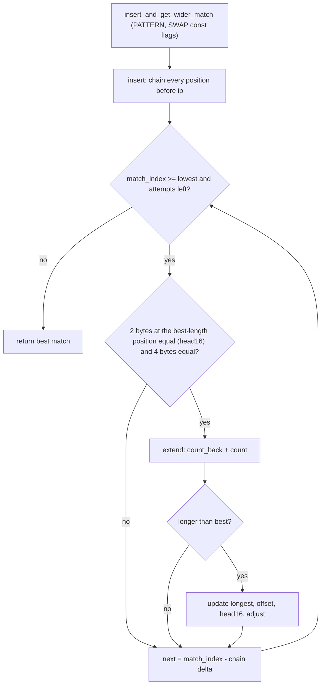
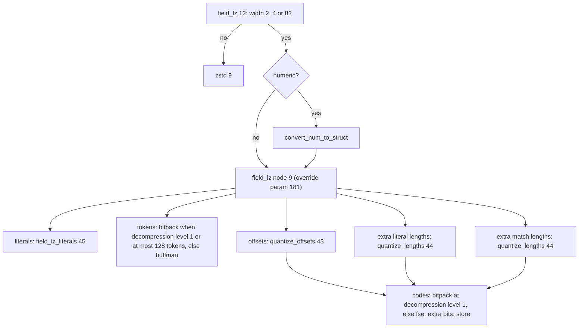
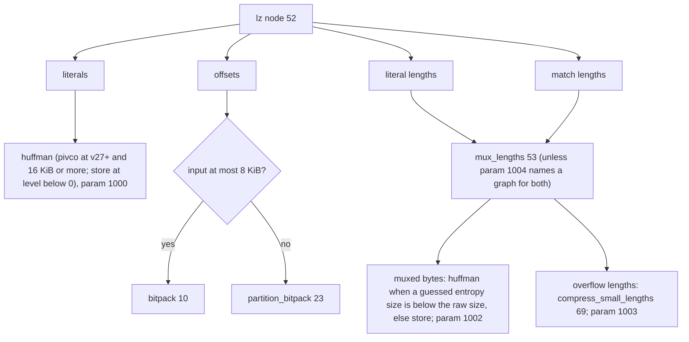
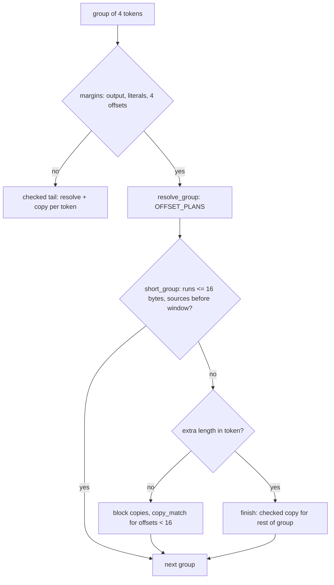

# LZ codecs and graphs

Four LZ-family encoders (`lz4`, `lz`, `field_lz`, plus the helper nodes
`quantize_*` and `mux_lengths`), the infrastructure they share and the graphs
that wire them to the entropy coders. Decoders are in the
[decoder catalogue](decoder-codecs.md). Tests: `tests/encode_lz.rs` (nodes),
`tests/encode_lzgraphs.rs` (graphs 12, 28, 45, 46, 69 and `compress_generic` on
struct and numeric inputs), `tests/encode_backends.rs` (lz4), all byte-identical
with the reference and round-tripped through both decoders.

## Module map

`lz_common` is compiled with `field-lz` or `lz`: the multiplicative hashes of
`shared/hash.h`, match-length counting (`ZS_count`, `ZS_countBack`), the
single-candidate `fast_table`, the 16-candidate `row_table` and a
single-segment `window` over indices (index 0 marks an empty slot). Dead code of
the reference (`fast_table16`, `fast_tag_table`, `copy.h`) is not ported.

### Row table and SIMD dispatch

`row_table` keeps each row as one 128-byte block (tags at 0, head at 16,
positions at 20, as `ZS_RowTable_Row`), a 64-byte aligned `Aligned` struct in a
boxed slice, so a row covers two cache lines (a `Vec<[u8; 128]>` from `calloc`
is only 16-byte aligned, which spreads a row over three lines). A lookup
compares the sixteen tags against the hash tag in one `fearless_simd` `u8x16`
compare, takes the bitmask, rotates it by the head and visits the set bits
newest first, so the candidates (and the frames) are those of the reference.

`RowTable<BIAS, MIN>` carries the index bias (0 for `lz`, 1 for the `field_lz`
window) and the hashed length as const generics (`MIN` 0 keeps the length in
the table, as `lz` does; `field_lz` passes 4 or 8 and 8 or 16 so that the hash
is selected at compile time: with a runtime length the hash was a jump table
dispatched per lookup). `fill` / `best_match` carry the field size (`FIELD`: 1
for `lz`, 2, 4 or 8 for `field_lz`). The reference gathers the candidates into
an array (prefetching each) and scores them afterwards. `best_match` with
`OUTLINE` (`field_lz`) does the same: it reads each candidate's first word
into small arrays, so the cache misses of the candidates overlap, then scores
them. Without `OUTLINE` (`lz`) each candidate is scored as it is read, which
is the same match because the candidate set is fixed before the new position
is inserted (the insert replaces the oldest slot, so it happens after the
loop, also when the loop breaks early).

Cache warming. Safe Rust has no prefetch instruction, and a load that misses
blocks retirement until it completes, so a "touch" by reading stalls the
pipeline. `lz` keeps one early read of the head byte of the row four fields
ahead (`warmed()` keeps the sum alive). `field_lz` greedy instead writes a
zero to an unused byte of the first cache line of the rows of the next eight
positions of both tables, four fields ahead, in one batch every eight
positions (`Finder::warm`, `RowTable::touch`): a store that misses is fetched
by the core without waiting for it at retirement, like a prefetch. Measured on
`sao` (4-byte fields, 7 MB): 4.6-5.2 G cycles with per-call early reads, 3.8 G
with the store batch; the C reference runs in 3.3 G.

`fill` hashes the windows of 16 bytes at each field step with a plain loop, so
the hash reads of every position whose bytes lie inside the source are
bounds-check free; the last few positions fall back to the zero-padded
`hash::load`.

`count` / `count_back` (`lz_common::count`) slice both runs once and compare a
word at a time over `as_chunks` / the preceding word, clamping the result to the
anchor and window bounds; a run that does not fit the source takes the padded
reference loop. `count_after` and `count_back` take a const `OUTLINE` flag that
runs them behind a call: the `field_lz` greedy parser sets it (`count_back`
keeps the usual case, a difference within the word before both positions,
inline and calls out only for longer runs and the window edges), because inlined,
the compiler hoists their slice arithmetic in front of the usual case of a
position with no candidate; the `lz` lazy parser keeps them inline (measured
with callgrind, 168 M against 177 M instructions on `osdb` for `lz`; the
opposite for `field_lz`). `field_lz::count_fields` is the common prefix of the
two runs rounded down to whole fields and is never inlined, for the same reason.

The SIMD level is selected once per node run, outside the parse loop: `lz`
(`kernel::lazy`) and `field_lz` (`compress`) call `dispatch!(cx.simd, simd =>
parse(simd, ..))`, and every function below the parse is `#[inline(always)]`
generic over `S: Simd`, so the whole parse is compiled with the level's target
features. Parsers are further specialised at compile time: `field_lz` greedy
on the field width (2, 4, 8) and its two hash lengths (`parse::<S, FIELD, MIN, LONG>`) and `lz` lazy on the strategy depth and on the
preset hash length 5. Fast, double-fast and the `field_lz` fast finder have no
vector kernel (single-candidate tables).

## Nodes

| Node | Codec | Output | Header | Mechanics |
| --- | --- | --- | --- | --- |
| `lz4` 86 | 62 | raw LZ4 block | `varint(input size)` | level = global or local int 0; levels up to 1 use `LZ4_compress_fast` (acceleration `-level + 1`, clamped to 1..65537), above uses HC (level clamped to 12, below 1 means 9) |
| `lz` 52 | 19 | literals (serial), offsets (numeric, 16 or 32 bit), literal lengths and match lengths (numeric, 16 bit) | `varint(bytes)` | strategy fast, dfast, greedy, lazy or lazy2 from the level; parameters 1 and 100 to 106 override fields; offsets are 32-bit when the adjusted window log exceeds 16; lengths above 65535 are split across sequences; match lengths carry metadata 77 = 4 (minimum match) |
| `field_lz` 9 | 24 | literals (struct), tokens (struct w2), offsets, extra literal lengths, extra match lengths (numeric w4) | `varint(fields)` | fields of width 2, 4 or 8; token: bits 0-1 offset kind (0 to 2 repcode, 3 explicit), bits 2-5 literal length, bits 6-9 match length, saturating at 15 into the extra streams; fast finder for levels up to 3 (long hash from 2), greedy from 4; level override parameter 181, levels at or below 0 act as 3 and above 5 as 5 |
| `mux_lengths` 53 | 65 | muxed bytes, overflow lengths | `split_point` OR `bias << 4` | one byte per sequence: `split_point` bits of literal length and the rest of match length minus the bias; saturated fields write `length - mask` to the overflow stream, literal length first; the bias comes from the lz metadata |
| `quantize_offsets` 43, `quantize_lengths` 44 | 25, 26 | codes (numeric w1), extra bits (serial, LSB first) | none | offsets: one code per power of two (0 is an error); lengths: below 16 literal codes, else power-of-two buckets |

### lz4 details

- Fast: inputs under 65547 bytes use the `byU16` table with a 4-byte 13-bit
  hash; larger inputs `byU32` with a 5-byte 12-bit hash and 65535 maximum
  distance; under 13 bytes the result is one literal run.
- HC: positions are indexed with a 64 KiB offset; level 2 is `lz4mid` (two 14-bit
  tables), levels 3 to 9 hash chains, 10 to 12 the optimal parser (96, 512 and
  16384 candidates, target lengths 64, 128 and 4095).
- Only the fresh-stream, not-limited output mode is ported (all OpenZL uses); the
  limited-output, fill-output, dictionary and streaming entry points are not.
- Hot-path shape (all safe Rust): the HC tables are fixed boxes
  (`Box<[u32; 1 << 15]>` hash, `Box<[u16; 1 << 16]>` chain, indexed by a `u16`
  so no bounds check remains); `insert` walks `windows(4)` over one pre-sliced
  range. `Hc::insert_and_get_wider_match` is `#[inline(always)]` (each call
  site gets its own copy with no call frame, as the C compiler does) and generic over the reference's
  `patternAnalysis` and `chainSwap` flags (`<PATTERN, SWAP>`): levels 3 to 7
  run `<false, false>`, levels 8 and 9 `<true, false>` (chosen once in
  `compress_hash_chain` by `max_attempts > 128`) and the optimal parser
  `<true, true>`, so each variant has only its own branches. The chain walk
  keeps the two bytes a candidate must share with the best match so far
  (`head16`, the C `LZ4_read16(iLowLimit + longest - 1)`) and the matching
  index adjustment in locals that change only when `longest` does; `peek16`
  returns `-2` for a read outside the source (a negative `LZ4HC_` back
  position wraps and fails `get`), which never equals `head16`'s `-1` miss
  value or a byte pair. Only a candidate that passes the 16-bit and 32-bit
  tests reaches `extend` (inlined: `count_back`, then `count`), which keeps
  the walk's register set small. `count_back` compares 8 bytes with a single
  read ending at the positions (most differences lie there) and falls to
  `count_back_long` only for longer runs or positions within 8 bytes of the
  start; `count` probes the first 8 bytes inline and falls to `count_long`
  (8-byte `as_chunks`) otherwise. `peek16`, `count` and `count_back` bound
  their reads with one or three comparisons and fall to the long loops
  outside them. The reads are `get`-based and panic only if
  a read leaves the source, which the reference never does.
- Decoder (`decompressor/core/codecs/lz4.rs`), three tiers of the same
  sequence loop:
  1. `fast_sequences` (inlined into the block loop) decodes a sequence while
     the unread input holds `IN_WINDOW` (288) bytes and the output has
     `OUT_WINDOW` (640) bytes of room. The windows cover a token, one
     literal extension byte (at most 269 literals), the offset and one match
     extension byte (at most 273), read as whole 16-byte chunks, so each
     window is one comparison and the end-of-block checks are implied. An
     extension byte of 255 leaves the sequence to the general loop. The unread
     input is a shrinking slice advanced as soon as the lengths are known, so
     the loop-carried chain does not wait on the copies. A match of at most 16
     bytes whose source ends before the literals is one inline 16-byte copy;
     every other match calls the out-of-line `copy_long_match` (32-byte chunks,
     sequential 16-byte chunks for overlap, `copy_match` below offset 16).
     Keeping that code out of line keeps the loop's positions in registers.
     It stops once the position reaches `MAX_OFFSET` (65535).
  1b. `far_sequences` (out of line, `#[inline(never)]`) takes over from
     `MAX_OFFSET` bytes of output on. Then every `u16` offset is valid (the
     `offset > written` check disappears; only offset 0 is an error) and each
     sequence touches one fixed-size window of the output, `FAR_WINDOW` =
     65535 + 640 bytes starting 65535 bytes before the position
     (`first_chunk_mut::<FAR_WINDOW>`, one check per sequence). Literals are
     copied to the constant index 65535 and a source is the index
     `65535 + literals - offset`, so every copy is a constant-length
     `copy_within` over computed indices that LLVM proves in bounds: the loop
     has no panic edge. A match of at most 18 bytes at an offset of 8 or more
     is three copies of 8, 8 and 2 bytes in order, as `LZ4_decompress_generic`
     does (right for any such offset, one predictable condition); longer
     matches use `chunked::<32|16|8>` by offset class (each chunk reads only
     final bytes, so in-order chunks reproduce an overlapping copy); offsets
     below 8 call `copy_long_match`. The old per-sequence choice "does the
     16-byte source chunk end before the literals" depended on the literal
     length and mispredicted (43 M branch misses against C's 26 M on ooffice);
     the offset-class conditions brought it level with C (28 M).
  2. The general loop keeps the reference's checks for everything else (longer
     extensions, the end of the block, blocks shorter than the windows).
  `copy_literals` and `copy_match` use 16-byte chunk copies when the output
  has the surplus room (the surplus is overwritten by later bytes), `memmove`
  for non-overlapping matches over 64 bytes, a fill for offset 1 and a doubling
  copy for short offsets with long matches. A chunk of an overlapping match
  only reads bytes that are final, so the in-order chunks reproduce LZ4's
  overlap semantics. `extended` finds the end of a 255-run with one
  `position` scan. The windows of tier 1 imply the checks of the general
  loop, so accepted and rejected blocks are unchanged (offset 0 stays an
  error).

## Graphs

`field_lz` (12): widths other than 2, 4 and 8 go to zstd. A stream shorter than
the `min_stream_size` is stored, and local int parameter `i` (0 to 4) replaces
stream `i`'s graph with custom graph number `value`.

`field_lz_literals` (45): width 1 goes to the channel selector (46); wider
literals are transposed with `transpose_split` (or the deprecated width nodes
below v11) and each byte channel goes to the selector.

Channel selector (46), `ZS2_transposedLiteralStreamSelector`: at decompression
level 1 a fast choice among store, constant, bitpack, flatpack and
delta-flatpack by statistics. Otherwise: a constant channel -> `constant` (v11+)
or `huffman`; under 200 bytes -> store; delta-or-not decided by comparing the
Huffman estimate with the delta-Huffman estimate (fast estimates at level 3 or
below, exact estimates below 7, trial compressions from 7); if the best Huffman
saves less than 2 percent, store; else the smallest trial of store, Huffman and
zstd (delta variants when delta wins), each with a size penalty (`gainSize`,
wrapping like `size_t`).

`lz` (28): runs node 52 forwarding the graph's parameters, then

Parameters: level 1, graph indices 1000 (literals), 1001 (offsets), 1002 (muxed
bytes), 1003 (overflow lengths), 1004 (mux for both lengths), minimum gain 10000
bytes (default `input/200 + 50`) and 10001 percent (default off). An invalid
override index keeps the default graph (`setEntropyDestinationOrOverride`).
`compress_small_lengths` (69) is described in [standard graphs](standard-graphs.md).

## Deviations and known gaps

- LZ4 decoder: the output is zero-filled (`resize`) before decoding because the stream buffer is a safe `Vec`; `lz4_flex` was not evaluated as a decoder (its end-of-block rules differ from the reference, which this port mirrors exactly).
- The reference's AVX2/SVE2 `mux_lengths` and `ZS_Reps_update4` produce the same
  bytes as the scalar ports here (`mux_lengths` is a scalar loop specialised on
  the length width). The row-table tag compare is vectorised; the row prefetch is
  an early read because safe Rust has no prefetch intrinsic.
- LZ4 streaming and limited-output entry points are not ported.
- Decoders reject offset 0 everywhere (the reference reads unwritten memory);
  see [decoder codecs](decoder-codecs.md).
- `tests/codecs_lz.rs` decodes frames of the LZ4 graph and of the `lz` and
  `field_lz` nodes the C library writes; the standard `lz` (28) and `field_lz`
  (12) graphs are covered by `tests/encode_lzgraphs.rs` and
  `tests/standard_graphs.rs`.

## Decoders of `lz`, `field_lz`, `quantize`

The `lz` and `field_lz` decoders write into an output buffer sized to the
declared size up front (`decompressor::core::codecs::lz_copy`): literal runs of
up to 16 bytes and matches with offset >= length are single 16-byte block
copies whose overshoot is scratch (never read: sources lie before the write
cursor) that later writes cover or the final truncation drops; longer or
overlapping matches use `copy_within`, `fill` (offset 1) or doubling of the
repeated pattern. Validation is unchanged (offset 0, offsets past the output,
lengths past the declared size and unused streams are `Corrupted`).
`quantize` reads the extra bits with one 64-bit load per value (a cold tail path
zero pads past the end) from tables covering all 256 codes after a range check.

### `field_lz` decode loop

`Fields::expand` (monomorphised on the field shift for 1, 2, 4 and 8-byte
fields, `groups::<BITS, LM>`) runs groups of four tokens, like the reference's
four-token unrolling, with one margin check per group (output room, literal
room, four explicit offsets left). Per group:

1. `offset_codes` gathers the four 2-bit offset codes with one multiply;
   `resolve_group` resolves the four offsets and the new repeat offsets from
   the `OFFSET_PLANS` table (the scalar counterpart of `ZS_kOffsetShuffle`
   plus `_pext_u64`), with a shortcut when all four are explicit.
2. `short_group` handles groups whose runs are at most 16 bytes (code 15 never
   qualifies): per token one 16-byte block for the literals and one for the
   match, both into a fixed 128-byte output window, the source read from the
   part of the output before the window. If any token is longer, or a source
   is not entirely before the window, it returns `None` and the group is
   redone by the general path (same bytes, same validity decision).
3. The general path copies literals and matches in 16-byte blocks (`copy_match`
   for offsets under 16). A token with an extra length hands the rest of the
   group to `finish`/`copy`, the fully checked step also used for the tail
   tokens, so errors and limits are exactly those of the previous loop.

The output is still zero-filled up front (`Vec::resize`): about a tenth of the
stage on sao. Known gap: no safe way found to skip it.
