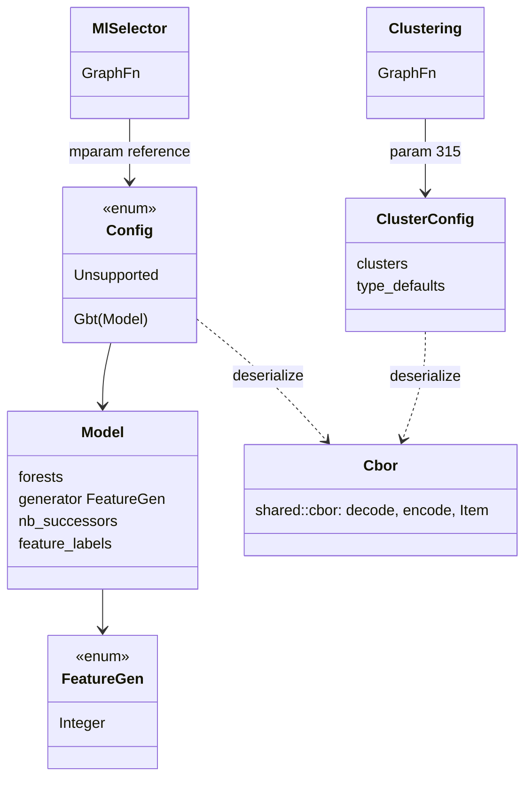
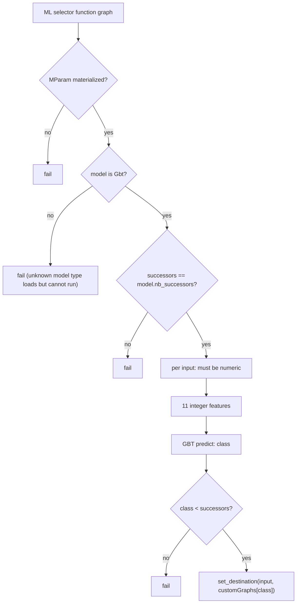
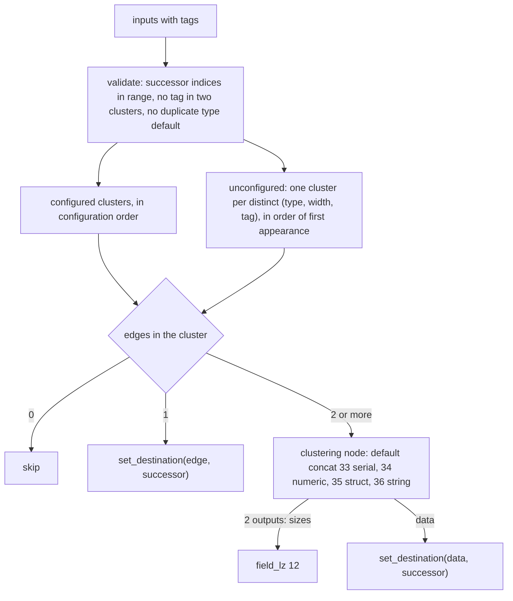

# ML selector and clustering

Two configurable graphs route streams by data the user trains or tags:
`ml_selector` (17) chooses a successor with a gradient-boosted-tree model over
statistics of a numeric stream, and `cluster` (18) groups tagged inputs and
concatenates each group before its successor. Both read the CBOR blobs the
reference's training tools write, through the shared CBOR codec. Code:
`compressor::core::graphs::{ml_selector, clustering}`, public wrappers in
`graph::{MlSelectorConfig, GbtModel, GbtNode, ClusteringConfig, ConfigError}`.
Tests: `tests/encode_ml.rs` (byte identity with the C graphs built through
`openzl_ffi::enc_ml`, round trips, configuration behaviour).

## Ownership

`shared::cbor` is a port of the reference's A1CBOR library (`decode`, `encode`,
`item`): strict decoder configuration (`DecoderConfig::STRICT`), `max_depth`
128, arena accounting through `limit_bytes` (`sizeof(A1C_Item)` = 32 and
`sizeof(A1C_Pair)` = 64 per item and pair), integers outside `i64` rejected,
maps written in item order. JSON output is not ported.

## ML selector (17)

The model travels as a CBOR blob, the graph's *MParam*. It is decoded once when
the graph is registered (`ZL_MLSel_materialize`) and kept as the reserved
reference parameter `MPARAM_REF_ID` (`i32::MIN + 1`) holding an `Arc<Config>`;
a graph without it fails like the reference's "config was not materialized".
`GraphBuilder::ml_selector(config, successors)` builds the graph;
`untrained_ml_selector` builds one whose model always chooses class 0.

- Features (`FeatureGen::Integer`, the only generator; an unknown generator ID
  fails to load): `nbElts`, `eltWidth`, `cardinality`, `cardinality_upper`,
  `cardinality_lower`, `range_size`, `mean`, `variance`, `stddev`, `skewness`,
  `kurtosis`. The mean is accumulated in two interleaved sums, width 1 is
  computed from a histogram with the reference's `unsigned` products, no fused
  multiply-adds.
- GBT prediction: one forest is a binary classifier (class 1 when the summed
  leaves are not negative), several forests score one class each and the
  highest wins (the first on ties). `f32` sums, tree by tree. A node splits on
  `feature < value` to `left`, otherwise `right`, and takes `missing` for a
  missing or NaN feature. Every child must advance (`next > node`).
- Deviation: the reference trusts a deserialized tree and, when malformed, reads
  out of bounds or loops; here a malformed tree (no children, a child that does
  not advance or is out of range, a feature index below -1) fails the
  prediction. The config reader accepts what the reference's reader accepts
  (including models `GBTModel_validate` would reject) and ignores unknown keys.

## Clustering (18)

Every input carries the integer metadata `CLUSTERING_TAG_METADATA_ID` (0), its
tag (`Input::with_metadata`). The configuration (CBOR, reference or copy
parameter 315) lists clusters (type, element width, member tags, successor
index, clustering-codec index) and per-type defaults. The graph's custom graphs
are the successors and its custom nodes the clustering codecs.

An unconfigured tag uses its type's default (successor and codec), or
`compress_generic` and the type's concat node without one. The map keys are
`(type, width, tag)` in a `BTreeMap`, so cluster order and hence node and stream
order, which determine the frame bytes, follow the rules above exactly.
The typed `ClusteringConfig` converts a blob only when its type fields are known
stream types (`unknown stream type` otherwise); a tag set twice on one input is
last-wins.

## Known gaps

- Only the GBT model type and the integer feature generator exist (the same as
  the reference at v0.3.0).
- No training: configurations come from the reference's tools or are written by
  hand in code.
- No AFL target feeds CBOR configurations to the decoder yet (see
  [fuzzing](fuzzing.md)).
