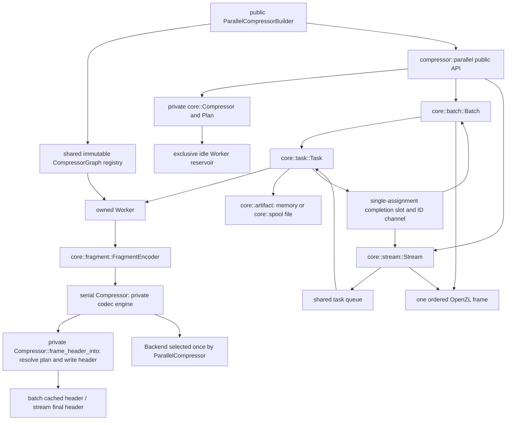
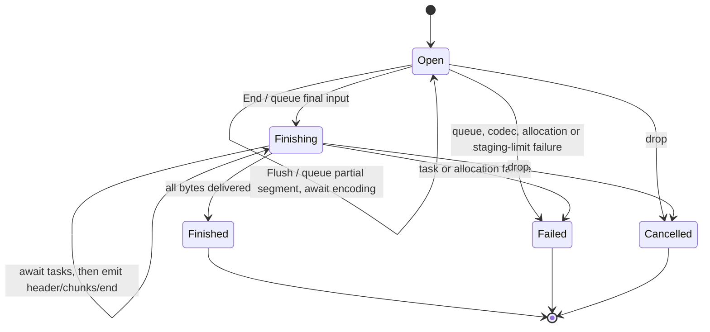

# Parallel compression

`compressor::parallel` is available with `compression` unless `no_std` is
selected. Its caller-scheduled API follows `../mbrotli`: `ParallelCompressor`,
`ParallelConfig`, `BatchConfig`, validated `SegmentSize` and `TaskCount`,
scoped/owned tasks and batches, random-access sources, staging, polling,
retention, borrowed/owned sessions, task queues, and synchronous I/O adapters.
There is no executor dependency, thread creation, global pool or unsafe code.
`ParallelCompressor::builder(encoder, parallel)` returns a
`ParallelCompressorBuilder` with serial-style `with_graph` and `with_backend`
methods. `new` and `with_backend` remain shorthand for the default graph.
Encoder settings are this crate's `EncoderConfig`; operations use this crate's
`Continue`, `Flush`, and `End` names.

## Ownership and dispatch



A task owns its worker, artifact, input handle, cancellation observer and
completion capability; it never borrows the coordinator or compressor. Borrowed
slice tasks work with scoped executors; owned sources produce `Send + 'static`
tasks. A batch exclusively borrows the compressor until finish/drop. A stream
borrows or owns it. Reconfiguration releases idle workers only when encoder
settings change; the selected graph is preserved by `reconfigure`. Parallel
reconfiguration reapplies retention limits. The graph registry and prepared
dictionaries are shared by `Arc`; every worker has its own serial encoder and
fragment buffers. Graph callbacks must accept concurrent calls and must be
deterministic for scheduling/backend byte invariance to apply.

`Backend` is detected once at construction or supplied with `with_backend`, then
passed to each worker's serial compressors. The existing codec engine performs
SIMD dispatch outside kernels. The parallel layer adds no SIMD kernels.

## Planning and source consistency

Segments have a validated size of 64 KiB through 16 MiB (default 4 MiB).
Segment boundaries depend on input coordinates, never task count. Tasks receive
balanced contiguous groups; effective count is `min(requested, segments)`.
A nonempty input smaller than `minimum_parallel_size` (default 8 MiB) uses a
canonical serial frame only if it fits one segment. Empty input has zero tasks
and uses the serial empty frame. OpenZL chunks have no cross-segment history;
`context_prefix_bytes` is always zero.

Slices are borrowed directly. `ArcBytesSource`, positional `FileSource`,
mutex-protected `SeekSource<R>` and custom `RandomAccessSource` handles support
owned tasks. Reads use `u64` absolute coordinates and at most one segment buffer
per worker. `SeekSource` keeps seek and short-read retry under one lock; file
sources use positional reads on Unix/Windows. Other platforms report unsupported
positional reads. Length and optional caller-supplied identity are captured at
planning and rechecked before batch destination writes, according to
`SourceConsistency`. Metadata snapshots cannot prove that contents are immutable;
the caller must keep the source unchanged.

Preflight checks arithmetic, task/descriptor storage, a conservative per-worker
workspace estimate (`64 * segment_size + 128 MiB`), retained workers and staging.
Payload allowance is `2 * input + 1024 * max(segments, 1)`. Complete-output allowance
adds 64 envelope bytes. Memory staging also charges descriptors; its explicit
limit and the optional aggregate memory limit are independent.
`maximum_staging_memory_bytes` computes the payload-plus-descriptor bound.
`BatchConfig::auto` uses memory staging with a `usize::MAX` caller ceiling; it
does not inspect available RAM or switch to disk. Estimates account for library
buffers and workspaces, and are not process RSS or allocator guarantees.

## Encoding and one-frame assembly

```mermaid
sequenceDiagram
    participant Caller
    participant Batch
    participant Task
    participant Serial as serial Compressor
    participant C as OpenZL decoder
    Caller->>Batch: prepare_slice / prepare_source
    Batch-->>Caller: take_tasks
    Caller->>Task: run in arbitrary executor/order
    loop fixed segments of this task
        Task->>Serial: compress one segment
        Serial-->>Task: complete serial frame
        Task->>Task: retain chunks; omit frame header and end marker
    end
    Task-->>Batch: artifact, descriptors and returned worker
    Caller->>Batch: finish_into / finish_to_writer
    Batch->>Batch: wait; verify source and every descriptor
    Batch->>C: one total-size header, ordered chunks, end marker 0
    C-->>Caller: original concatenated input
```

`FragmentEncoder` reuses a serial compressor, frame buffer and header buffer.
Every worker is built with the selected `CompressorGraph`; standard graphs,
static pipelines, parameterized codec nodes, selectors, segmenters and application
codecs use the existing serial graph engine. Each independent input segment is
serial; the graph may convert it internally. Segment boundaries, including a
short final segment or a flush, must satisfy the graph's alignment/record rules.
Typed or multiple top-level inputs are not exposed by this API.

The private `Compressor::frame_header_into` resolves the serial plan and writes
only its header through `Engine::header`. Fragment extraction uses that exact
header length, rather than assuming a default header or parsing compressed data.
This preserves the bundle-ID lane and checksum for dictionary graphs. The batch
prepares and caches the full-input header before handing out workers; streaming
writes it when the input size is known. Header failures preserve `EncodeError`
under `ParallelEncodeError::FrameHeader`, before any destination mutation.

All bytes between the serial header and end marker are independently checksummed
OpenZL chunks. Smaller fixed chunking and a selected graph's own segmenter stay
in force inside each parallel segment; trying to wrap an existing segmenter with
`Chunking::Fixed` returns the same graph error as serial compression. Serial
fallback and empty-input handling use the selected graph too. Changing global
encoder parameters releases idle workers and preserves graph selection.

Without the `zstd` feature, the default-graph factory selects stored chunks even
with nondefault stream/expansion/decompression-level settings. An explicitly
selected graph receives its exact configuration and follows serial behavior for
disabled codecs or unsupported versions: it may fail, or fall back when the graph
and permissive settings permit it. Explicit selection never silently replaces
the graph. Graph execution errors retain task/segment context and typed sources.
The existing staged-payload allowance still applies; graphs that expand beyond
it fail staging rather than exceeding the approved artifact bound.

The coordinator writes one new header announcing the full input length, copies
artifacts in source order, and writes the OpenZL end marker. The serial fallback
already contains its envelope and is copied unchanged. These are ordinary OpenZL
frames, not concatenated frames or a private container. They need not match the
reference default graph's bytes. Fixed configuration/input gives identical bytes
across scheduling order, task count, source, staging and supported SIMD backend.

Memory artifacts grow geometrically within their approved payload bounds.
Directory staging creates exclusive private spool files, retains open handles,
and unlinks them on drop. Assembly streams file contents through 128 KiB scratch.
Descriptors must exactly cover planned segment ranges and artifact lengths.
`finish_into` preserves the existing vector prefix and rolls its length back on
assembly failure. Consuming `finish_to_writer` returns the writer, typed cause
and exact accepted byte count on error; it does not flush or promise durability.

## Streaming lifecycle



The task queue's cloned handles support blocking iteration and nonblocking
`try_recv`. At most `window` segments are queued/running/awaiting ordered
collection; one additional input segment is gathered. Completed chunks move into
a deque without copying payload and free their completion slots for reuse.
OpenZL's reference decoder requires a known total input size. The API follows
mbrotli's size-free streaming signatures, so **all compressed chunks remain
buffered until `End`**. Only then is the total-size header prepended and the end
marker appended. `Flush` encodes a partial segment but emits no prefix; it changes
later segment boundaries. A stream without flushes matches its batch bytes.
The optional aggregate memory limit reserves the initial window estimate and
limits subsequent staged payload capacity plus per-part metadata. Unlimited
configuration can retain a whole compressed input; window size alone does not
bound that storage.

`process` is nonblocking and reports exact consumed/produced counts with
`NeedsInput`, `Pending`, `NeedsOutput`, or `Finished`. `wait`/`wait_timeout` await
completions without executing tasks. `process_uninit` shares the same state
machine and writes only the produced prefix through the existing safe
`Destination` abstraction. `Read` consumes the source through EOF before first
output; `Write` retains compressed chunks until finish. Writer sink failures
preserve undelivered bytes and allow finalization retry via `FinishError`.
Executors must stay runnable while any adapter or wait blocks.

## Failures and cleanup

Each task publishes exactly once. Dropping an unrun task publishes abandonment.
Under unwind builds, a task catches worker/source panics, discards the worker,
and reports `TaskPanicked`; abort builds cannot recover. Cancellation is
cooperative between segments and cannot interrupt arbitrary blocking source I/O.
A failed task cancels siblings. Batch failure selection prefers originating
errors over cancellation fallout, then lowest task ID. Stream failures preserve
the cause in `StreamFailed`, permanently fail subsequent calls and close the
queue. Public errors preserve typed serial/configuration/I/O source chains.

Dropping a coordinator cancels and drains already published completions without
waiting for detached tasks. Late tasks own their resources until completion.
Dropping all queue handles closes the queue and abandons queued tasks; tasks
already taken remain the executor's responsibility. Completion never requires a
coordinator to drain payload, so one-thread executors can run complete batches.

## Validation and known gaps

`tests/parallel*.rs` cover C interoperability, versions/checksums, sources,
staging, scheduler/backend determinism, fallback/segment boundaries, cancellation,
panics, retryable I/O, incremental chunking and uninitialized destinations.
`tests/parallel_graphs.rs` additionally covers selected graphs, codec pipelines,
local parameters, custom nodes, dictionary envelopes and error propagation.
Focused core tests cover baseline dispatch, artifact invariants and budget failure.
The uninitialized streaming test is registered in `scripts/check_simd_uninit.py`
for both Miri and ASan. AFL `parallel` and its libFuzzer adapter compare batch,
source and streaming results and decode through C and Rust. `benches/parallel.rs`
compares complete caller-scheduled compression with the C serial segmenter.

Known gaps: no parallel typed/multiple top-level input API or comment setter; no
streaming disk staging or early frame output; no built-in executor; byte identity
with reference default compression is not a contract. Active workspace estimates
are conservative models, not hard allocator limits.
