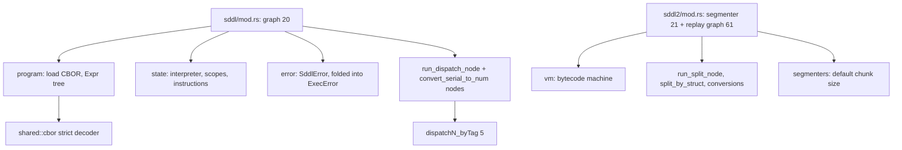
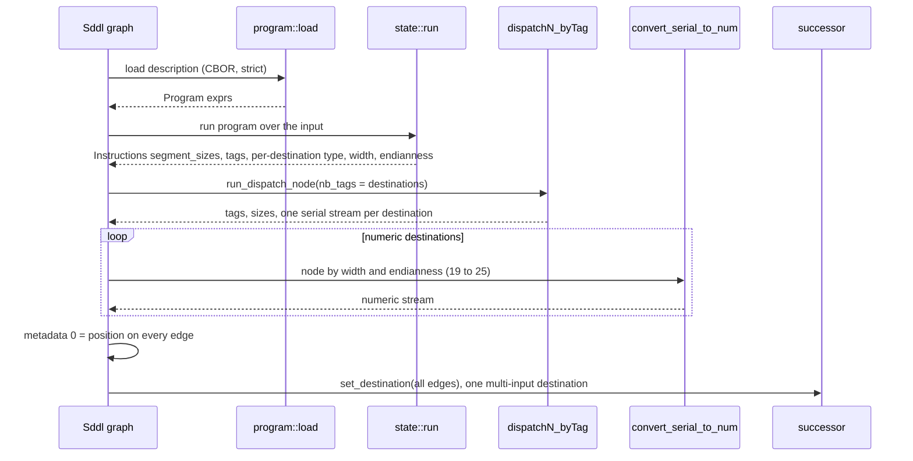
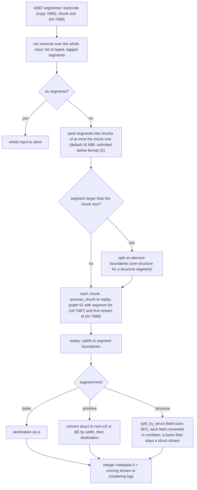

# SDDL and SDDL2

The Simple Data Description Language graphs parse a serial input with a compiled
description and route the parsed fields to separate streams. `sddl` (20) is an
interpreter over a CBOR *description*; `sddl2` (21) is a segmenter that runs a
stack-machine *bytecode* and replays the segments it found through the private
`sddl2_chunk` graph (61). The compilers of the reference are C++ tools outside
this repository, so descriptions and bytecode arrive as bytes (public:
`GraphBuilder::sddl(&[u8], impl Into<GraphId>)`,
`GraphBuilder::sddl2(&[u8], chunk_size, Option<GraphId>)`). Code:
`compressor::core::graphs::{sddl, sddl2}`; tests: `tests/encode_sddl.rs` with
hand-built programs in `tests/support/sddl.rs` (byte identity with the reference
and round trips through both decoders).

## Module map

## SDDL (20)

Parameters: description in copy parameter 522 (`DESCRIPTION_PID`), exactly one
custom graph, no custom node, exactly one serial input.

Interpreter (`state.rs`): it evaluates the program's root expressions against the
input. Consuming an atom appends to the dispatch instructions; consecutive atoms
sent to the same destination merge into one segment. A record consumed
repeatedly by an array replays a cached copy of its instructions
(`consume_record_no_scope`), including the way the reference reconstructs a
cached first instruction, because the segment list is part of the frame.
Expression kinds: `Null`, `Op` (die, expect, log, consume, sizeof, send, assign,
member, bind, comparison, arithmetic, bit and logic operators), `Num`, `Field`
(atom, record, array, poison), `Dest`, `Var`, `Scope`, `Tuple`, `Func`.
Reference counting is `Rc`; scopes shared by several holders are copied before
modification, as in the reference.

Limits (port of the reference constants): at most 100 000 000 segments, 1 024
variables per scope, 1 024 destinations (a destination index of 1 024 or more is
an error). Failures: a violated `expect`, a read past the input, an inconsistent
destination type, unconsumed input.

Reproduced quirks: the cached first-instruction merge length; the 1 024 variable
scope limit; wrapping `i64` arithmetic where C is undefined. Deviations: no
stderr logging, the disassembler is not ported.

## SDDL2 (21 and 61)

The destination is the segmenter's custom graph, `compress_generic` when none.
Zero-size segments consume stream IDs without producing a stream, so the tags a
downstream [clustering](ml-and-clustering.md) graph sees stay aligned with the
program.

VM (`sddl2/vm.rs`): 32-bit little-endian instruction words, the family in the
high 16 bits and the opcode in the low 16; `push.u32`, `push.i32` and `push.tag`
carry a 4-byte immediate, `push.i64` an 8-byte one. Families: push, math, cmp,
logic, control, load, stack, type, var, call, segment. Capacities: 256 stack
values, 256 value registers, 524 288 segments, 32 768 tags.

Quirks kept on purpose: an unknown family is a silent no-op (the reference's
dispatch `switch` has no default); `stack.over` and `stack.rot` are in the opcode
table but invalid bytecode, as in the interpreter; `type.fixed_array` truncates
its count to 32 bits before multiplying. VM failures map to the reference's
messages (`InvalidBytecode`, `StackOverflow`, `StackUnderflow`, `MathOverflow`,
`TypeMismatch`, `LoadBounds`, `SegmentBounds`, `LimitExceeded`, `DivZero`,
`ValidationFailed`) and surface as `GraphError`.

## Known gaps

- No AFL target feeds descriptions or bytecode to the interpreter and VM, and
  `check_simd_uninit.py` does not list these modules (they use no `unsafe` or
  `MaybeUninit`).
- The SDDL2 bytecode disassembler and trace buffer are not ported (debug only).
- No compiler for either language.
