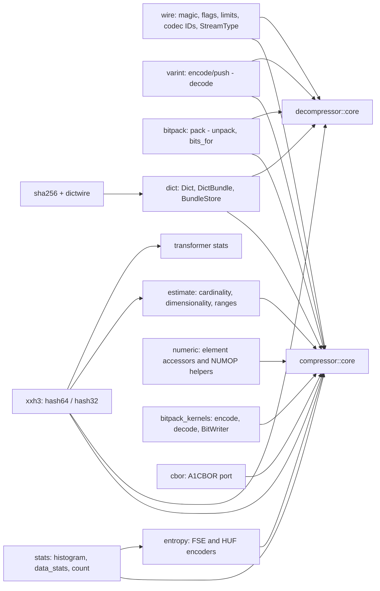
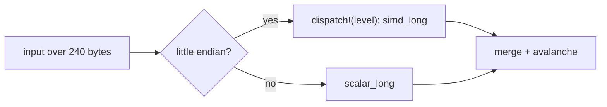

# Shared primitives

`shared` is private and compiled when either codec is enabled; each item is
gated to the codec (and, for the encoder-side algorithms, the Cargo codec
features) that uses it. [Codec features](codec-features.md) lists the gates.

## Both directions

- `varint`: LEB128 as `ZL_varintEncode`; decoding is the reference's lenient
  reader (redundant groups accepted, ten bytes at most, bit 0 of a tenth byte).
- `bitpack`: values packed from the least significant bit of the first byte,
  zero-padded to a byte (`ZS_bitpackEncode32`); `bits_for` is `ZL_nextPow2`.
- `wire`: magic, flag bits, `BUNDLE_VERSION_MIN` (25), `COMMENT_VERSION_MIN`
  (22), limits, standard codec IDs, `StreamType`.
- `sha256` (FIPS 180-4, scalar): derives dictionary and bundle IDs
  (`ZL_UniqueID_computeSHA256`); dictionaries are hashed once, so it is far from a
  hot path. Tests check the NIST vectors and the C library on every padding
  shape.
- `dictwire`: the formats of dictionaries, bundle info, fat bundles and trained
  Zstandard content (`parse_dict`, `pack_dict`, `parse_bundle_info`,
  `parse_fat_bundle`, `pack_fat_bundle`, `bundle_id`, `parse_zstd_content`,
  `pack_zstd_content`) with a private `WireError`; see
  [dictionaries](dictionaries.md).

## Encoder-side modules (`compression`)

| Module | Contents | Gate |
| --- | --- | --- |
| `stats` | `Histogram` (8 and 16 bit), `DataStatsU8` (lazily computed entropy with the reference's integer log table, cardinality, bit-packed, flat-packed and constant sizes, delta variants, Huffman size estimates), `count` (match-length counting) | `entropy` or `pivco-huffman`; `data_stats` also serves the `field_lz` literals selector |
| `entropy` | OpenZL's FSE/HUF encoder fork (`bits`, `fse`, `huf`, `huf16`), see [entropy](entropy.md) | `entropy` or `pivco-huffman` |
| `estimate` | cardinality by linear counting and HyperLogLog (`estimate_cardinality_fixed`, `_variable`, `_hashed`), `estimate_dimensionality`, `compute_unsigned_range`, `guess_float_width`; floating point ported expression by expression with no fused multiply-add, libm entry points from `std` or the `libm` crate; uses `xxh3` | `compression`; consumers: Transformer, ML selector features |
| `numeric` | `read_le`/`push_le`/`elements`, the `NUMOP_*` helpers (`find_max`, sums, `under_limit`, `width_for_array`, `write_numerics_from_*`, `byteswap`); items without a caller are `#[cfg(test)]` | `compression` (inner items per codec feature) |
| `bitpack_kernels` | `encode`/`decode`/`encode_bound` of fixed-width fields (LSB first) and `writer::BitWriter`, the port of `ZS_BitCStreamFF` | `bitpack` or `bitunpack` |
| `cbor` | A1CBOR port: `Item`, strict `decode` (`max_depth` 128, arena `limit_bytes`), `encode_to_vec`; see [ML selector and clustering](ml-and-clustering.md) | `compression` |

All of it is a scalar port of the reference function of the same name and
returns the same numbers, quirks included (the integer entropy approximation,
the estimators' bias, wrapping arithmetic); several helpers carry
`expect(dead_code)` for feature sets that do not use them.

## XXH3

`xxh3::hash64(level, input)` is `XXH3_64bits` with the default secret and seed
0; `hash32` keeps the low 32 bits. Inputs up to 240 bytes take the reference's
scalar short paths. Longer inputs run the stripe accumulator:

`simd_long` keeps the eight accumulator lanes in one `u64x8`. Per 64-byte
stripe it loads the data as `u8x64`, bit-casts to `u64x8`, XORs the key,
splits the keyed `u32x16` into two `u32x8`, de-interleaves low and high words
(`unzip_low`/`unzip_high`) and multiplies them with `widening_mul_u32x8`; the
pairwise swap of data lanes is a `swizzle_dyn_within_blocks` that exchanges
the 8-byte halves of each 16-byte block. The once-per-kilobyte scramble runs
on the stored lanes with the scalar code. The level is selected when the codec
is built and passed down; `dispatch!` runs once per hash, outside the stripe
loop. `scalar_long` is the independent baseline: unit tests compare both at
every host level and against the C library for every length class.

## Known gaps

- Big-endian targets take the scalar accumulator.
- Only XXH3 has a SIMD path. The histogram, estimators, entropy encoders and bit
  packing kernels are scalar; they were not profiled (see
  [encoder codecs](encoder-codecs.md)).
- `no_std` estimators use `libm`, whose last bit can differ from the platform
  libm (see [transformer](transformer.md)).
