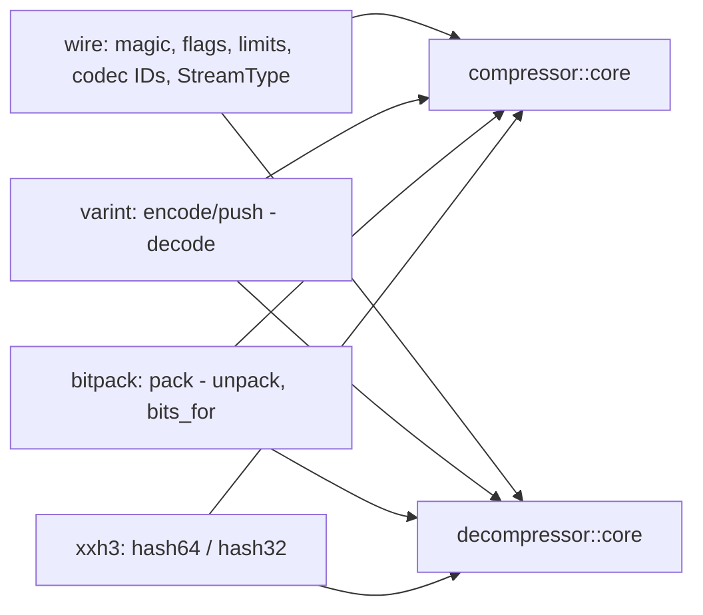
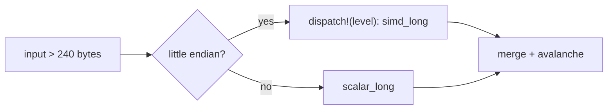

# Shared primitives

`shared` is private and compiled when either codec is enabled; each item is
gated to the codec that uses it.

- `varint`: LEB128 as `ZL_varintEncode`; decoding is the reference's lenient
  reader (redundant groups accepted, ten bytes at most, bit 0 of a tenth byte).
- `bitpack`: values packed from the least significant bit of the first byte,
  zero-padded to a byte (`ZS_bitpackEncode32`); `bits_for` is `ZL_nextPow2`.

## XXH3

`xxh3::hash64(level, input)` is `XXH3_64bits` with the default secret and seed
0; `hash32` keeps the low 32 bits. Inputs up to 240 bytes take the reference's
scalar short paths. Longer inputs run the stripe accumulator:

`simd_long` keeps the eight accumulator lanes in one `u64x8`. Per 64-byte
stripe it loads the data as `u8x64`, bit-casts to `u64x8`, XORs the key,
splits the keyed `u32x16` into two `u32x8`, de-interleaves low and high words
(`unzip_low`/`unzip_high`) and multiplies them with `widening_mul_u32x8`; the
pairwise swap of data lanes is a `swizzle_dyn_within_blocks` that exchanges
the 8-byte halves of each 16-byte block. The once-per-kilobyte scramble runs
on the stored lanes with the scalar code. The level is selected when the codec
is built and passed down; `dispatch!` runs once per hash, outside the stripe
loop. `scalar_long` is the independent baseline: unit tests compare both at
every host level and against the C library for every length class.

## Known gaps

- Big-endian targets take the scalar accumulator.
