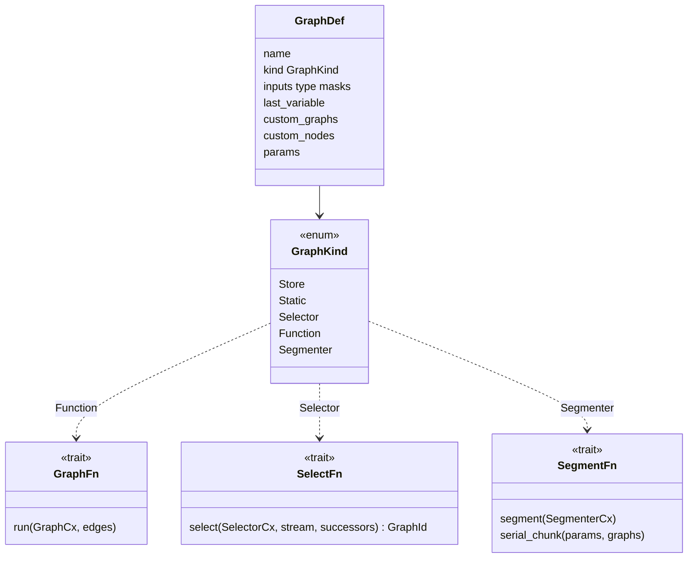
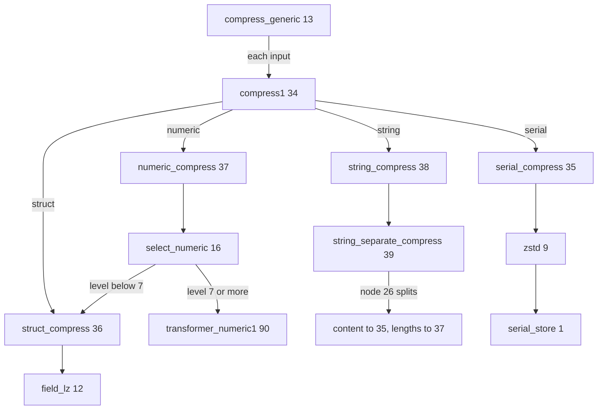
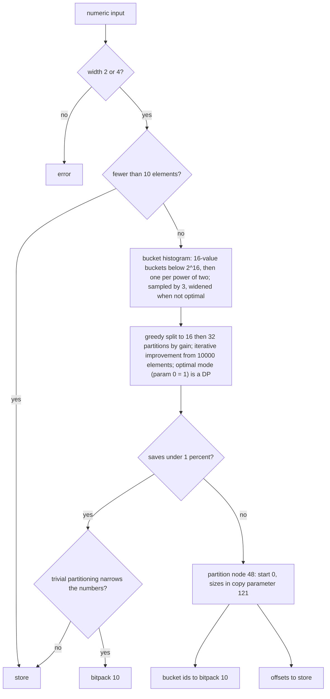
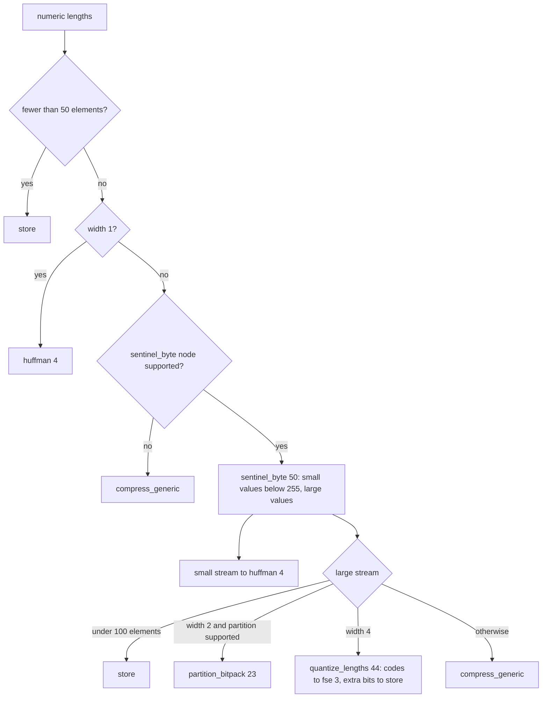

# Standard graphs

Every graph of `GR_standardGraphs` (IDs 1 to 90, `registry/graphs.rs`) is
implemented. This page records what each one decides; the engine that runs them
is in [compression graphs](compressor-graphs.md). Graph IDs below are the
registry's numbering. Implementations live in `compressor::core::graphs`
(one file per family) and stay byte-identical with the reference:
`tests/standard_graphs.rs` runs every graph the C library accepts over serial,
struct, numeric and string inputs at several levels and format versions and
compares the frames.

## Kinds

- **Static**: one node followed by fixed successors (`node_graph!`).
- **Selector**: looks at one stream and returns the successor graph.
- **Function**: runs nodes and assigns every output edge a destination.
- **Segmenter**: cuts the whole input into chunks, each run through a successor.

Without a Cargo feature a graph that needs its codec aliases
`UNPORTED_FUNCTION` / `UNPORTED_SELECTOR` (`ExecError::Unported`), which only
exists for feature-off builds and tests: `field_lz` and its private graphs need
`field-lz` + `entropy`, `lz` needs `lz` + `entropy`, `partition_bitpack` needs
`partition`, `merge_sorted` needs `merge-sorted`, and the five entropy graphs
need `entropy`.

## Routing and stores

| ID | Graph | Decision |
| --- | --- | --- |
| 1 | `serial_store` | Store kind: marks the stream stored |
| 2 | `store` | function: every input to `store1` (32) |
| 32 | `store1` | selector: strings to `string_store` (33), everything else to `serial_store`; typed data reaches it through an implicit conversion node |
| 33 | `string_store` | node 26 `separate_string_components`, both outputs to `serial_store` |
| 13 | `compress_generic` | function, variable inputs: each input to `compress1` |
| 34 | `compress1` (private "compress2") | selector by input type, table above |
| 35-38 | `serial/struct/numeric/string_compress` | constant selectors: zstd (9), `field_lz` (12), `select_numeric` (16), `string_separate_compress` (39) |
| 39 | `string_separate_compress` | node 26, then lengths to `numeric_compress` (37), content to `serial_compress` (35) |
| 14 | `select_generic_lz_backend` | always zstd (9) |
| 16 | `select_numeric` | `level < 7` -> `struct_compress`; otherwise `transformer_numeric1` (90) |
| 31 | `brute_force` | trial-compresses each compatible successor with `try_graph`; the smallest frame strictly below the input weight wins, otherwise `store` |
| 62 | `n_to_n` | input `i` goes to custom graph `i` |

## Segmenters

| ID | Graph | Behaviour |
| --- | --- | --- |
| 29 | `segment_serial` | cuts every N bytes (int parameter 7700, default 16 MiB), each chunk to custom graph 0 (default `compress_generic`); below format 21 one chunk. `serial_chunk` exposes `(size, successor)` structurally so sessions stay incremental |
| 15 | `segmenter_numeric` | cuts every 16 MiB of elements, chunks to `numeric_compress` |
| 24-27 | `segment_num{8,16,32,64}_from_serial` | serial input cut every N bytes aligned down to the width (parameters 300 size, 301 width), chunks to the interpret graphs 65-68 |
| 21 | `sddl2` | see [SDDL](sddl.md) |

## Entropy and packing graphs

| ID | Graph | Decision |
| --- | --- | --- |
| 3-7 | `fse`, `huffman`, `huffman_huf0`, `huffman_pivco`, `entropy` | the one entropy plan, see [entropy](entropy.md) |
| 8 | `constant` | selector: a single-byte-pattern stream (or serial input) to `constant_serial` (42), struct or numeric to `constant_fixed` (43), strings illegal; verification happens at the node |
| 10 | `bitpack` | selector: numeric -> `bitpack_int` (41), otherwise `bitpack_serial` (40) |
| 11 | `flatpack` | node 65, both outputs to `serial_store` |
| 40-44 | private `bitpack_serial/int`, `constant_serial/fixed`, `fse_ncount` | one node then `serial_store` |
| 23 | `partition_bitpack` | below |
| 63 | private `merge_sorted` | function with two custom graphs (the node pipeline and a backup): width other than 4, or more than 64 strictly increasing runs, goes to the backup |
| 69 | `compress_small_lengths` | below |

### partition_bitpack (23)

Cost model: `24 + count * ceil(log2(bucket size))` bits per partition plus
`ceil(log2(partitions))` bits per element; at most 256 partitions.

### compress_small_lengths (69)

The overflow-lengths stream of the `lz` graph: mostly tiny values, a few large
ones.

## Structure graphs

| ID | Graph | Decision |
| --- | --- | --- |
| 19 | `try_parse_int` | parses every string as `i64`. All parse: `parse_int` (38) with pre-parsed values, output to custom graph 0. None parse: whole input to custom graph 1. Mixed: `dispatch_string` into two outputs, indices to custom graph 2, the parsable ones through `parse_int` to graph 0, exceptions to graph 1 |
| 57-60 | `split_serial/struct/numeric/string` | run the one custom node, output `i` to custom graph `i` |
| 64 | `transpose_split` selector | v11 and newer always the `transpose_split` pipeline (last of five custom graphs); older versions pick by width, but the deprecated nodes are not reachable at the supported range |
| 18 | `cluster` | see [ML selector and clustering](ml-and-clustering.md) |
| 17 | `ml_selector` | see [ML selector and clustering](ml-and-clustering.md) |
| 20, 21, 61 | `sddl`, `sddl2`, `sddl2_chunk` | see [SDDL](sddl.md) |

## Numeric static pipelines

Static node-plus-successor graphs the Transformer reaches; see
[transformer](transformer.md).

| IDs | Graphs |
| --- | --- |
| 47-49, 65-68 | `delta_huffman`, `delta_flatpack`, `delta_zstd` (serial-to-numeric conversion node 19, then the internal delta graph 50-52), `interpret_num{8,16,32,64}_compress` (conversion nodes 19-22, then `numeric_compress`) |
| 50-56 | `delta_huffman_internal`, `flatpack_internal`, `zstd_internal`, `delta_field_lz`, `range_pack`, `range_pack_zstd`, `tokenize_delta_field_lz` |
| 70-75 | `transformer_delta_int`, `range_pack`, `divide_by_gcd`, `tokenize_numeric(_sorted)`, `sparse_num`: the node, outputs back to `transformer_numeric1` (90) |
| 76-89 | `transformer_static_*`: the heuristic selectors and their pipelines |
| 30, 90 | `transformer_numeric`, `transformer_numeric1` |

## LZ graphs

`lz4` (22) is a static node graph; `field_lz` (12), `field_lz_literals` (45),
the channel selector (46) and `lz` (28) are covered in [LZ](lz.md).

## Known gaps

- `ExecError::Unported` is no longer reachable with every codec feature on; with
  a feature off a graph that needs it fails like any disabled codec.
- Custom (user) graphs are expressed through `graph::Selector`, `FunctionGraph`
  and `Segmenter`; a failing user graph is reported as `GraphError`.
