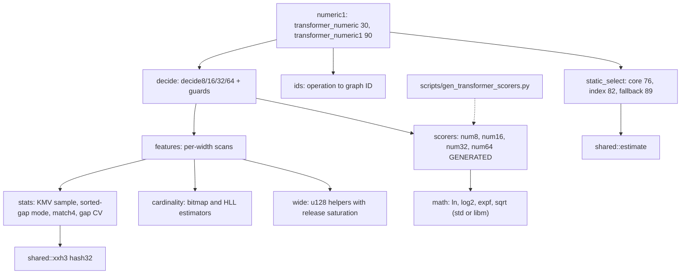
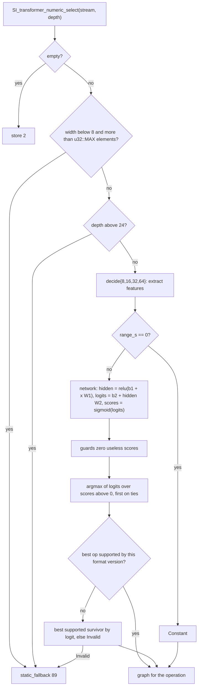
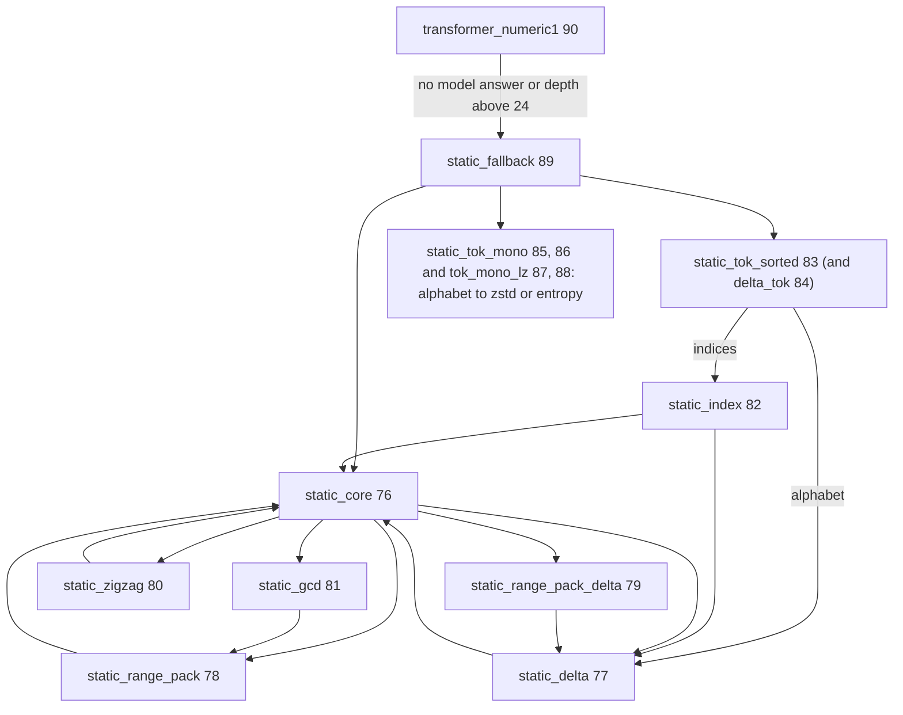

# Transformer numeric selector

For numeric streams at compression level 7 and above, `select_numeric` (16)
hands the stream to `transformer_numeric1` (90), a selector that extracts
statistical features, scores the candidate operations with a small neural
network and routes the stream to the best supported one. The code is in
`compressor::core::graphs::transformer`; it is the only consumer of
`shared::estimate`. Output is byte-identical with the reference
(`tests/encode_transformer.rs`: widths 1, 2, 4 and 8 over many data shapes,
graphs 16, 30, 70 to 90, with no skipped cases).

## Module map

## Decision flow

The operation to graph mapping (`graph_for_operation`): `Constant` 8, `Bitpack`
10, `DeltaInt` 70, `DivideByGcd` 72, `Entropy` 7, `FieldLz` 12, `Fse` 3,
`RangePack` 71, `SparseNum` 75, `Store` 2, `TokenizeNumeric` 73,
`TokenizeNumericSorted` 74, `Zstd` 9, `Invalid` 89. Support is a format-version
check through `is_node_supported`: `Constant` needs both constant nodes,
`DivideByGcd` needs `divide_by`, `SparseNum` needs `sparse_num`; the other
operations are always supported.

The transforming graphs 70 to 75 run their node and send every output back to
`transformer_numeric1`, so a stream can be transformed repeatedly; the recursion
depth (`SelectorCx::depth`) is bounded at 24 for the model, after which the
fallback decides.

## Features and scorers

- One scan per width, each ported in the reference's operation order: Q32 fixed
  point for widths 1 to 4 and doubles for width 8; a full feature set for width
  1 and "decision" subsets for widths 2, 4 and 8. Only the fields the scorers and
  guards read are computed. Elements are read little endian.
- `stats` implements the KMV sample (K = 256), the sorted-gap mode, the
  `match4` hash table (4096 entries, `xxh3::hash32`) and the transition-gap
  coefficient of variation; `cardinality` the bitmap and HyperLogLog estimators.
- `scorers/num{8,16,32,64}.rs` hold the weight tables and the per-width feature
  expressions. They are **generated** by `scripts/gen_transformer_scorers.py`
  from the vendored C (`score_numeric{8,16,32,64}.c` and the feature headers):
  the script re-emits each `f32` with the shortest decimal that round-trips,
  converts the feature expressions with a small C expression parser and
  refuses to run when the C network differs from the hand-written
  `scorers/mod.rs` (two dense layers, ReLU, sigmoid clamped at +-15). Rerun it,
  `cargo fmt` and commit whenever the vendored scorers change.
- Guards (`apply_score_guards`) zero the score of: `DivideByGcd` when
  `min_lb0 == 0` or `min_u == 1`; the tokenize operations when range density
  `cardinality / (range + 1)` exceeds the float-rounded 0.9; `RangePack` when
  the minimum is 0 and the maximum reaches half the width.

## Static selectors (no model)

`transformer_static_fallback` (89) is the answer when the model has none. It
tries, in order: the dense small-range num16 tokenize rule, the delta override,
the float64 override, then a low-cardinality tokenize policy and the num16 delta
rescue. Those choices end in the `transformer_static_*` pipelines (77 to 88), whose
outputs lead to `static_core` (76), `static_index` (82) or, for the monotonic
tokenize rows, straight to zstd and entropy.

`static_core` (76), in order: empty -> store; constant -> `constant` (v11 and
newer, else store); depth above 30 (24 plus a margin of 6) -> terminal graph
(zstd for width 1, `field_lz` otherwise); `delta_int` rules on up/down counts
and delta cardinality; `zigzag` when the signed data crosses zero with at least
25 percent negative extent; `divide_by_gcd` for gcd of at least 256 (powers of
two need decisive narrowing); `range_pack` (with a second delta stage for smooth
data); the num8 FSE gate; the terminal graph.

`static_index` (82) decides whether a tokenize index stream is smooth enough for
`delta_int` first (num8 locality and small-delta share, num16 temporal locality).

## Floating point and determinism

- Every operation is a single IEEE operation in the reference's order and type
  (`float` network, `double` feature expressions); `mul_add` is never used and
  the reference is built with `-ffp-contract=off`. The matrix product loops are
  interchanged (inputs outermost) for contiguous weight rows, but each output's
  summation order (bias first, then inputs by index) is preserved.
- `math.rs` routes `ln`, `log2`, `expf` and `sqrt` to the platform libm with
  `std`, and to the `libm` crate with `no_std`.
- **no_std caveat.** `libm::expf` differs by one ULP from the platform `expf`
  for some inputs, and `shared::estimate` (`log`, `exp`, `pow`) can differ in the
  last bit too. A `no_std` build therefore has no byte-identity guarantee for
  decisions that depend on these functions; scores are within about 2 ULP and a
  decision changes only on an exact tie (none seen in more than 4000 compared
  frames). `sqrt` is correctly rounded everywhere. The `libm` crate is an
  optional dependency enabled by `no_std`; `shared::estimate` is compiled with
  `compression` in every build.
- Wide arithmetic (`wide.rs`) uses native `u128` with the reference's
  release-build saturation (a quotient that does not fit is `u64::MAX`).

## Known gaps

- No automated drift check runs the generator in CI; the suggested check is to
  rerun the script and `git diff`.
- The feature scans are scalar; the reference's are scalar too, so no SIMD
  path exists to compare.
- `no_std` determinism, see above.
