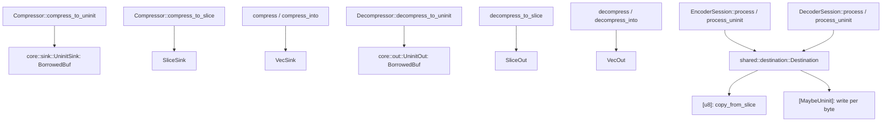

# Uninitialized output

`compress_to_uninit`, `decompress_to_uninit` and `process_uninit` on both
sessions write into `&mut [MaybeUninit<u8>]` (for example
`Vec::spare_capacity_mut`) without `unsafe` in the crate and without a
temporary buffer. They return the same bytes, counts and errors as their
initialized counterparts; exactly `dst[..written]` / `output[..produced]` is
initialized afterwards.

## Encoder

`UninitSink` wraps the destination in a `borrowed_buf::BorrowedBuf`; every
`put` appends to its filled prefix, so only written bytes become initialized
and nothing is zeroed. The compressed checksum reads the chunk back from the
filled prefix.

## Decoder

`UninitOut` appends stored streams to the filled prefix without zeroing. A
Zstandard stream (magicless, decoded in place with no staging buffer; with a
dictionary when the node carries one, `Out::zstd` takes the optional
`DecodeDictionary`) is decoded into `grow(size)`, which zeroes exactly the bytes
about to be decoded into (each byte once). `VecOut` instead appends through
`mzstd::Decompressor::decompress_into`, so `Vec` destinations are never
zero-filled; the content checksum reads the regenerated chunk back from the
destination either way.

## Sessions

Sessions decode or compress into their own pending buffer and copy into the
caller's output through `shared::destination::fill`, which is generic over
`Destination`; `[MaybeUninit<u8>]` is written byte by byte (a `memcpy` after
optimization) and never read. Calls of both kinds may be mixed on one
operation.

## Verification

`tests/uninit.rs` starts every buffer as `MaybeUninit::uninit()`; its
`rust_only_*` tests and the unit tests of `shared::destination`,
`compressor::core::sink` and `decompressor::core::out` run under Miri and
AddressSanitizer through `scripts/check_simd_uninit.py`.

## Known gaps

- The Miri/ASan lists in `scripts/check_simd_uninit.py` (`compressor::core::sink`,
  `decompressor::core::out`, `shared::destination`, `shared::xxh3`, and the
  `simd_backends` and `uninit` tests) are unchanged: the encoder codecs, graphs
  and shared algorithms added since are scalar, `Vec`-based safe code with no
  SIMD kernel and no `MaybeUninit` path, so they are not on the lists.
- `decompress_to_slice` and `decompress_to_uninit` decode Zstandard through
  `mzstd::decompress_to_slice`, which is slower than its `decompress_into`
  path on some data (records: 1.37 vs 1.76 GiB/s); see
  [the comparison](benchmark-comparison.md).
