# Silesia comparison

**AMD Ryzen 9 7950X (KVM, 2 vCPUs) · rustc 1.99.1 · C at -O3 · full Silesia files · 2026-11-10.** Each standard graph compresses every listed Silesia file as one
input with the library defaults (level 6, format version 27, both checksums).
Every frame was verified byte-identical to OpenZL v0.3.0 C, and both decoders
restored the input, before timing; compressed sizes are therefore equal.
Throughput is MB/s (10⁶ bytes per second) of uncompressed bytes, from the
median of alternating rounds; a graph's figure is its total bytes over its
total median time. "/ C" is mopenzl's speed relative to C (above 1× is faster).

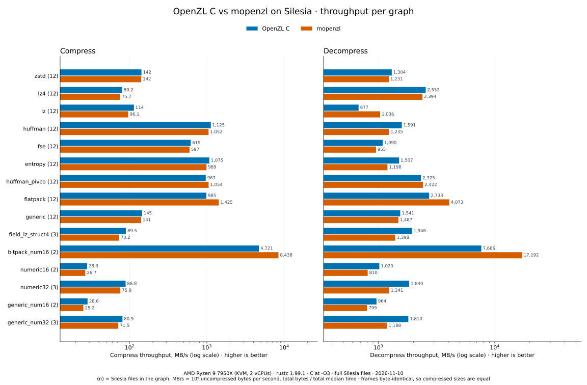

Raw measurements: [silesia-2026-11-10/](silesia-2026-11-10/) · [how to reproduce](../benchmarking.md#silesia-comparison).

## Per graph

| Graph | Files | C compress | mopenzl compress | / C | C decompress | mopenzl decompress | / C |
| --- | --- | --- | --- | --- | --- | --- | --- |
| zstd | 12 | 142 MB/s | 142 MB/s | 0.99× | 1,304 MB/s | 1,231 MB/s | 0.94× |
| lz4 | 12 | 80.2 MB/s | 75.7 MB/s | 0.94× | 2,552 MB/s | 2,394 MB/s | 0.94× |
| lz | 12 | 114 MB/s | 96.1 MB/s | 0.85× | 677 MB/s | 1,036 MB/s | 1.53× |
| huffman | 12 | 1,125 MB/s | 1,052 MB/s | 0.94× | 1,591 MB/s | 1,235 MB/s | 0.78× |
| fse | 12 | 619 MB/s | 597 MB/s | 0.96× | 1,090 MB/s | 955 MB/s | 0.88× |
| entropy | 12 | 1,075 MB/s | 989 MB/s | 0.92× | 1,507 MB/s | 1,198 MB/s | 0.79× |
| huffman_pivco | 12 | 967 MB/s | 1,054 MB/s | 1.09× | 2,325 MB/s | 2,422 MB/s | 1.04× |
| flatpack | 12 | 985 MB/s | 1,425 MB/s | 1.45× | 2,733 MB/s | 4,073 MB/s | 1.49× |
| generic | 12 | 145 MB/s | 141 MB/s | 0.97× | 1,541 MB/s | 1,487 MB/s | 0.96× |
| field_lz_struct4 | 3 | 89.5 MB/s | 73.2 MB/s | 0.82× | 1,946 MB/s | 1,398 MB/s | 0.72× |
| bitpack_num16 | 2 | 4,721 MB/s | 8,438 MB/s | 1.79× | 7,666 MB/s | 17,192 MB/s | 2.24× |
| numeric16 | 2 | 28.3 MB/s | 26.7 MB/s | 0.95× | 1,020 MB/s | 810 MB/s | 0.79× |
| numeric32 | 3 | 88.8 MB/s | 75.9 MB/s | 0.85× | 1,840 MB/s | 1,241 MB/s | 0.67× |
| generic_num16 | 2 | 28.6 MB/s | 25.2 MB/s | 0.88× | 964 MB/s | 799 MB/s | 0.83× |
| generic_num32 | 3 | 80.9 MB/s | 71.5 MB/s | 0.88× | 1,810 MB/s | 1,188 MB/s | 0.66× |

## zstd

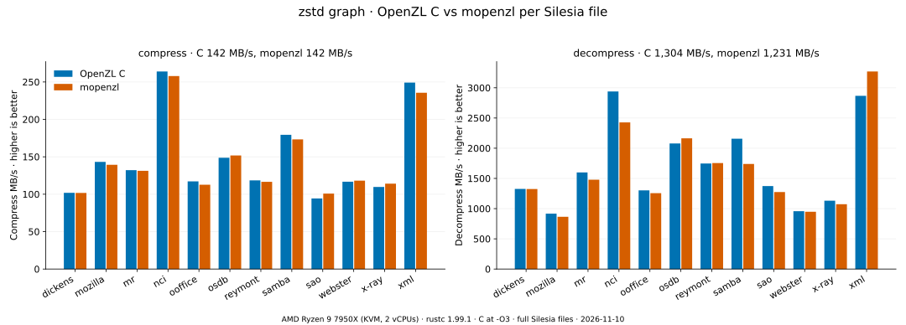

| File | Bytes | Ratio | C compress | mopenzl compress | / C | C decompress | mopenzl decompress | / C |
| --- | --- | --- | --- | --- | --- | --- | --- | --- |
| dickens | 10192446 | 2.982 | 102 MB/s | 102 MB/s | 1.00× | 1,326 MB/s | 1,324 MB/s | 1.00× |
| mozilla | 51220480 | 2.986 | 143 MB/s | 139 MB/s | 0.97× | 916 MB/s | 865 MB/s | 0.94× |
| mr | 9970564 | 2.944 | 132 MB/s | 131 MB/s | 0.99× | 1,599 MB/s | 1,479 MB/s | 0.92× |
| nci | 33553445 | 13.830 | 264 MB/s | 258 MB/s | 0.98× | 2,939 MB/s | 2,427 MB/s | 0.83× |
| ooffice | 6152192 | 2.099 | 117 MB/s | 113 MB/s | 0.96× | 1,302 MB/s | 1,256 MB/s | 0.96× |
| osdb | 10085684 | 2.970 | 149 MB/s | 152 MB/s | 1.02× | 2,079 MB/s | 2,164 MB/s | 1.04× |
| reymont | 6627202 | 3.735 | 118 MB/s | 117 MB/s | 0.98× | 1,747 MB/s | 1,754 MB/s | 1.00× |
| samba | 21606400 | 4.724 | 179 MB/s | 173 MB/s | 0.97× | 2,157 MB/s | 1,740 MB/s | 0.81× |
| sao | 7251944 | 1.375 | 94.3 MB/s | 101 MB/s | 1.07× | 1,373 MB/s | 1,275 MB/s | 0.93× |
| webster | 41458703 | 3.836 | 117 MB/s | 118 MB/s | 1.01× | 958 MB/s | 948 MB/s | 0.99× |
| x-ray | 8474240 | 1.526 | 110 MB/s | 114 MB/s | 1.04× | 1,131 MB/s | 1,073 MB/s | 0.95× |
| xml | 5345280 | 9.777 | 249 MB/s | 236 MB/s | 0.95× | 2,868 MB/s | 3,270 MB/s | 1.14× |

## lz4

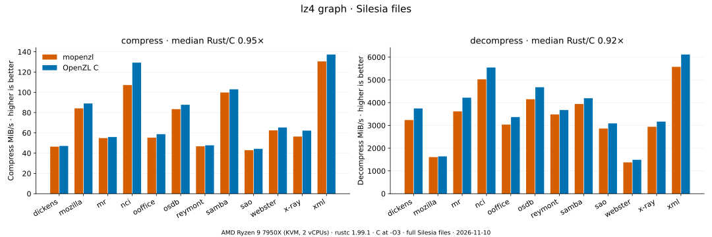

| File | Bytes | Ratio | C compress | mopenzl compress | / C | C decompress | mopenzl decompress | / C |
| --- | --- | --- | --- | --- | --- | --- | --- | --- |
| dickens | 10192446 | 2.284 | 49.4 MB/s | 48.7 MB/s | 0.99× | 3,926 MB/s | 3,393 MB/s | 0.86× |
| mozilla | 51220480 | 2.309 | 93.4 MB/s | 88.3 MB/s | 0.95× | 1,718 MB/s | 1,684 MB/s | 0.98× |
| mr | 9970564 | 2.308 | 58.6 MB/s | 57.5 MB/s | 0.98× | 4,423 MB/s | 3,792 MB/s | 0.86× |
| nci | 33553445 | 8.889 | 136 MB/s | 112 MB/s | 0.83× | 5,813 MB/s | 5,269 MB/s | 0.91× |
| ooffice | 6152192 | 1.733 | 61.6 MB/s | 58.0 MB/s | 0.94× | 3,530 MB/s | 3,183 MB/s | 0.90× |
| osdb | 10085684 | 2.534 | 92.0 MB/s | 87.5 MB/s | 0.95× | 4,904 MB/s | 4,351 MB/s | 0.89× |
| reymont | 6627202 | 3.055 | 50.0 MB/s | 49.0 MB/s | 0.98× | 3,855 MB/s | 3,652 MB/s | 0.95× |
| samba | 21606400 | 3.508 | 108 MB/s | 105 MB/s | 0.97× | 4,398 MB/s | 4,132 MB/s | 0.94× |
| sao | 7251944 | 1.261 | 46.4 MB/s | 45.0 MB/s | 0.97× | 3,240 MB/s | 3,000 MB/s | 0.93× |
| webster | 41458703 | 2.945 | 68.4 MB/s | 65.5 MB/s | 0.96× | 1,561 MB/s | 1,442 MB/s | 0.92× |
| x-ray | 8474240 | 1.181 | 65.3 MB/s | 59.1 MB/s | 0.91× | 3,320 MB/s | 3,084 MB/s | 0.93× |
| xml | 5345280 | 6.844 | 144 MB/s | 137 MB/s | 0.95× | 6,412 MB/s | 5,843 MB/s | 0.91× |

## lz

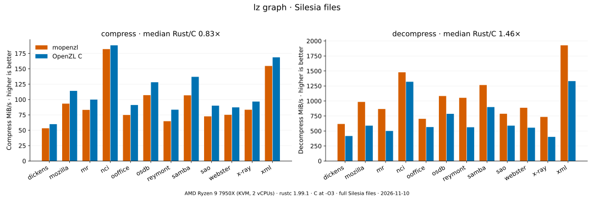

| File | Bytes | Ratio | C compress | mopenzl compress | / C | C decompress | mopenzl decompress | / C |
| --- | --- | --- | --- | --- | --- | --- | --- | --- |
| dickens | 10192446 | 2.935 | 62.9 MB/s | 55.9 MB/s | 0.89× | 436 MB/s | 647 MB/s | 1.48× |
| mozilla | 51220480 | 2.713 | 120 MB/s | 97.9 MB/s | 0.82× | 617 MB/s | 1,032 MB/s | 1.67× |
| mr | 9970564 | 2.954 | 105 MB/s | 87.2 MB/s | 0.83× | 525 MB/s | 908 MB/s | 1.73× |
| nci | 33553445 | 12.380 | 197 MB/s | 191 MB/s | 0.97× | 1,384 MB/s | 1,549 MB/s | 1.12× |
| ooffice | 6152192 | 1.972 | 95.5 MB/s | 78.5 MB/s | 0.82× | 593 MB/s | 737 MB/s | 1.24× |
| osdb | 10085684 | 2.945 | 134 MB/s | 112 MB/s | 0.84× | 824 MB/s | 1,135 MB/s | 1.38× |
| reymont | 6627202 | 3.651 | 87.5 MB/s | 67.9 MB/s | 0.78× | 590 MB/s | 1,104 MB/s | 1.87× |
| samba | 21606400 | 4.437 | 144 MB/s | 112 MB/s | 0.78× | 942 MB/s | 1,327 MB/s | 1.41× |
| sao | 7251944 | 1.370 | 94.5 MB/s | 76.2 MB/s | 0.81× | 618 MB/s | 825 MB/s | 1.34× |
| webster | 41458703 | 3.739 | 91.5 MB/s | 78.8 MB/s | 0.86× | 582 MB/s | 930 MB/s | 1.60× |
| x-ray | 8474240 | 1.477 | 101 MB/s | 87.5 MB/s | 0.86× | 421 MB/s | 770 MB/s | 1.83× |
| xml | 5345280 | 8.950 | 177 MB/s | 162 MB/s | 0.92× | 1,396 MB/s | 2,021 MB/s | 1.45× |

## huffman

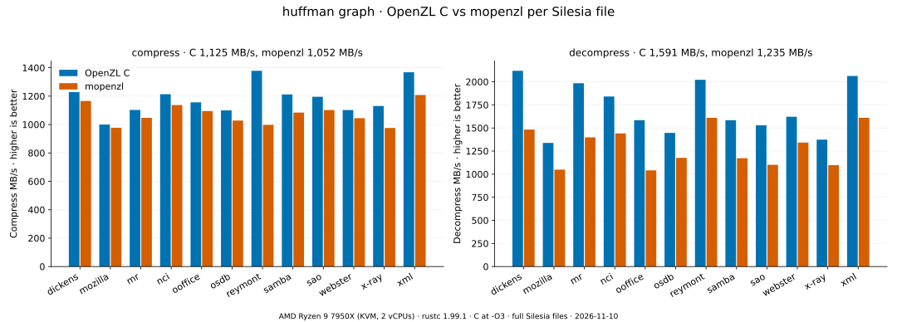

| File | Bytes | Ratio | C compress | mopenzl compress | / C | C decompress | mopenzl decompress | / C |
| --- | --- | --- | --- | --- | --- | --- | --- | --- |
| dickens | 10192446 | 1.748 | 1,228 MB/s | 1,166 MB/s | 0.95× | 2,119 MB/s | 1,482 MB/s | 0.70× |
| mozilla | 51220480 | 1.441 | 1,000 MB/s | 977 MB/s | 0.98× | 1,338 MB/s | 1,049 MB/s | 0.78× |
| mr | 9970564 | 2.250 | 1,103 MB/s | 1,047 MB/s | 0.95× | 1,984 MB/s | 1,398 MB/s | 0.70× |
| nci | 33553445 | 3.256 | 1,213 MB/s | 1,137 MB/s | 0.94× | 1,841 MB/s | 1,441 MB/s | 0.78× |
| ooffice | 6152192 | 1.268 | 1,156 MB/s | 1,095 MB/s | 0.95× | 1,584 MB/s | 1,041 MB/s | 0.66× |
| osdb | 10085684 | 1.202 | 1,100 MB/s | 1,028 MB/s | 0.93× | 1,447 MB/s | 1,177 MB/s | 0.81× |
| reymont | 6627202 | 1.658 | 1,378 MB/s | 998 MB/s | 0.72× | 2,021 MB/s | 1,610 MB/s | 0.80× |
| samba | 21606400 | 1.514 | 1,212 MB/s | 1,084 MB/s | 0.89× | 1,584 MB/s | 1,172 MB/s | 0.74× |
| sao | 7251944 | 1.074 | 1,195 MB/s | 1,102 MB/s | 0.92× | 1,529 MB/s | 1,101 MB/s | 0.72× |
| webster | 41458703 | 1.599 | 1,102 MB/s | 1,045 MB/s | 0.95× | 1,622 MB/s | 1,342 MB/s | 0.83× |
| x-ray | 8474240 | 1.247 | 1,130 MB/s | 976 MB/s | 0.86× | 1,373 MB/s | 1,098 MB/s | 0.80× |
| xml | 5345280 | 1.609 | 1,368 MB/s | 1,208 MB/s | 0.88× | 2,063 MB/s | 1,610 MB/s | 0.78× |

## fse

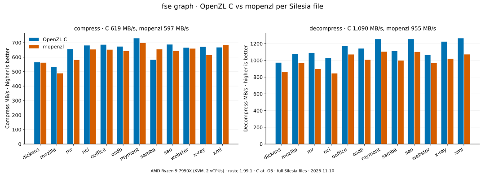

| File | Bytes | Ratio | C compress | mopenzl compress | / C | C decompress | mopenzl decompress | / C |
| --- | --- | --- | --- | --- | --- | --- | --- | --- |
| dickens | 10192446 | 1.761 | 564 MB/s | 562 MB/s | 1.00× | 972 MB/s | 864 MB/s | 0.89× |
| mozilla | 51220480 | 1.443 | 532 MB/s | 488 MB/s | 0.92× | 1,077 MB/s | 966 MB/s | 0.90× |
| mr | 9970564 | 2.272 | 656 MB/s | 580 MB/s | 0.89× | 1,090 MB/s | 897 MB/s | 0.82× |
| nci | 33553445 | 3.273 | 681 MB/s | 653 MB/s | 0.96× | 1,029 MB/s | 844 MB/s | 0.82× |
| ooffice | 6152192 | 1.266 | 686 MB/s | 652 MB/s | 0.95× | 1,172 MB/s | 1,071 MB/s | 0.91× |
| osdb | 10085684 | 1.202 | 673 MB/s | 642 MB/s | 0.95× | 1,141 MB/s | 1,007 MB/s | 0.88× |
| reymont | 6627202 | 1.665 | 730 MB/s | 698 MB/s | 0.96× | 1,254 MB/s | 1,104 MB/s | 0.88× |
| samba | 21606400 | 1.520 | 582 MB/s | 654 MB/s | 1.12× | 1,111 MB/s | 998 MB/s | 0.90× |
| sao | 7251944 | 1.070 | 687 MB/s | 643 MB/s | 0.94× | 1,254 MB/s | 1,101 MB/s | 0.88× |
| webster | 41458703 | 1.607 | 665 MB/s | 659 MB/s | 0.99× | 1,065 MB/s | 966 MB/s | 0.91× |
| x-ray | 8474240 | 1.245 | 671 MB/s | 614 MB/s | 0.92× | 1,224 MB/s | 1,020 MB/s | 0.83× |
| xml | 5345280 | 1.618 | 667 MB/s | 684 MB/s | 1.03× | 1,264 MB/s | 1,071 MB/s | 0.85× |

## entropy

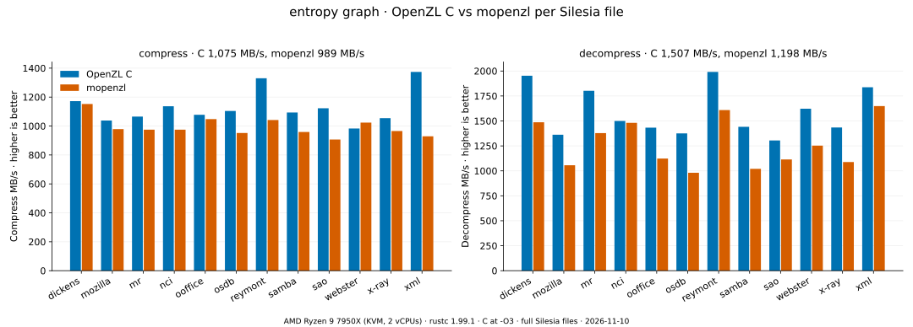

| File | Bytes | Ratio | C compress | mopenzl compress | / C | C decompress | mopenzl decompress | / C |
| --- | --- | --- | --- | --- | --- | --- | --- | --- |
| dickens | 10192446 | 1.748 | 1,172 MB/s | 1,152 MB/s | 0.98× | 1,953 MB/s | 1,487 MB/s | 0.76× |
| mozilla | 51220480 | 1.442 | 1,038 MB/s | 978 MB/s | 0.94× | 1,362 MB/s | 1,056 MB/s | 0.78× |
| mr | 9970564 | 2.258 | 1,065 MB/s | 975 MB/s | 0.92× | 1,802 MB/s | 1,378 MB/s | 0.76× |
| nci | 33553445 | 3.256 | 1,137 MB/s | 975 MB/s | 0.86× | 1,500 MB/s | 1,481 MB/s | 0.99× |
| ooffice | 6152192 | 1.268 | 1,078 MB/s | 1,048 MB/s | 0.97× | 1,433 MB/s | 1,123 MB/s | 0.78× |
| osdb | 10085684 | 1.202 | 1,104 MB/s | 952 MB/s | 0.86× | 1,375 MB/s | 981 MB/s | 0.71× |
| reymont | 6627202 | 1.658 | 1,330 MB/s | 1,041 MB/s | 0.78× | 1,991 MB/s | 1,609 MB/s | 0.81× |
| samba | 21606400 | 1.514 | 1,094 MB/s | 959 MB/s | 0.88× | 1,441 MB/s | 1,020 MB/s | 0.71× |
| sao | 7251944 | 1.074 | 1,123 MB/s | 907 MB/s | 0.81× | 1,305 MB/s | 1,114 MB/s | 0.85× |
| webster | 41458703 | 1.599 | 983 MB/s | 1,024 MB/s | 1.04× | 1,622 MB/s | 1,253 MB/s | 0.77× |
| x-ray | 8474240 | 1.247 | 1,054 MB/s | 965 MB/s | 0.92× | 1,434 MB/s | 1,088 MB/s | 0.76× |
| xml | 5345280 | 1.609 | 1,374 MB/s | 929 MB/s | 0.68× | 1,837 MB/s | 1,649 MB/s | 0.90× |

## huffman_pivco

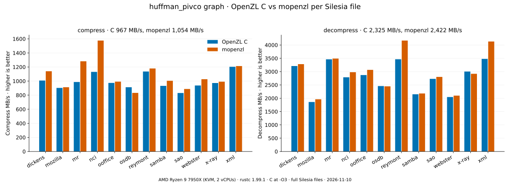

| File | Bytes | Ratio | C compress | mopenzl compress | / C | C decompress | mopenzl decompress | / C |
| --- | --- | --- | --- | --- | --- | --- | --- | --- |
| dickens | 10192446 | 1.745 | 1,008 MB/s | 1,140 MB/s | 1.13× | 3,210 MB/s | 3,281 MB/s | 1.02× |
| mozilla | 51220480 | 1.439 | 903 MB/s | 913 MB/s | 1.01× | 1,859 MB/s | 1,962 MB/s | 1.06× |
| mr | 9970564 | 2.247 | 987 MB/s | 1,281 MB/s | 1.30× | 3,462 MB/s | 3,490 MB/s | 1.01× |
| nci | 33553445 | 3.251 | 1,130 MB/s | 1,575 MB/s | 1.39× | 2,787 MB/s | 2,979 MB/s | 1.07× |
| ooffice | 6152192 | 1.266 | 974 MB/s | 992 MB/s | 1.02× | 2,871 MB/s | 3,066 MB/s | 1.07× |
| osdb | 10085684 | 1.200 | 913 MB/s | 832 MB/s | 0.91× | 2,457 MB/s | 2,447 MB/s | 1.00× |
| reymont | 6627202 | 1.656 | 1,136 MB/s | 1,179 MB/s | 1.04× | 3,466 MB/s | 4,167 MB/s | 1.20× |
| samba | 21606400 | 1.512 | 932 MB/s | 1,004 MB/s | 1.08× | 2,149 MB/s | 2,179 MB/s | 1.01× |
| sao | 7251944 | 1.073 | 831 MB/s | 888 MB/s | 1.07× | 2,729 MB/s | 2,802 MB/s | 1.03× |
| webster | 41458703 | 1.597 | 937 MB/s | 1,027 MB/s | 1.10× | 2,046 MB/s | 2,099 MB/s | 1.03× |
| x-ray | 8474240 | 1.246 | 973 MB/s | 991 MB/s | 1.02× | 3,004 MB/s | 2,918 MB/s | 0.97× |
| xml | 5345280 | 1.607 | 1,203 MB/s | 1,213 MB/s | 1.01× | 3,478 MB/s | 4,131 MB/s | 1.19× |

## flatpack

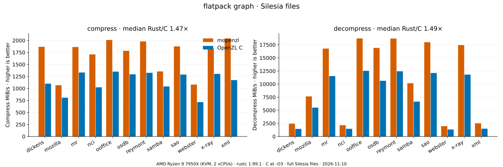

| File | Bytes | Ratio | C compress | mopenzl compress | / C | C decompress | mopenzl decompress | / C |
| --- | --- | --- | --- | --- | --- | --- | --- | --- |
| dickens | 10192446 | 1.143 | 1,154 MB/s | 1,958 MB/s | 1.70× | 1,515 MB/s | 2,562 MB/s | 1.69× |
| mozilla | 51220480 | 1.000 | 847 MB/s | 1,119 MB/s | 1.32× | 5,774 MB/s | 8,016 MB/s | 1.39× |
| mr | 9970564 | 1.000 | 1,397 MB/s | 1,954 MB/s | 1.40× | 12,087 MB/s | 17,584 MB/s | 1.45× |
| nci | 33553445 | 1.333 | 1,074 MB/s | 1,792 MB/s | 1.67× | 1,536 MB/s | 2,249 MB/s | 1.46× |
| ooffice | 6152192 | 1.000 | 1,416 MB/s | 2,108 MB/s | 1.49× | 13,131 MB/s | 19,621 MB/s | 1.49× |
| osdb | 10085684 | 1.000 | 1,357 MB/s | 1,871 MB/s | 1.38× | 11,147 MB/s | 17,714 MB/s | 1.59× |
| reymont | 6627202 | 1.000 | 1,391 MB/s | 2,076 MB/s | 1.49× | 13,042 MB/s | 19,593 MB/s | 1.50× |
| samba | 21606400 | 1.000 | 1,093 MB/s | 1,421 MB/s | 1.30× | 6,972 MB/s | 10,658 MB/s | 1.53× |
| sao | 7251944 | 1.000 | 1,352 MB/s | 1,968 MB/s | 1.46× | 12,698 MB/s | 18,868 MB/s | 1.49× |
| webster | 41458703 | 1.143 | 751 MB/s | 1,133 MB/s | 1.51× | 1,401 MB/s | 2,067 MB/s | 1.48× |
| x-ray | 8474240 | 1.000 | 1,367 MB/s | 1,921 MB/s | 1.41× | 12,384 MB/s | 18,283 MB/s | 1.48× |
| xml | 5345280 | 1.143 | 1,231 MB/s | 2,142 MB/s | 1.74× | 1,552 MB/s | 2,633 MB/s | 1.70× |

## generic

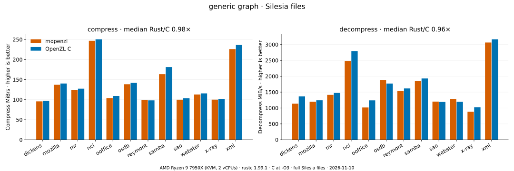

| File | Bytes | Ratio | C compress | mopenzl compress | / C | C decompress | mopenzl decompress | / C |
| --- | --- | --- | --- | --- | --- | --- | --- | --- |
| dickens | 10192446 | 2.982 | 102 MB/s | 100 MB/s | 0.99× | 1,431 MB/s | 1,191 MB/s | 0.83× |
| mozilla | 51220480 | 2.986 | 147 MB/s | 144 MB/s | 0.98× | 1,303 MB/s | 1,257 MB/s | 0.96× |
| mr | 9970564 | 2.944 | 134 MB/s | 130 MB/s | 0.97× | 1,546 MB/s | 1,482 MB/s | 0.96× |
| nci | 33553445 | 13.830 | 263 MB/s | 259 MB/s | 0.99× | 2,924 MB/s | 2,598 MB/s | 0.89× |
| ooffice | 6152192 | 2.099 | 115 MB/s | 109 MB/s | 0.95× | 1,301 MB/s | 1,066 MB/s | 0.82× |
| osdb | 10085684 | 2.970 | 149 MB/s | 145 MB/s | 0.98× | 1,857 MB/s | 1,973 MB/s | 1.06× |
| reymont | 6627202 | 3.735 | 103 MB/s | 104 MB/s | 1.01× | 1,695 MB/s | 1,613 MB/s | 0.95× |
| samba | 21606400 | 4.724 | 190 MB/s | 172 MB/s | 0.90× | 2,024 MB/s | 1,945 MB/s | 0.96× |
| sao | 7251944 | 1.375 | 108 MB/s | 105 MB/s | 0.97× | 1,249 MB/s | 1,261 MB/s | 1.01× |
| webster | 41458703 | 3.836 | 121 MB/s | 118 MB/s | 0.98× | 1,254 MB/s | 1,341 MB/s | 1.07× |
| x-ray | 8474240 | 1.526 | 107 MB/s | 105 MB/s | 0.98× | 1,071 MB/s | 925 MB/s | 0.86× |
| xml | 5345280 | 9.777 | 248 MB/s | 237 MB/s | 0.96× | 3,317 MB/s | 3,212 MB/s | 0.97× |

## field_lz_struct4

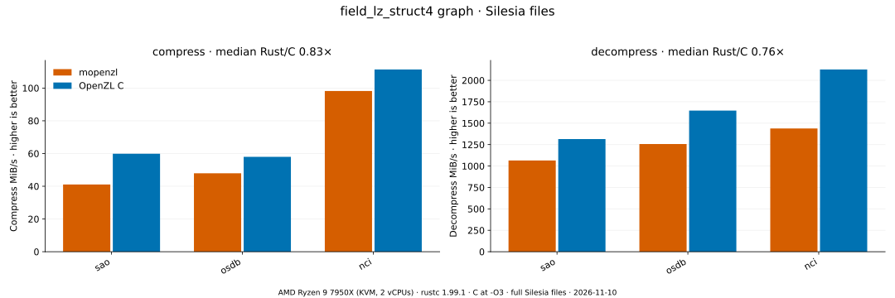

| File | Bytes | Ratio | C compress | mopenzl compress | / C | C decompress | mopenzl decompress | / C |
| --- | --- | --- | --- | --- | --- | --- | --- | --- |
| sao | 7251944 | 1.471 | 62.8 MB/s | 43.1 MB/s | 0.69× | 1,379 MB/s | 1,116 MB/s | 0.81× |
| osdb | 10085684 | 3.027 | 60.8 MB/s | 50.3 MB/s | 0.83× | 1,727 MB/s | 1,318 MB/s | 0.76× |
| nci | 33553444 | 12.506 | 117 MB/s | 103 MB/s | 0.88× | 2,230 MB/s | 1,508 MB/s | 0.68× |

## bitpack_num16

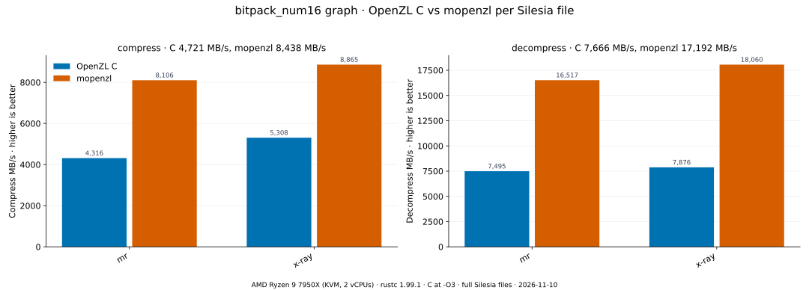

| File | Bytes | Ratio | C compress | mopenzl compress | / C | C decompress | mopenzl decompress | / C |
| --- | --- | --- | --- | --- | --- | --- | --- | --- |
| mr | 9970564 | 1.000 | 4,316 MB/s | 8,106 MB/s | 1.88× | 7,495 MB/s | 16,517 MB/s | 2.20× |
| x-ray | 8474240 | 1.000 | 5,308 MB/s | 8,865 MB/s | 1.67× | 7,876 MB/s | 18,060 MB/s | 2.29× |

## numeric16

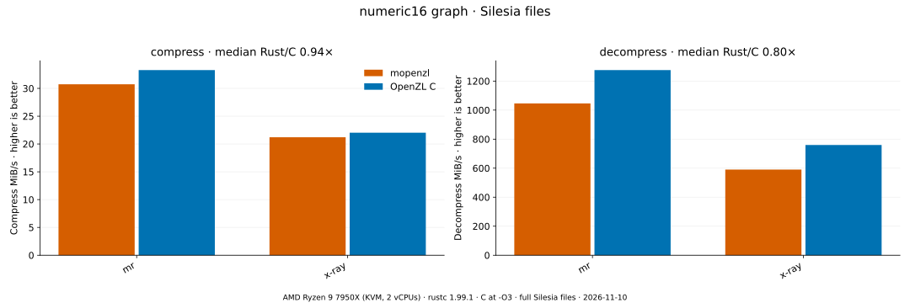

| File | Bytes | Ratio | C compress | mopenzl compress | / C | C decompress | mopenzl decompress | / C |
| --- | --- | --- | --- | --- | --- | --- | --- | --- |
| mr | 9970564 | 3.178 | 34.9 MB/s | 32.2 MB/s | 0.92× | 1,338 MB/s | 1,097 MB/s | 0.82× |
| x-ray | 8474240 | 1.636 | 23.1 MB/s | 22.3 MB/s | 0.96× | 797 MB/s | 619 MB/s | 0.78× |

## numeric32

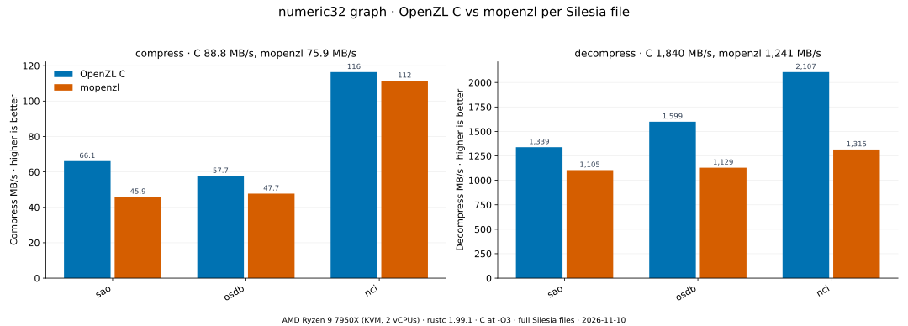

| File | Bytes | Ratio | C compress | mopenzl compress | / C | C decompress | mopenzl decompress | / C |
| --- | --- | --- | --- | --- | --- | --- | --- | --- |
| sao | 7251944 | 1.471 | 66.1 MB/s | 45.9 MB/s | 0.69× | 1,339 MB/s | 1,105 MB/s | 0.83× |
| osdb | 10085684 | 3.027 | 57.7 MB/s | 47.7 MB/s | 0.83× | 1,599 MB/s | 1,129 MB/s | 0.71× |
| nci | 33553444 | 12.506 | 116 MB/s | 112 MB/s | 0.96× | 2,107 MB/s | 1,315 MB/s | 0.62× |

## generic_num16

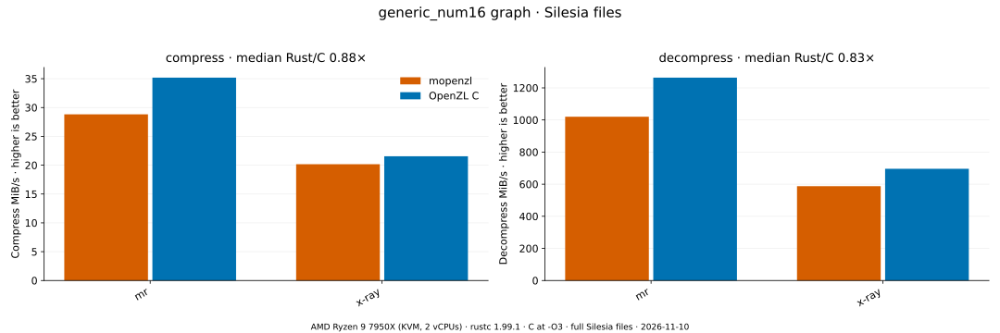

| File | Bytes | Ratio | C compress | mopenzl compress | / C | C decompress | mopenzl decompress | / C |
| --- | --- | --- | --- | --- | --- | --- | --- | --- |
| mr | 9970564 | 3.178 | 36.9 MB/s | 30.2 MB/s | 0.82× | 1,325 MB/s | 1,070 MB/s | 0.81× |
| x-ray | 8474240 | 1.636 | 22.6 MB/s | 21.1 MB/s | 0.94× | 730 MB/s | 616 MB/s | 0.84× |

## generic_num32

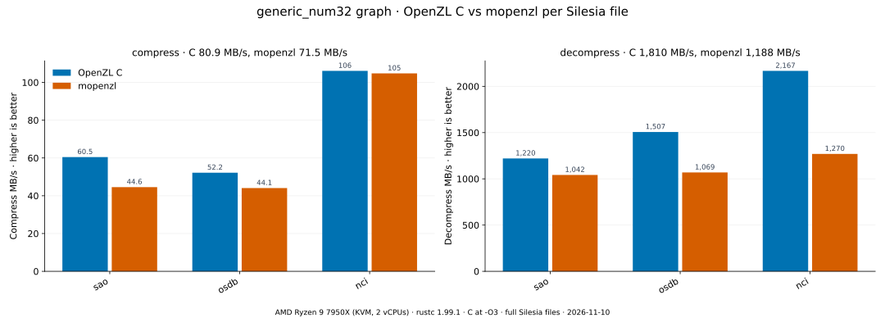

| File | Bytes | Ratio | C compress | mopenzl compress | / C | C decompress | mopenzl decompress | / C |
| --- | --- | --- | --- | --- | --- | --- | --- | --- |
| sao | 7251944 | 1.471 | 60.5 MB/s | 44.6 MB/s | 0.74× | 1,220 MB/s | 1,042 MB/s | 0.85× |
| osdb | 10085684 | 3.027 | 52.2 MB/s | 44.1 MB/s | 0.84× | 1,507 MB/s | 1,069 MB/s | 0.71× |
| nci | 33553444 | 12.506 | 106 MB/s | 105 MB/s | 0.99× | 2,167 MB/s | 1,270 MB/s | 0.59× |
