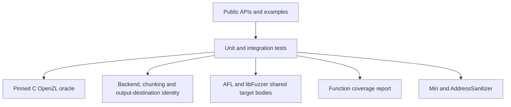

# Compatibility and validation

This page states the output contract and the evidence behind it. Rust/C frame
identity, decoding interoperability, malformed-input behavior and memory safety
are separate checks. See [oracle mechanics](../architecture/compatibility.md).

## What is claimed

- Serial compression is byte-identical to Meta's pinned OpenZL v0.3.0 for the
  same graph, typed inputs, global/local parameters and chunk boundaries.
- Supported frame versions are 21–27. Every non-legacy standard node/graph is
  ported; deprecated nodes 76–85 and older formats remain unsupported.
- A frame describes its codec layout. Decoding needs matching enabled codecs,
  custom-codec registrations and external dictionary bundles, not its selector
  or compressor graph definition.
- Backend choice, workspace retention and destination shape preserve output.
  Sessions without flushes match one-shot bytes for arbitrary buffer splits.
- Parallel assembly produces compatible OpenZL frames, with a separate byte
  contract from serial compression. Framing adds a mopenzl-specific container
  around independent ordinary frames.

`no_std` estimators use libm; Transformer/estimator decisions have a C byte
identity guarantee only with std. Missing codec features can produce stored
fallbacks or explicit graph errors, and disabled decoder codecs report
Unsupported. See [codec features](../architecture/codec-features.md).

## Validation layers

### Differential tests

| Test suite | What it compares |
| --- | --- |
| `tests/differential_c.rs` | Default graph, levels, versions, checksums, chunking, bounds and representative/boundary inputs |
| `tests/graph_engine.rs`, `tests/standard_graphs.rs` | Typed/multiple inputs, graph composition, selectors, segmenters, permissive/trial compression and every standard graph |
| `tests/encode_numeric.rs`, `tests/encode_structure.rs`, `tests/encode_backends.rs` | Numeric/structural transforms and packing/LZ4 nodes, widths and local parameters |
| `tests/encode_entropy.rs`, `tests/encode_lz.rs`, `tests/encode_lzgraphs.rs` | FSE/Huffman, LZ families and their graph decisions |
| `tests/encode_transformer.rs`, `tests/encode_ml.rs`, `tests/encode_sddl.rs` | Numeric selection, model/configuration parsing and SDDL interpreters |
| `tests/encode_dict.rs`, `tests/custom_codec.rs` | Bundles and application codecs, source chains and C interoperability |
| `tests/codecs_*.rs`, `tests/typed_outputs.rs` | Reference-encoded frames, malformed streams and typed output validation |

### Internal identity tests

`tests/streaming.rs`, `tests/io.rs`, `tests/uninit.rs` and
`tests/simd_backends.rs` cover arbitrary input/output splits, completion,
buffer destinations and every available backend. Private core tests explicitly
exercise scalar baselines. `tests/parallel.rs` covers task ordering, sources,
staging and streaming assembly. `tests/framed.rs` covers independent graphs,
typed resources, metadata, seek, transport retries and corruption/truncation.

## Feature and fuzz coverage

`scripts/check_codec_features.py` checks public direction/codec isolation.
`scripts/check_simd_uninit.py` selects focused Miri tests and full ASan codec
modules; x86-64 Miri uses x86-64-v3, while ARM64 tests Neon paths supported by
Miri and leaves unsupported Neon operations to ASan.

The isolated AFL package covers ordinary/typed decoding, one-shot and streaming
compression, graph configuration, individual nodes, custom codecs, parallel
assembly and framed containers. Every target has an engine-neutral body, small
regression corpus and matching libFuzzer adapter. CI replays regressions and
ClusterFuzzLite runs on pull requests and daily schedules. See
[fuzzing coverage and commands](../architecture/fuzzing.md).

## Framed-container smoke campaign — 2026-11-11

Apple M5 Pro, aarch64-apple-darwin, libFuzzer with AddressSanitizer under Rust
1.101.0-nightly (2026-10-23). The bounded arbitrary-container target completed
411,538 executions in 31 seconds; resource round-trip completed 67,489 in
31 seconds, with no findings. Inputs cap frame/output sizes and resource count;
the round-trip oracle checks native/one-shot equality and C decoding of every
embedded frame. These are short smoke campaigns, not an exhaustive audit.

The same AFL++ 4.40c/cargo-afl 0.18.2 targets built and replayed the committed
corpus. Local campaigns failed before execution because macOS SysV shared-memory
allocation was unavailable, also outside the sandbox. No host tuning was done.
Linux CI contains bounded AFL smoke runs. See the
[recorded framing verification](../architecture/framing.md#initial-measurements).

## Campaign records and reproducibility

Record input corpus, target, revision, toolchain, feature set, engine version,
limits, duration and findings together. Keep live queues/findings out of Git.
Minimize every confirmed crash, commit a deterministic regression, then fix it.
The [AFL guide](../fuzz/afl/README.md) and
[libFuzzer guide](../fuzz/libfuzzer/README.md) describe replay and minimization.
Every published campaign record should identify the mopenzl revision and its
actual target bodies, corpus and oracle.

## Limits of the evidence

Passing tests and short fuzz runs do not prove every input safe or every platform
equivalent. Function coverage shows which functions ran, not exhaustive branch
or state coverage. There are no Lean/Aeneas proofs in this repository. C
compatibility intentionally differs where the reference reads uninitialized
data on malformed input; see [decoder codec deviations](../architecture/decoder-codecs.md).
Directory/resource checksums detect corruption and do not authenticate input.
