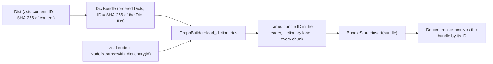

# Dictionaries

A codec may need side information a frame does not carry. In OpenZL v0.3.0 that is
a trained Zstandard dictionary: small records that share structure compress far
better against a dictionary built from similar records. This guide covers the
`mopenzl::dict` types, attaching a dictionary to a graph, and resolving it on the
decoder.

[Concepts](#concepts) · [Building dictionaries](#building-dictionaries-and-bundles) ·
[Compressing](#compressing-with-a-dictionary) · [Decoding](#decoding-with-a-bundlestore) ·
[Errors](#errors)

## Concepts



- A `Dict` is opaque content for one codec with a `DictId`, by default the SHA-256 of
  its content.
- A `DictBundle` is an ordered list of dictionaries with a `BundleId`, the SHA-256 of
  the dictionary IDs in order. Codecs address a dictionary by its **position** in the
  bundle, so the order is part of the bundle's identity.
- A frame compressed with a bundle records the `BundleId` in its header (format
  version 25 and newer) and each chunk carries a lane naming the dictionary of every
  codec. The dictionary content itself is **not** in the frame: the decoder must hold
  the same bundle.
- Only standard Zstandard dictionaries can be materialized, and only with the `zstd`
  feature. Other codecs, custom codecs and a build without `zstd` get
  `DictError::NoMaterializer`.

## Building dictionaries and bundles

| Item | Builds | Notes |
| --- | --- | --- |
| `Dict::zstd(raw, level)` | A Zstandard dictionary | `raw` is a dictionary in Zstandard's format (what `zstd --train` writes) or raw content; it is prepared for compression `level` |
| `Dict::new(codec, content)` | A dictionary for any `DictCodec` | `DictCodec::ZSTD` is the only one that can be loaded |
| `Dict::with_id(id)` | The same, with your own ID | An all-zero ID restores the SHA-256 default |
| `Vec::from(&dict)` / `Dict::try_from(&[u8])` | Packed form | The reference's `Dict_pack` / `ZL_Dict_parse` |
| `DictBundle::try_from(Vec<Dict>)` | A bundle | At most 65 535 dictionaries |
| `Vec::from(&bundle)` / `DictBundle::try_from(&[u8])` | The *fat bundle* | OpenZL's interchange format: bundle info plus the packed dictionaries; the reference's training tools write it |

This crate does not train dictionaries. Train with the reference's tools or with
`zstd --train`, and load the result here.

<!-- cfg: feature = "zstd" -->
```rust
use mopenzl::dict::{Dict, DictBundle, DictCodec};

fn main() -> Result<(), Box<dyn std::error::Error>> {
    let users = Dict::zstd(&br#"{"user":"alice","plan":"pro"}"#.repeat(8), 3)?;
    let events = Dict::new(DictCodec::ZSTD, b"raw dictionary content".to_vec())?;

    // Order matters: the bundle's ID, and the index frames record, follow it.
    let bundle = DictBundle::try_from(vec![users.clone(), events.clone()])?;
    let reversed = DictBundle::try_from(vec![events, users.clone()])?;
    assert_ne!(bundle.id(), reversed.id());

    // Fat bundles round-trip through bytes.
    let fat = Vec::from(&bundle);
    assert_eq!(DictBundle::try_from(&fat[..])?, bundle);
    assert_eq!(bundle.dicts()[0].id(), users.id());
    println!("bundle {}", bundle.id()); // 64 hexadecimal digits
    Ok(())
}
```

## Compressing with a dictionary

The order of the calls matters. A dictionary can only be materialized for a node that
references it, so:

1. **Parameterize the node** that will use it: `parameterize_node_with(node,
   NodeParams::default().with_dictionary(dict_id))`. Only the Zstandard node uses a
   dictionary.
2. **Load the bundle**: `load_dictionaries(&bundle)`. Every dictionary in the bundle
   must already be referenced by some node, and a compressor holds one bundle.
3. **Build** the graph: `build(start)` resolves each node's dictionary to its index in
   the bundle.

Format version 25 or newer is required: below it, a node that references a dictionary
fails when it runs (as in the reference), and a bundle that no node uses leaves the
frame unchanged. The default format version is 27.

<!-- cfg: feature = "zstd" -->
```rust
use mopenzl::dict::{BundleStore, Dict, DictBundle};
use mopenzl::graph::{GraphBuilder, NodeParams, StandardGraph, StandardNode};
use mopenzl::{Compressor, Decompressor, EncoderConfig};

fn main() -> Result<(), Box<dyn std::error::Error>> {
    // Dictionary content: 40 representative records of the data to compress.
    let record = |i: usize| {
        let users = ["alice", "bob", "carol", "dave", "erin"];
        let cities = ["Oslo", "Lima", "Kyiv", "Pune"];
        format!(
            r#"{{"user":"{}","city":"{}","plan":"{}","seen":{},"flags":["beta","email"],"locale":"en-GB"}}"#,
            users[i % 5],
            cities[i % 4],
            if i.is_multiple_of(2) { "pro" } else { "free" },
            i * 7
        )
    };
    let history = (0..40).map(record).collect::<Vec<_>>().join("\n");
    let dict = Dict::zstd(history.as_bytes(), 3)?;
    let bundle = DictBundle::try_from(vec![dict.clone()])?;

    let mut builder = GraphBuilder::new();
    let node = builder.parameterize_node_with(
        StandardNode::Zstd,
        NodeParams::default().with_dictionary(dict.id()),
    )?;
    builder.load_dictionaries(&bundle)?;
    let start = builder.static_graph(node, &[StandardGraph::Store.into()])?;
    let graph = builder.build(start)?;

    let record = record(1234).into_bytes();
    let mut with_dict = Compressor::builder(EncoderConfig::default())
        .with_graph(graph)
        .build()?;
    let small = with_dict.compress(&record)?;
    let plain = Compressor::default().compress(&record)?;
    println!(
        "with dictionary {} bytes, without {}",
        small.len(),
        plain.len()
    );

    let mut store = BundleStore::default();
    store.insert(&bundle)?;
    let mut decoder = Decompressor::builder(Default::default())
        .with_dictionaries(store)
        .build();
    assert_eq!(decoder.decompress(&small)?, record);
    Ok(())
}
```

Notes:

- A graph with a loaded bundle writes the bundle ID and a dictionary lane in **every**
  chunk, including stored and empty ones, as the reference does.
- Block splitting inside the Zstandard node ignores the dictionary, as in the
  reference.
- The dictionary is prepared at the level stored in its content: pass the level you
  compress with to `Dict::zstd`.
- A `BundleStore` is shared: put it in an `Arc` and give the same store to many
  decoders (`with_dictionaries(impl Into<Arc<BundleStore>>)`); a built
  `CompressorGraph` is cheap to clone for many compressors.

## Decoding with a `BundleStore`

`BundleStore` holds the bundles frames may refer to. `insert(&bundle)` materializes the
dictionaries once (a Zstandard `DDict`), returns the `BundleId`, and shares them with
every decoder given the store. A dictionary listed by several bundles is materialized
once; inserting the same bundle twice is a no-op. `contains(&id)` and `len()` inspect
it. A store holds at most 128 bundles and 65 535 dictionaries.

`DecompressorBuilder::with_dictionaries(store)` attaches the store (the builder is no
longer `Copy` for that reason). A frame that names a bundle the decoder does not hold
is `DecodeError::MissingBundle { bundle }`, and a codec that names a dictionary index
past the end of the bundle is `DecodeError::InvalidData` of kind `DictionaryIndex`.

## Errors

| Error | When |
| --- | --- |
| `DictError::Malformed` | Bytes that are not a dictionary or a fat bundle, or an ID that differs from the declared one |
| `DictError::TooManyDicts` | More than 65 535 dictionaries in a bundle |
| `DictError::ContentTooLarge` | A content of 4 GiB or more |
| `DictError::ConflictingId` | Two different contents share an ID |
| `DictError::NoMaterializer` | The dictionary is not a standard Zstandard one, or `zstd` is off |
| `DictError::Materialization` | Zstandard rejected the content |
| `DictError::StoreFull` | A `BundleStore` is at its limits |
| `GraphError::Dictionary(DictError)` | A bundle problem found by `load_dictionaries` or `build` |
| `GraphError::BundleAlreadyLoaded` | `load_dictionaries` called twice on one builder |
| `GraphError::DictionaryNotFound(id)` | A node references an ID the loaded bundle lacks, or no bundle is loaded |
| `DecodeError::MissingBundle` | The decoder holds no bundle with the frame's ID |

<!-- cfg: feature = "zstd" -->
```rust
use mopenzl::dict::{BundleStore, Dict, DictBundle};
use mopenzl::graph::{GraphBuilder, GraphError, NodeParams, StandardGraph, StandardNode};
use mopenzl::{Compressor, DecodeError, Decompressor, EncoderConfig};

fn main() -> Result<(), Box<dyn std::error::Error>> {
    let dict = Dict::zstd(&b"some shared history ".repeat(10), 3)?;
    let bundle = DictBundle::try_from(vec![dict.clone()])?;

    // The order rule: loading before any node references the dictionary fails.
    let mut early = GraphBuilder::new();
    assert!(matches!(
        early.load_dictionaries(&bundle),
        Err(GraphError::Dictionary(_))
    ));

    // A node referencing a dictionary with no bundle loaded fails at build time.
    let mut unloaded = GraphBuilder::new();
    let node = unloaded.parameterize_node_with(
        StandardNode::Zstd,
        NodeParams::default().with_dictionary(dict.id()),
    )?;
    let start = unloaded.static_graph(node, &[StandardGraph::Store.into()])?;
    assert!(matches!(
        unloaded.build(start),
        Err(GraphError::DictionaryNotFound(_))
    ));

    // The right order, and a second load is refused.
    let mut builder = GraphBuilder::new();
    let node = builder.parameterize_node_with(
        StandardNode::Zstd,
        NodeParams::default().with_dictionary(dict.id()),
    )?;
    builder.load_dictionaries(&bundle)?;
    assert_eq!(
        builder.load_dictionaries(&bundle),
        Err(GraphError::BundleAlreadyLoaded)
    );
    let start = builder.static_graph(node, &[StandardGraph::Store.into()])?;
    let graph = builder.build(start)?;

    let frame = Compressor::builder(EncoderConfig::default())
        .with_graph(graph)
        .build()?
        .compress(b"some shared history, again")?;

    // A decoder without the bundle says which one it is missing.
    assert!(matches!(
        Decompressor::default().decompress(&frame),
        Err(DecodeError::MissingBundle { bundle: id }) if id == bundle.id()
    ));
    let mut store = BundleStore::default();
    store.insert(&bundle)?;
    let mut decoder = Decompressor::builder(Default::default())
        .with_dictionaries(store)
        .build();
    assert_eq!(decoder.decompress(&frame)?, b"some shared history, again");
    Ok(())
}
```
